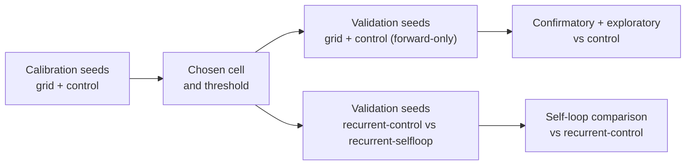

# Experiment: self-loops on the recurrent execution path (Issue #4160)

## Summary

PR #4169 delivered the opt-in `deno task connectivity-prior-study` harness and
its negative grid result, but left one part of the issue undone: self-loops were
not tested. This PR tests them on the already-supported recurrent execution
path, as a paired comparison of the control topology with and without one
self-loop per hidden neuron. The result is `no-benefit`, so no optional prior is
added and nothing under `src/` changes. Every earlier forward-only result
reproduces exactly. Closes #4160.

## Spec

### Intent and Rationale

- The issue says: "Test self-loops only in an already-supported recurrent
  execution path". NEAT-AI's recurrent path is `forwardOnly: false` with
  `feedbackLoop: true` and `activate(input, true)`. The harness now uses that
  path as it is, with no engine change.
- Two recurrent arms differ only in the initial self-loops: `recurrent-control`
  (the control topology, `forwardOnly: false`) and `recurrent-selfloop` (the
  same plus one self-loop per hidden neuron). The self-loop weights come from a
  separate seeded stream, so the forward weights are identical at each seed.

### Essential Design Decisions

- Both recurrent arms search by mutation alone (`mutateOffspring`), because
  `Offspring.breed` cannot carry a self-loop. Both use the default `FFW`
  mutation set, which has no self-loop operator, so neither arm can gain or lose
  self-loops except by neuron removal.
- Recurrent scoring: `clearState()`, then
  `scoreCreature(creature, records, 1, true)`, on train and holdout.
  `scoreCreature` (in `scripts/lib/preSelectionAB.ts`) gains an optional
  `feedbackLoop` argument. Its default is `false`, which leaves the
  PreSelectionAB callers unchanged. Only the recurrent arms pass `true`.
- Assumption: the self-loop comparison is exploratory. It runs on validation
  seeds 4160–4179 only, at the same 60,000-record budget and with the same
  verdict rule, against `recurrent-control`. `chooseCell` never considers it.
- The recurrent arms are compared only with each other. They differ from the
  forward arms in both the search and the execution path.

### Undiscoverable Facts

- `Offspring.sortNeurons` topologically sorts every inward synapse, so a parent
  with a self-loop is rejected. In a scratch probe, `Offspring.breed` returned
  `undefined` for two self-loop parents.
- The mutation-only path keeps self-loops. In a scratch probe, cloning with
  `Creature.fromJSON(parent.exportJSON())` plus `forwardOnly = false` and then
  mutating under `feedbackLoop: true` kept 7 of 8 self-loops over 40
  generations. Repeated `activate(x, true)` calls gave different outputs (0.926
  then 1.027), so the state is live.
- arXiv 2610.33498 was not read. The method is this repository's reading of the
  issue.

## Evidence

Script/CLI change; no UI files are touched. Reproduce:

```bash
deno task connectivity-prior-study --code-version=f1eac480 \
  --json=docs/evidence/connectivity-prior-4160.json
```

- Coverage: 280 of 280 runs, 0 failures (240 forward-only and 40 recurrent).
  Calibration cost 2,400,000 records. The recurrent phase cost a further
  2,400,000.
- Compared with the artefact on the base branch, the calibration runs, the
  chosen cell (`d3-f1`), the threshold, every validation run and the
  confirmatory comparison are identical. The only difference is the new per-run
  `selfLoops` field.
- Self-loops: `no-benefit`. The self-loop arm's holdout MSE minus
  `recurrent-control`'s has a mean of +0.001095, with 95% CI [−0.02372,
  +0.01908] and W/L 9/11. Median holdout is 0.1065 against 0.09504, and upper
  quartile 0.1513 against 0.1354. The self-loop arm reached the threshold in 5
  of 20 runs, against 4 of 20. Self-loops survived the search: the best creature
  kept a mean of 7.7 of 8 (minimum 6).



## Test Plan

- `test/scripts/ConnectivityPriorStudy.ts` adds five tests:
  - `buildRecurrentCreature adds one self-loop per hidden neuron and nothing else`.
    It asserts 8 self-loops against 0, `forwardOnly === false`, and forward
    synapses identical to the no-loop build at the same seed.
  - `self-loops matter only on the recurrent path`. The recurrent scores differ,
    and the stateless scores are equal.
  - `recurrent arms are reproducible, restore global state and report self-loops`.
    It asserts initial 8 and final > 0 for the self-loop arm, and 0/0 for
    `recurrent-control`. For both recurrent arms it also asserts that the search
    ran: `stalled === false`, `generations > 1`, and `recordsScored` above the
    initial population's cost, so offspring were produced and scored.
  - `mutateOffspring returns mutated recurrent children that keep their self-loops`.
    With `mutationRate: 1` and `feedbackLoop: true`, it asserts exactly `count`
    children, each with `forwardOnly === false`, 8 self-loops, no score, a uuid
    and an `exportJSON()` different from every parent's, and that the parents
    are not edited in place.
  - `chooseCell never returns a recurrent arm`. A recurrent arm has the lowest
    train MSE in the input and is still not chosen.
- Existing tests: the test helper `run` now fills `selfLoops`, and the grid-cell
  loop filters on `arm.kind !== "prior"` so it type-checks with the new arm
  kind. No assertion was removed.
- `deno test -A test/scripts/ConnectivityPriorStudy.ts test/scripts/PreSelectionAB.ts`
  on the working tree after the review fixes: `ok | 24 passed | 0 failed`.
- `./quality.sh --rust-scorer-bin=<built rust_scorer>` on c40ce1bc exited 0:
  `ok | 10360 passed (5 steps) | 0 failed | 50 ignored (8m48s)`.

## Not done / risks

- Self-loops were tested on the control topology only, not crossed with the
  in-degree × fan-out grid.
- The study uses a synthetic 4-input regression with 8 hidden neurons. It says
  nothing about production-scale creatures.
- The paper was not read.
