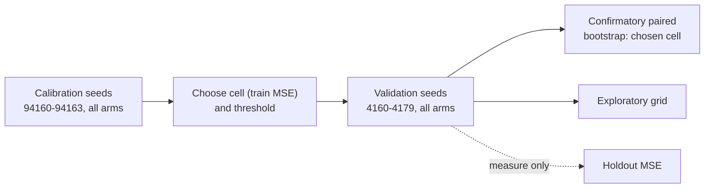

# Experiment: initial connectivity and input fan-out as interacting priors (Issue #4160)

## Summary

Adds an opt-in research harness, `deno task connectivity-prior-study`. It
sweeps, as a full factorial grid, hidden mean in-degree {1.5, 2, 3} × input
fan-out {1, 2, 3} against the current fully connected initialisation, at an
equal budget of charged train records, with separate calibration and validation
seeds and paired bootstrap statistics. The result is a **negative finding**: the
cell chosen on calibration seeds (`d3-f1`) is `harm` against the control, and
none of the nine cells shows a benefit. No optional prior is added, and nothing
under `src/` changed. Self-loops in a recurrent execution path were not swept,
so this PR is Part of #4160.

## Spec

### Intent and Rationale

- The issue asks for a controlled comparison, not a feature. The harness follows
  the existing study pattern (`scripts/lib/preSelectionAB.ts`): a library, a
  CLI, a `deno task`, an evidence page and a JSON artefact.
- It reuses `scoreCreature` and `breedOffspring` (now exported, unchanged) from
  `scripts/lib/preSelectionAB.ts`, `median` from `scripts/lib/rankFidelity.ts`,
  the `cliArgs` readers, and the real `Mutator`, `Offspring.breed` and
  `createNeatConfig`.

### Essential Design Decisions

- Control is today's initialisation: `new Creature(4, 1, { layers: [...] })`
  with 8 hidden neurons, fully connected (in-degree 4, fan-out 8). Every arm
  uses `TANH` hidden and `IDENTITY` output squashes, so only connectivity
  differs.
- Prior creatures are built so each input feeds exactly `fanOut` hidden neurons
  (round-robin first, so inputs cover as many hidden neurons as they can), every
  hidden neuron is reachable from an input and connects to the output, and the
  hidden in-degree is exact. They are forward-only with no duplicate synapses.
  `validateCell` refuses cells this construction cannot build.
- Assumption: calibration (seeds 94160–94163) picks the one confirmatory cell by
  median **training** MSE and sets the search-economics threshold (the control's
  median calibration train MSE). The holdout never guides selection. All other
  cells are reported as exploratory.
- Assumption: equal charged records stand in for equal compute; wall-clock is
  not capped.

### Undiscoverable Facts

- arXiv 2610.33498 was not read (the issue audit's fetch had failed). The
  manifest records the method as this repository's reading of the issue.
- `createNeatConfig` without `seed` installs an unseeded global generator, and
  mutation names new neurons with `crypto.randomUUID`. `runArm` therefore passes
  the seed and swaps in a seeded uuid stream, restoring both in `finally`.
- The first full run showed the original random fan-out assignment could not
  build `d1.5-f3` (its 12-edge budget leaves no room for repair edges). The
  round-robin assignment fixes it, and a test builds every cell for 5 seeds.

## Evidence

Script/CLI change; no UI files are touched. The full record is
`docs/evidence/connectivity-prior-4160.md`, and the machine-readable artefact is
`docs/evidence/connectivity-prior-4160.json`. The artefact holds the manifest
(code commit b345b837, NEAT-AI version, Deno version, corpus seed, seeds,
settings, criteria, the self-loop status), calibration runs and cost (2,400,000
records), per-run results, the comparisons and coverage (240 of 240 runs, no
failures, no stalls).

The diff is the arm's holdout MSE minus the control's, so a negative diff is
better:

| Cell (vs control)    | Mean diff | CI95                 | W/L   | Verdict      |
| -------------------- | --------- | -------------------- | ----- | ------------ |
| `d3-f1` confirmatory | +0.02862  | [+0.01459, +0.04385] | 5/15  | `harm`       |
| `d1.5-f2`            | +0.01097  | [−0.0025, +0.0254]   | 10/10 | `no-benefit` |
| `d1.5-f3`            | +0.006622 | [−0.0032, +0.0177]   | 9/11  | `no-benefit` |
| `d2-f3`              | +0.002967 | [−0.0070, +0.0142]   | 10/10 | `no-benefit` |

The other five exploratory cells are `harm`. The control's median holdout MSE is
0.03729 and its upper-quartile (lower-quartile performance) value is 0.04695. It
reached the threshold in 19 of 20 runs, against 10–19 for the prior cells.



To reproduce:

```bash
deno task connectivity-prior-study --code-version=$(git rev-parse --short=8 HEAD) \
  --json=docs/evidence/connectivity-prior-4160.json
```

## Acceptance Criteria

- **missing** — "Test self-loops only in an already-supported recurrent
  execution path" — reason: the harness evaluates only the forward-only path
  (the production default); recurrent self-loops were not swept, and the
  manifest reports them as not swept.

## Test Plan

- Added `test/scripts/ConnectivityPriorStudy.ts` (14 tests):
  - `buildPriorCreature` gives the exact in-degree and fan-out, reachability,
    forward-only synapses and no duplicate pairs; every grid cell builds for 5
    seeds (the regression for the `d1.5-f3` failure);
  - `buildControlCreature` has in-degree 4, fan-out 8 and is reachable;
  - `validateCell` refuses `d1-f3`, fan-out 0 and fan-out 9 with the cell named,
    and accepts `d1.5-f3`;
  - building and `runArm` are deterministic per seed; `runArm` restores the
    caller's generator and `crypto.randomUUID` and stays within budget;
  - changing the holdout changes `holdoutMse` but not the train trajectory;
  - `recordsToThreshold` with reachable and unreachable thresholds;
  - `verdict` for benefit, harm, no-benefit, and a CI benefit refused by the
    upper-quartile rule; `chooseCell` ties; `compareToControl` refuses
    mismatched seeds; `pairedBootstrapCi` determinism, bounds and empty input.
- `scripts/lib/preSelectionAB.ts`: `breedOffspring` is only exported; the
  existing `test/scripts/PreSelectionAB.ts` tests pass unchanged.
- `./quality.sh --rust-scorer-bin=<rust_scorer>` ran on head b7461c59 and exited
  0 with `ok | 10340 passed (5 steps) | 0 failed | 50 ignored (19m6s)`. The only
  later change is this summary.

## Not done / risks

- Recurrent self-loops were not swept (see above).
- The objective is a synthetic 4-input regression with one distractor input and
  8 hidden neurons. The result says nothing about production-scale creatures,
  and no representative production run was made.
- The paper was not read.
