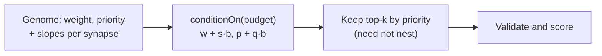

## Summary

PR #4172 tested a genome that expresses its top-k synapses by an evolved
priority gene, and recorded that it has no budget input. The cited paper's key
ingredient is exactly that input: its generator takes developmental time as an
input. This PR adds a fourth arm, `budgetInput`, to
`deno task budget-conditioned-study`. In it each candidate synapse's priority
and weight are linear in the budget, so the budget becomes an input to
expression. The arm has its own success rule, written in the code before its
first run.

**The result is negative again.** The pre-declared outcome for `budgetInput` is
`failure`. On the unseen budgets (37.5% and 75%) it is **harmful** against
independent per-budget searches: mean paired validation-MSE difference +0.1598,
95% CI [0.1151, 0.2100], 0 wins in 20. Against the magnitude-pruned network it
shows no benefit (+0.03158, CI [−0.03595, 0.1044]). At full size it is
**harmful** against that network (+0.1712, CI [0.1398, 0.2033], 0 wins). It is
also worse than the `conditioned` arm on the unseen budgets (exploratory:
+0.08140, CI [0.03031, 0.1378]). The three original arms reproduce the previous
artefact exactly.

This run also pins more of the paper's method from search-indexed excerpts:

- **Testing age:** in testing, the paper sets the substrate's age and the
  generator's time input separately; for aware controllers both equal the
  testing age.
- **Substrates:** each follows an interpolation g(T), with time constants τ(T),
  and substrate coordinates are not normalised.
- **Unseen ages:** standard HyperNEAT was tested at three unseen developmental
  times, but the excerpts don't say which.

The full text still cannot be fetched from this host, so that part of the issue
stays open. Part of #4161.

## Spec

### Intent and Rationale

- The merged study recorded its main departure from the paper as "the genome has
  no budget input". The `budgetInput` arm is the simplest encoding that removes
  that departure. It adds one priority slope and one weight slope per synapse,
  read at the budget being expressed. That way the negative finding is no longer
  only about a nested, gene-ordered expression.
- The arm reuses the existing search, expression, charging and statistics
  unchanged, through `conditionOn` at the top of `expressGenome`. Its search
  costs exactly what `conditioned` costs: 299,700 records per seed.

### Essential Design Decisions

- **Existing arms are unchanged.** `budgetInput` is appended to `ARM_NAMES`, so
  the per-arm rng streams (`seed * 31 + armIndex`) of the existing arms are
  untouched. `randomGenome` and the fixed-genome path of `offspringOf` draw
  exactly as before. The three original arms' runs and their primary, full-size,
  per-budget and outcome results match the previous artefact exactly.
- **Its own success rule.** The `budgetInput` rule is `criteriaBudgetInput` in
  the manifest: the same rule as `conditioned`, declared before the arm first
  ran. The top-level `primary` / `fullSize` / `outcome` fields still judge
  `conditioned`; the new arm's results are in a separate `budgetInput` block.
- **Required parameters.** `evolve` gains a required `encoding` parameter and
  `studyOutcome` a required arm label, so no caller can drop either silently.
- **Not the paper's generator.** A linear rule per synapse is not a CPPN over
  substrate coordinates. The evidence page says the result is evidence against
  these two encodings on this task, not against the paper's generator.

### Undiscoverable Facts

- **Paper access:** this host's proxy still refuses arxiv.org, its SciRate
  mirror and Semantic Scholar: curl gives `CONNECT tunnel failed, response 403`,
  and WebFetch gives `proxy refused the connection`. The new method details come
  from search-indexed excerpts read on 2026-11-16.
- **Scorer:** `./quality.sh` needs the native `rust_scorer`, and this worktree
  has none next to it. It was built from a fresh clone of NEAT-AI-scorer,
  outside the checkout, and passed with `--rust-scorer-bin`.

## Evidence

This is a backend research harness only, with no UI. Artefact:
`docs/evidence/budget-conditioned-4161.json`, regenerated at code commit
`35e22395` (NEAT-AI 7.1.22, Deno 2.9.8): 80 of 80 runs, 0 failures. Write-up:
`docs/evidence/budget-conditioned-4161.md`.

| Comparison (arm − control), unseen budgets unless noted | Mean diff | 95% CI             | Wins / 20 | Verdict    |
| ------------------------------------------------------- | --------- | ------------------ | --------- | ---------- |
| `budgetInput` vs `independent`                          | +0.1598   | [0.1151, 0.2100]   | 0         | harm       |
| `budgetInput` vs `pruned`                               | +0.03158  | [−0.03595, 0.1044] | 8         | no-benefit |
| `budgetInput` vs `pruned`, full size                    | +0.1712   | [0.1398, 0.2033]   | 0         | harm       |
| `budgetInput` vs `conditioned` (exploratory)            | +0.08140  | [0.03031, 0.1378]  | 6         | harm       |
| `conditioned` vs `independent` (unchanged)              | +0.07841  | [0.05120, 0.1068]  | 2         | harm       |



Reproducibility:

- **Two runs at `35e22395`:** identical, compared with `jq -S` after deleting
  `latencyMicros` and `medianLatencyMicros`.
- **Against the previous artefact (`429f66b9`):** the runs of the three original
  arms, and the `primary`, `fullSize`, `perBudget` and `outcome` blocks, are
  identical.

Command:

```bash
deno task budget-conditioned-study --code-version=35e22395 \
  --json=docs/evidence/budget-conditioned-4161.json
```

## Acceptance Criteria

- **missing** — "Read and pin the full method before reproducing it" — reason:
  the full text still cannot be fetched (the host proxy refuses arxiv.org and
  its mirrors). The method is pinned only from search-indexed excerpts. The
  CPPN's other inputs and link-expression threshold, the NEAT settings beyond
  population size and generations, the task fitness definitions and the values
  of the three unseen ages remain unpinned (`SOURCE_METHOD.unpinned`).

## Test Plan

- `test/scripts/BudgetConditionedStudy.ts`, new tests:
  - **Non-nested expression:**
    `conditionOn makes expression depend on the
    budget, not nested`. With
    literal fixtures, the kept set at 25% is `[0..10]` and at 50% is `[11..32]`,
    so they do not overlap. The conditioned weight is 1.0 and the conditioned
    priority 0.4, and no slopes are left after conditioning.
  - **Fixed genomes pass through:**
    `conditionOn leaves a genome without slopes
    unchanged`.
  - **Refusals:** `conditionOn refuses half a slope pair or a wrong length`.
    Each refusal names the missing or wrong-length field.
  - **Arm label:** `studyOutcome names the arm it judges`. Every reason starts
    with `budgetInput`.
  - **Reproduction:**
    `the budgetInput arm reproduces and differs from
    conditioned`.
  - **Draw order:** `a budget-input genome adds slopes after the fixed draws`.
    This pins that fixed genomes keep their draws, and that the slope arrays
    have length 44.
- Existing tests edited:
  - **Updated calls:** `evolve` calls now pass `"fixed"` and `studyOutcome`
    calls pass `"conditioned"`.
  - **Budget bound:** `every arm stays within the budget` gains a `budgetInput`
    bound of three evaluations.
  - **Assertions changed:**
    - Removed from `test/scripts/BudgetConditionedStudy.ts`:
      `assertEquals(study.coverage.completedRuns, 6);`
      - Obsolete: the study has four arms, so two seeds give 8 runs. Still
        covered by:
        `test/scripts/BudgetConditionedStudy.ts::a small study completes every run at the budgeted size`.
        Replaced by: `assertEquals(study.coverage.completedRuns, 8);`
    - Removed from `test/scripts/BudgetConditionedStudy.ts`:
      `assertEquals(study.coverage.expectedRuns, 6);`
      - Obsolete: four arms × two seeds is 8 expected runs. Still covered by:
        `test/scripts/BudgetConditionedStudy.ts::a failed run is recorded and the others still compare`.
        Replaced by: `assertEquals(study.coverage.expectedRuns, 8);`
    - Removed from `test/scripts/BudgetConditionedStudy.ts`:
      `assertEquals(study.coverage.completedRuns, 4);`
      - Obsolete: `budgetInput` costs 120 records per evaluation like
        `conditioned` and also fits its initial population, so 6 runs complete.
        Still covered by:
        `test/scripts/BudgetConditionedStudy.ts::a failed run is recorded and the others still compare`.
        Replaced by: `assertEquals(study.coverage.completedRuns, 6);`
    - Removed from `test/scripts/BudgetConditionedStudy.ts`:
      `assertEquals(study.runs.length, 4);`
      - Obsolete: as above, 6 runs complete. Still covered by:
        `test/scripts/BudgetConditionedStudy.ts::a failed run is recorded and the others still compare`.
        Replaced by: `assertEquals(study.runs.length, 6);`
  - **Unchanged:** the `studyOutcome(...)` and `evolve(...)` assertions changed
    only by the added argument. Their expected values are unchanged, in the same
    tests. The failed-run test also now asserts that
    `study.budgetInput.outcome.outcome` is `"failure"`.
- **Full gate:** `./quality.sh --rust-scorer-bin=<built rust_scorer>` on
  `c67334a5` passed with exit 0: 10,484 passed, 0 failed, 50 ignored. It covered
  fmt, lint, check and all tests, including `test/docs/*.ts`.
- **Spelling:** cspell over the changed docs reported 0 issues.
- **Not checked:**
  - the paper's full text;
  - macOS and Windows;
  - the invalid-expression path: every expression validated, so none occurred;
  - any production corpus: the finding covers tiny networks on a synthetic
    regression only.
