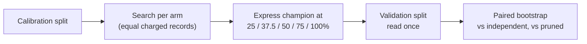

## Summary

Adds an opt-in, controlled study of a compact genome expressed at several
connection budgets. The genome carries weights, biases and an evolved
expression-priority gene, and is selected on calibration data at 25%, 50% and
100% of 44 candidate synapses. It is then evaluated on untouched validation data
at those budgets and at the unseen 37.5% and 75%. It is compared under an equal
charged-record budget with independent per-budget searches and with a full-size
search pruned by frozen-weight magnitude. The PR adds the reproducible command
`deno task budget-conditioned-study`, the 20-seed machine-readable results and
an evidence page.

**The result is negative.** The pre-declared outcome is `failure`. On the unseen
budgets the conditioned genome is **harmful** against the independent searches:
mean paired validation-MSE difference +0.0784, 95% CI [0.0512, 0.107], 2 wins in
20. It does beat the magnitude-pruned network on the unseen-budget mean
(−0.0498, CI [−0.102, −0.0042]). It **regresses at full size** against that
network (+0.0479, CI [0.0345, 0.0622], 0 wins in 20). It also does not
interpolate: its median at the unseen 75% budget (0.173) is worse than at 50%
(0.058) or 100% (0.085). Nothing under `src/` changes, and no default or genome
format changes.

The cited paper, arXiv 2611.06895 v1 (Fehrman, Morra & Naumann), is now pinned
in the manifest (`manifest.paper`, from `SOURCE_METHOD`) and on the evidence
page. Each element of its method is mapped to this study, and the details the
source excerpts do not give are listed. The paper's core mechanism is a
HyperNEAT CPPN that takes developmental time as an input. This genome has no
budget input, so the study tests a simpler, gene-ordered expression, and the
negative result is not evidence against the paper's generator.

## Spec

### Intent and Rationale

- The issue asks for a controlled comparison in an isolated prototype, not a
  feature. NEAT-AI has no budget-conditioned encoding, so the genome lives in
  the harness and is expressed into real `Creature`s through `Creature.fromJSON`
  and checked with `creatureValidate`.
- The harness follows the merged sibling study (Issue #4160) and reuses its
  corpus and statistics by import: `buildStudyCorpus`, `pairedBootstrapCi`,
  `quantile`, together with `scoreCreature`, `median` and `cliArgs`. Nothing was
  copied.
- The `pruned` arm stands in for frozen-weight ranking (the NEAT-AI-Ockham style
  that the issue asks to distinguish from). In the `conditioned` arm the
  expression order is an evolved, heritable gene instead.

### Essential Design Decisions

- **Equal total search cost.** Every arm is charged at most 300,000 calibration
  records per seed: conditioned 299,700 (333 evaluations × 3 budgets × 300
  records), independent 300,000 (five searches with a fifth each) and pruned
  300,000. A search halts before any evaluation that would overrun its budget.
- **Calibration and validation are separate.** The corpus's train split drives
  every selection. The validation split is read only after a search returns, and
  a test pins that changing it changes no search outcome.
- **Pre-declared rules** (`manifest.criteria` in the JSON). The primary metric
  is the per-seed mean validation MSE over 37.5% and 75%, using a 95% paired
  bootstrap (10,000 resamples). Success requires a benefit against both controls
  and no full-size harm against `pruned`. Per-budget comparisons are
  exploratory.
- **Expressivity** is effective synapses divided by kept synapses, after hidden
  neurons left dangling are dropped. Invalid expressions are recorded with the
  validator's message (`invalidReason`), not hidden. There were none.
- The harness is kept as the reproducible command, as in the sibling studies. It
  has no production caller.

### Undiscoverable Facts

- This host's proxy refuses direct fetches of arxiv.org (curl:
  `CONNECT tunnel failed, response 403`; WebFetch:
  `proxy refused the connection`). The paper was read on 2026-11-15 through
  search-indexed excerpts of its abstract and HTML full text. The CPPN's other
  inputs and its threshold, the NEAT settings beyond population size (100) and
  generations (200), the task fitness definitions and the exact unseen ages are
  not in those excerpts. They are listed as `unpinned` and not guessed.
- Latency (µs per activation) was measured on a shared, parallel host. It is
  indicative only and no verdict uses it.

## Evidence

Backend and CLI research harness only; no UI. Write-up:
`docs/evidence/budget-conditioned-4161.md`; artefact:
`docs/evidence/budget-conditioned-4161.json`. The run was at code commit
`429f66b9`, NEAT-AI 7.1.19 and Deno 2.9.8. It covered seeds 4161–4180 and corpus
seed 4161, completed 60/60 runs with 0 failures, and took about 19 s
(indicative).

| Comparison (conditioned − control) | Mean diff | 95% CI             | Wins / 20 | Verdict |
| ---------------------------------- | --------- | ------------------ | --------- | ------- |
| unseen budgets vs `independent`    | +0.0784   | [0.0512, 0.107]    | 2         | harm    |
| unseen budgets vs `pruned`         | −0.0498   | [−0.102, −0.00417] | 13        | benefit |
| full size (100%) vs `pruned`       | +0.0479   | [0.0345, 0.0622]   | 0         | harm    |

The study was run twice at `429f66b9`. The two JSON files were identical apart
from latency fields (compared with `jq` after deleting `latencyMicros` and
`medianLatencyMicros`). Since `f6c60651`, the code changes only add the pinned
method to the manifest. The results also match the first run at `f6c60651`
exactly, once latency, `codeVersion` and `paper` are removed.

## Acceptance Criteria

<!-- vibe-spec-review inputs="diff+issue-body" -->

- **partial** — "Read and pin the full method before reproducing it" — evidence:
  `scripts/lib/budgetConditionedStudy.ts` (`SOURCE_METHOD`, emitted as
  `manifest.paper`),
  `test/scripts/BudgetConditionedStudy.ts::the manifest pins the source method it maps onto`,
  `docs/evidence/budget-conditioned-4161.md` (Source method (pinned)) —
  reviewer: partial — reason: the paper was read only through search-indexed
  excerpts, because this host's proxy refuses arxiv.org, so four method details
  stay unpinned. The pin was added after the study had already run, and the
  study tests a different mechanism (nested top-k expression, not a CPPN that
  takes the condition as an input).

## Test Plan

- Added `test/scripts/BudgetConditionedStudy.ts` (14 tests):
  - budget-to-synapse rounding (11, 17, 22, 33, 44), with refusals for 0,
    negative, above-1 and NaN budgets
  - expression keeps exactly the top-k by priority, nested across budgets;
    priority ties go to the lower index; magnitude ranking keeps the largest
    absolute weights
  - a dangling hidden neuron is dropped and the expression stays valid
  - `validateSettings` names the offending field
  - `evolve` charges within budget, and the leftover is smaller than one
    evaluation; every arm stays within budget
  - validation never guides the search
  - same-seed reproduction, and a different seed differs
  - `budgetVerdict` and `studyOutcome`, every branch, including full-size harm
    blocking success
  - a small `runStudy` completes every run
  - the manifest carries the pinned source method (`SOURCE_METHOD`), and every
    element has a paper side, a study side and a fidelity, with at least one
    marked `departs`
- `deno test --allow-all test/scripts/BudgetConditionedStudy.ts test/scripts/ConnectivityPriorStudy.ts`
  passed (27 passed, 0 failed). No existing test was edited. After the method
  pin, `deno test --allow-all test/scripts/BudgetConditionedStudy.ts` passed (14
  passed, 0 failed).
- All `test/docs/*.ts` passed (318 passed, 0 failed). cspell over the new and
  changed files reports only the existing `carryover` hit in `CHANGELOG.md`.
  `expressivity` was added to `docs/cspell.json`, and later the paper's author
  names, `connectomes`, `optomotor` and `thresholded`. After the method pin,
  `test/docs/*.ts` passed again (318 passed, 0 failed), and cspell over the
  changed files reports 0 issues.
- `./quality.sh` ran on head `9858f5f5` and passed: exit 0, 10,369 passed, 0
  failed, 50 ignored. It has not been re-run after the method pin; the worker
  re-runs it on the final head.
- Not checked: macOS and Windows; the invalid-expression path (no input that
  fails `creatureValidate` was found); no production corpus or representative
  run, so the finding covers tiny networks on a synthetic target only.
