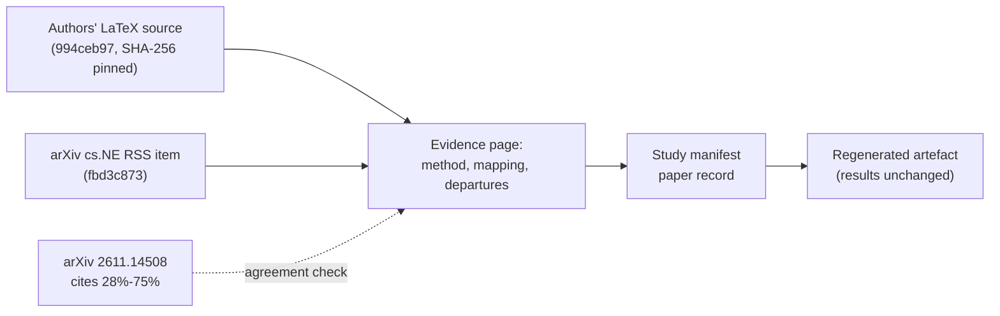

## Summary

Pins the method of arXiv 2611.01213 ("Is Newborn Wiring Special? Separating
Wiring from Weight Placement in Connectome Reservoirs"). This was the one part
of the issue still open after #4173 merged the opt-in
`deno task topology-weight-luck-study` harness. arXiv itself is still refused
from this host. The method is therefore pinned from the authors' own LaTeX
source at a fixed commit of their public repository. The abstract is pinned from
arXiv's own cs.NE RSS item. Closes #4162.

- `docs/evidence/topology-weight-luck-4162.md` has a new section, "The paper's
  method, pinned". It covers the sources (commit and SHA-256), the method (the
  wiring / weight-placement decomposition, K ≥ 25 draws, the nulls and the
  inference), how the harness maps onto it, and where it departs. The Limits
  bullet no longer says the method was not pinned.
- The study manifest (`scripts/lib/topologyWeightLuckStudy.ts`) records a
  structured `paper` record in place of the string "method not pinned". The
  committed artefact `docs/evidence/topology-weight-luck-4162.json` was
  regenerated at 1125fce4.
- The `CHANGELOG.md` entry for #4162 and `docs/cspell.json` are updated to
  match.

## Spec

### Intent and Rationale

- The issue asks to "Read and pin the full method before reproducing it". The
  earlier runs could not reach arXiv. A GitHub code search found the authors'
  repository, `Riccardo8888/connectome-reservoir-nulls`. It holds the paper's
  LaTeX source and the macro file every number in it is generated from. That is
  the method text itself, not a summary of it.
- The harness is unchanged. The paper confirms the principle it already
  followed: average a structural change's effect over weight draws, because one
  draw is noise.

### Essential Design Decisions

- **Assumption:** the authors' LaTeX at commit 994ceb97 stands in for arXiv v1.
  That commit predates the v1 announcement and is the anonymised workshop
  version, so the evidence page states it is not verified to be identical to v1.
- The harness keeps the issue's eight draws, not the paper's K ≥ 25. The issue
  fixes "eight fixed new-edge weight seeds", so this is listed as a departure,
  not changed.
- The artefact was regenerated rather than edited by hand, so the manifest is
  still produced by the code that ships. Every result section is identical to
  the 4ccb7100 run.

### Undiscoverable Facts

- On 2026-11-20 arXiv was still refused from this host:
  `curl: (56) CONNECT tunnel failed, response 403` for the abstract page and the
  export API.
- Two independent checks agree with the LaTeX source. arXiv's own abstract, like
  the source, says a single weight-rule draw carries about one z unit of noise.
  A later paper, arXiv 2611.14508, cites 2611.01213 for the same adult
  weight-placement share of 28% to 75%. That paper was read from a full-text
  copy in a public GitHub repository, found by `gh search code "2611.01213"`.

## Evidence

Documentation and research-record change only. No UI files and nothing in `src/`
changed.

- Sources pinned:
  - the abstract, from `ehijano/rss_fetch` at
    `fbd3c873cc7d24e7c8d3dd2f1cd63dc3a3a71980`
    (`rss_data/cs.NE/2026-11-03_cs.NE.xml`);
  - the method, from `Riccardo8888/connectome-reservoir-nulls` at
    `994ceb97e20c9807cb777b05759d00d837914db7`
    (`paper/esn_connectome_devai.tex`, SHA-256
    `c7235bcc88f86c484a7e6f4b5353eb7c7165433b6df8760d99137cc60f454d2c`), fetched
    with `gh api repos/<repo>/contents/<path>?ref=<sha>`.
- Artefact regeneration:
  `deno task topology-weight-luck-study --json=docs/evidence/topology-weight-luck-4162.json --code-version=1125fce4`
  printed `Coverage: 99/100 parents, 99 mutations, 0 failures`.
  - Compared with the committed 4ccb7100 artefact, `mutations`, `distribution`,
    `rules`, `primary`, `secondary`, `cost` and `coverage` are identical.
  - Only `codeVersion`, `neatAiVersion` (7.1.20 → 7.1.34) and `paper` in the
    manifest changed.
  - A run of the base code on current Develop also reproduced every result
    section exactly.

Issue numbers cited: #4162 (this issue: Experiment: Separate topology gains from
new-edge weight-placement luck); #4173 (the merged PR that added the harness).

## Test Plan

- No test added. The change adds a constant record to the manifest and
  documentation; no behaviour changed. The existing tests still cover the
  harness: `deno test --allow-all test/scripts/TopologyWeightLuckStudy.ts` gave
  `ok | 15 passed | 0 failed`.
- `deno fmt --check`, `deno lint` and `deno check` on the edited files passed.
  cspell (`npm:cspell@8`, run with `--no-config --no-lock` and
  `docs/cspell.json`) found no issues in the edited files after eight words were
  added to the word list.
- Full gate:
  `./quality.sh --rust-scorer-bin=<rust_scorer built from NEAT-AI-scorer 742c5df>`
  on e4a609f1 gave `ok | 10591 passed (5 steps) | 0 failed | 50 ignored`.
  - The first run of the gate failed one unrelated test:
    `test/scripts/LineageTargetingStudy.ts`, "best-of-R screening improves the
    targeted child and charges every candidate" ("screening must improve at
    least one seeded child").
  - That file passed twice on its own, and the second gate run passed. This diff
    does not touch it.
- Tests removed: none. Assertions removed: none.

Not done or not checked: arXiv v1 itself was not read, so the pinned source is
the authors' pre-v1 LaTeX, corroborated as described above. The harness was not
re-run with K ≥ 25 draws. The `LineageTargetingStudy.ts` failure under parallel
load was not investigated, because it is outside this issue.

🤖 Generated with [Claude Code](https://claude.com/claude-code)
