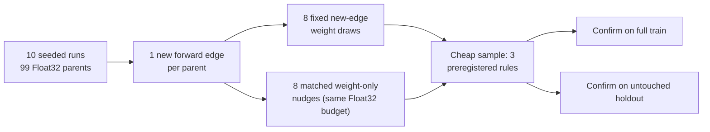

## Summary

Adds an opt-in research harness, `deno task topology-weight-luck-study`, that
tests whether a new edge's gain comes from its topology or from where its
initial weight landed. Each of 99 evolved parents gets one new forward edge
under eight fixed weight draws. Each draw is paired with a weight-only nudge of
the same Float32 budget. Three preregistered selection rules pick mutations on a
cheap sample, and the picks are then checked on the full train set and an
untouched holdout.

Result on the synthetic corpus:

- `best-draw` picked 19 mutations and 15 are confirmed on the holdout (precision
  0.79, as for `single-draw`). Its mean holdout gain (−0.00016) is pulled below
  zero by one mutation (`r0-p6`, −0.0377); the median of the 19 is +0.00108. The
  study does not show that best-of-eight selection picks luck.
- The preregistered primary test, `median-paired` against `best-draw`, is
  **no-benefit**: +0.175 holdout precision, 95% CI [−0.009, 0.381].
- No default changed, and nothing in `src/` calls the harness.

The paper's method could not be pinned (the arXiv fetch was refused), so this PR
is Part of #4162.

## Spec

### Intent and Rationale

- An added edge is two changes at once: a new topology and a random new weight.
  Pairing each new-edge draw with a weight-only nudge of the same Float32 L1
  budget (|w_k|) separates the two. The paired difference is the topology's
  share of the gain.
- The harness reuses existing code rather than building new machinery:
  - from the #4160 study: the corpus (`buildStudyCorpus`), the starting
    creatures (`buildControlCreature`) and the seeding (now the exported
    `withSeededGlobals`);
  - from the pre-selection A/B harness: the scorer and breeder (`scoreCreature`,
    `breedOffspring`);
  - from production: the weight draw (`Synapse.randomWeight` at the default
    `structuralWeightScale` of 1) and the mutation operators (`Mutator`).

### Essential Design Decisions

- **Assumption — the structural mutation:** each parent gets one new forward
  synapse, chosen uniformly the way AddConnection chooses one. AddNeuron is not
  studied.
- **Assumption — the parents:** the "100 representative parents" are the top 10
  distinct creatures from each of 10 seeded 15-generation runs. All weights and
  biases are rounded to Float32 so the matched budget is exact. Only 99 are
  distinct, and the artefact's `coverage` reports that.
- **Calibration and validation:** selection reads only the cheap sample (the
  first 50 train records). The full train set confirms, and the holdout is never
  read before confirmation. A test proves selection does not change when the
  holdout changes.
- **The criteria:** rules, thresholds (6 of 8), seeds and the
  benefit/harm/no-benefit criteria are fixed in code and in the manifest. The
  primary verdict uses the preregistered CI rule even though the point estimate
  favours `median-paired`.

### Undiscoverable Facts

- `https://arxiv.org/abs/2611.01213` could not be read in this run: the fetch
  failed with `proxy refused the connection`. The method is this repository's
  reading of the issue.
- "Scorer #588" perturbation machinery is not in this repository
  (`gh issue view 588` here is an unrelated release PR), so the perturbations
  are built from `Synapse.randomWeight` and `Math.fround`.
- The study takes about 5 s on this host, so the full 100-parent design ran in
  one go.

## Evidence

Backend/CLI research harness only. No UI files changed.

- Command:
  `deno task topology-weight-luck-study --json=docs/evidence/topology-weight-luck-4162.json --code-version=4ccb7100`
  (base commit 4ccb7100, NEAT-AI 7.1.20, Deno 2.9.8). Coverage: 99 of 100
  parents, 99 mutations, 0 failures.
- Results:
  [docs/evidence/topology-weight-luck-4162.md](../../evidence/topology-weight-luck-4162.md),
  with the machine-readable artefact
  `docs/evidence/topology-weight-luck-4162.json`.

| rule          | selected | holdout precision | mean holdout gain | cheap cost (records) |
| ------------- | -------- | ----------------- | ----------------- | -------------------- |
| single-draw   | 60       | 0.783             | +0.00163          | 9,900                |
| best-draw     | 19       | 0.789             | −0.00016          | 79,200               |
| median-paired | 28       | 0.964             | +0.00291          | 79,200               |

- **Primary** (median-paired − best-draw): +0.175, CI [−0.0088, 0.381] →
  no-benefit.
- **Secondary** (median-paired − single-draw): +0.181, CI [0.079, 0.291] →
  benefit, at eight times the cheap evaluation cost.
- **Holdout distribution:** the median of the per-mutation median paired gain is
  +0.00052 (CI [0.00021, 0.00076]). Only 36% of mutations win at least 6 of 8
  draws, and 8% are luck-only (best draw wins, median does not).
- **Total cost (records):** preparation 533,100; cheap 84,150; train 504,900;
  holdout 504,900.

Issue numbers cited: #4162 (this issue: Experiment: Separate topology gains from
new-edge weight-placement luck); #4160 (the sibling connectivity-prior study
whose corpus and seeding are reused).

## Acceptance Criteria

<!-- vibe-spec-review inputs="diff+issue-body" -->

- **missing** — "Read and pin the full method before reproducing it" — reviewer:
  missing — reason: the paper could not be read from this sandbox, so the method
  is this repository's reading of the issue, and every artefact says so. The
  retry run tried again: `curl` to arXiv `abs`, `pdf`, `export` and the export
  API failed with `CONNECT tunnel failed, response 403`, and WebFetch to arXiv,
  Semantic Scholar and alphaXiv failed with `proxy refused the
  connection`.

## Test Plan

- Added `test/scripts/TopologyWeightLuckStudy.ts`:
  - `drawNewEdgeWeights`: the eight values are Float32 and deterministic, and
    the global RNG is restored.
  - `buildTopologyVariant` adds exactly one synapse and leaves the parent
    unchanged.
  - `buildWeightOnlyVariant` moves exactly one weight by the matched budget.
  - `chooseNewEdge` picks an absent forward pair and refuses a full creature,
    with a positive control.
  - Hand-computed `summarise` arithmetic.
  - A lucky draw is selected by `best-draw` but not by `median-paired`.
  - `ruleOutcome` against a 14-mutation fixture where the cheap and holdout
    shapes disagree: `selected`, `confirmedTrain`, `confirmedHoldout`, both
    precisions, `meanHoldoutGainSelected` and `selectionCostRecords` for all
    three rules, asserted by hand; the nothing-selected case (null precisions
    and gain, cost still charged); and a flipped holdout that leaves selection
    and train figures unchanged while the holdout figures move.
  - `distribution` (now exported) by hand on the same fixture: histogram,
    `fractionConsistent`, `fractionLuckOnly` and the median, plus the empty
    case.
  - `comparePrecision` returns benefit, harm and no-benefit.
  - `validateSettings` names the field it refuses.
  - A tiny end-to-end study is complete and reproducible, and selection is the
    same when the holdout changes.
- `test/scripts/ConnectivityPriorStudy.ts` (unchanged) still passes after
  `withSeededGlobals` was extracted from `runArm`, so the refactor kept the old
  behaviour.
- `deno test --allow-all test/scripts/TopologyWeightLuckStudy.ts test/scripts/ConnectivityPriorStudy.ts`:
  28 passed, 0 failed (14 in each file, run on the final head).
- `./quality.sh --rust-scorer-bin=<built rust_scorer>` on the code commit before
  the review fixes (the review-fix push adds tests, an `export` and docs
  wording, and was checked with the targeted commands below, not the full gate):
  exit 0, 10365 passed, 0 failed, 50 ignored (12m23s). This host has no
  `rust_scorer` on PATH, and plain `./quality.sh` stops at its pre-flight, so
  the binary was built from a fresh NEAT-AI-scorer clone.
- Tests removed: none. Assertions removed: none.

Not done: the paper was not read; there were no runs on production or private
corpora; AddNeuron mutations were not studied. Remaining risk: the result comes
from a synthetic 4-input regression and does not transfer to production on its
own.

🤖 Generated with [Claude Code](https://claude.com/claude-code)
