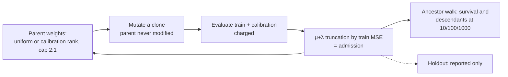

# Experiment: offspring admission versus durable lineage contribution (Issue #4163)

## Summary

Adds an opt-in research harness, `deno task admission-persistence-study`. It
logs whether each offspring is admitted to the population and whether it
persists after 10, 100 and 1000 generations, measured two ways: individual
survival and descendant contribution, with right-censoring. It then compares
uniform parent selection with a calibration-ranked bias capped at 2:1 odds. The
predeclared 20-seed run is a **negative finding**: the bias gives no benefit by
the predeclared criteria (both held-out comparisons `no-benefit`, and both
bootstrap 95% CIs span zero). Individual survival is 0 at 100 and 1000
generations in both arms, so durability shows only as descendant contribution,
which about 11% of admitted offspring reach. Nothing under `src/` changed.

The cited paper could not be read, and persistence is broken down by founder
clade rather than by species (both recorded below), so this is Part of #4163.

## Spec

### Intent and Rationale

- The issue asks for a controlled measurement, not a feature. The harness
  follows the sibling study harnesses (#4155, #4159): a library, a CLI, a
  `deno task`, an evidence page and a JSON artefact. It reuses `breedPair`,
  `stratumErrors`, `buildStratifiedCorpus`, `behaviouralDiversity`,
  `pairedComparison`, `verdict` and `SUCCESS_CRITERIA` from
  `scripts/lib/lineageTargetingStudy.ts`, `seedPopulation` from
  `scripts/lib/preSelectionAB.ts`, and the real `Mutator` and `Genus`.
- `pairedComparison` now takes a structural `PairedInput` rather than the #4155
  `ArmResult`, so this study reuses it without a copy. The git provenance
  helpers moved from `scripts/island_exchange_study.ts` to
  `scripts/lib/gitProvenance.ts`, and both CLIs import them.

### Essential Design Decisions

- **Admission** means surviving a μ+λ truncation by train MSE in the generation
  the offspring was born. Ties go to the older individual. This is the harness's
  own mutation-only loop, a stand-in for NEAT-AI's production selection, so the
  result describes the mechanism on a synthetic task.
- **Persistence**: individual survival means the individual itself is in the
  population h generations after birth. Descendant contribution counts the
  members at birth + h that are the individual or descend from it. An offspring
  born after G − h is right-censored: it is excluded from the horizon-h rates
  and counted. Kaplan–Meier gives survival of admitted offspring.
- **The bias** reads only the calibration split. Each parent's weight is
  `oddsCap ** (1 − r)`, where r is its calibration-MSE rank in [0, 1] and tied
  parents share a rank. The best-to-worst odds are therefore exactly 2:1 and
  never more. Train drives admission. Holdout is used only for reporting and is
  never charged.
- **Assumption:** "per species/team" maps to the founder clade (the seed
  individual a lineage descends from). Genus species appear only as a count,
  because UUID-based speciation collapses under mutation-only offspring. Each
  seed runs in its own child process, because one process ran the V8 JavaScript
  engine's heap out of memory at seed 12.

### Undiscoverable Facts

- arXiv 2611.06522 was unreachable from this host: `curl` to `arxiv.org` and
  `export.arxiv.org` returned HTTP status 000. No method detail or number from
  the paper is used.
- The first 20-seed attempt died with "Fatal JavaScript out of memory:
  Ineffective mark-compacts near heap limit" after 11 seeds. Those 11 seeds
  printed the same per-seed numbers as the reported run. The evidence page
  counts this attempt and both smoke runs as preparation cost.

## Evidence

Purely a script/CLI change; no UI files. The full record is in
`docs/evidence/admission-persistence-4163.md`, and the machine-readable artefact
is `docs/evidence/admission-persistence-4163.json`. The artefact holds the
manifest, the definitions, the per-seed paired differences, the bootstrap CIs,
`failuresRun` (empty) and coverage of 20/20 paired seeds. The manifest records
commit `308ae6ee`, `dirty: false`, NEAT-AI 7.1.22, the NEAT-AI-core rev, Deno
2.9.8 and seeds 4163–4182. Later commits changed only console labels, when
provenance is read, the `--single-seed` integer check and comments, not the
measured loop. To reproduce:

```bash
deno task admission-persistence-study --json=docs/evidence/admission-persistence-4163.json
```

Observation, pooled over 20 seeds per arm (264,000 offspring per arm, admission
≈ 0.20):

| Arm     | Horizon | Survival given admitted | Contribution given admitted |
| ------- | ------- | ----------------------- | --------------------------- |
| uniform | 10      | 0.0995                  | 0.273                       |
| uniform | 100     | 0                       | 0.111                       |
| uniform | 1000    | 0                       | 0.109                       |
| biased  | 10      | 0.100                   | 0.274                       |
| biased  | 100     | 0                       | 0.115                       |
| biased  | 1000    | 0                       | 0.112                       |

Comparison, biased minus uniform held-out MSE (negative is better), with the
criteria from #4155 fixed before the run:

| Metric           | Mean     | CI95                 | Wins  | Diversity | Verdict      |
| ---------------- | -------- | -------------------- | ----- | --------- | ------------ |
| best-by-train    | −4.58e-4 | [−1.08e-3, +1.38e-4] | 11/20 | ×0.912    | `no-benefit` |
| whole population | −4.75e-4 | [−1.11e-3, +1.29e-4] | 11/20 | ×0.912    | `no-benefit` |



Independent review ran before this summary was written. The two dedicated
reviewer agents returned HTTP 429, so general-purpose agents ran the same
briefs. The issue has no Acceptance Criteria heading, so the Spec verdicts are
recorded here. The Spec reviewer rated 9 items met and 6 partial. Fixed in this
diff: preparation costs are now counted on the evidence page, the stand-in and
censoring caveats are stated, and provenance is read before the run. The partial
items still open are below. The reviewer also judged the persistence summary
across seeds, which has median/min/max but no interval, as partial; the evidence
page says so. Its `unrequested` items were the shared `gitProvenance.ts`, the
`PairedInput` widening, the child process per seed, the `keepIndividuals` option
and the CHANGELOG/README entries. Each traces to the issue's "reuse existing
mechanisms" or to the reproducible command, as described above.

## Acceptance Criteria

- **missing** — "Read and pin the full method before reproducing it" — reason:
  arXiv 2611.06522 was unreachable from this host (HTTP 000), so the harness
  implements this repository's reading of the issue text and is not a
  reproduction of the paper.
- **missing** — "persistence after 100/1000 generations per species/team" (the
  per-species breakdown) — reason: persistence is broken down by founder clade.
  Genus species appear only as a count, because UUID-based speciation collapses
  under mutation-only offspring (about 2 species at the end of a run).

## Standards Review

<!-- vibe-standards-review inputs="diff+AGENTS.md+docs/ENGINEERING_PRINCIPLES.md" -->

- **violation** — the evidence page claimed that wall-clock times were recorded,
  which breaks `docs/DOC_STYLE.md` rule 4 (fact-check claims) — evidence:
  `docs/evidence/admission-persistence-4163.md:107` — reason: fixed in this diff
- **violation** — acronyms were not expanded on first use, which breaks
  `docs/DOC_STYLE.md` rule 1 — evidence:
  `docs/evidence/admission-persistence-4163.md:64` — reason: fixed in this diff
- **clean** — tests check outcomes, with no timing APIs and no `Deno.env.set`.
  The other areas checked:
  - the logging policy: `console.*` appears only under `scripts/`;
  - no forbidden dependencies;
  - Australian English and the NEAT vs NEAT-AI rule;
  - the neuron UUID, creature UUID and semantic version invariants (parents
    proven unmodified);
  - DRY: the git provenance is shared;
  - no public API change, and no existing test expectation changed.

  The optional items it raised were fixed: the `gitProvenance.ts` doc-comment
  placement, provenance read before the run, `--single-seed` integer-checked,
  and a test comment that did not match its assertion.

## Test Plan

- Added `test/scripts/AdmissionPersistenceStudy.ts` (15 tests):
  - `kaplanMeier` with and without censoring, and on no data;
  - parent weights: uniform all 1, the best exactly the cap, ties shared, and an
    `oddsCap` below 1 refused by name;
  - `validateSettings` names the bad setting;
  - `persistenceSummary` on a hand-built run, and with no offspring;
  - a run is deterministic, and the caller's generator is restored;
  - holdout never guides a decision: holdout targets shifted give an identical
    trace and persistence, and the holdout MSE differs as the positive control;
  - persistence bookkeeping is consistent: censored counts, descendants ≥
    survival, parents unmodified;
  - the bias reaches selection.
- Callers checked for the widened `pairedComparison`:
  `scripts/lineage_targeting_study.ts` (unchanged and still type-checks) and the
  new CLI. Callers of the moved `gitCommit`/`dirtyTree`:
  `scripts/island_exchange_study.ts` and the new CLI. No assertion was removed
  from any existing test.
- On the head, `deno test --allow-all test/scripts/AdmissionPersistenceStudy.ts`
  plus `test/scripts/IslandExchangeStudy.ts` and
  `test/scripts/LineageTargetingStudy.ts` gave 53 passed, 0 failed.
- The full `./quality.sh --rust-scorer-bin=<locally built rust_scorer>` ran in
  the foreground on head `2b9f2289` and exited 0: 10,493 passed, 0 failed, 50
  ignored. The gate refuses to run without a native scorer, so it was built from
  `stSoftwareAU/NEAT-AI-scorer`.
- The CLI's child-failure path (a non-zero exit or a missing output file) was
  not exercised by a test. Pooled aggregation and coverage were checked only
  through the real 20-seed run's artefact.
