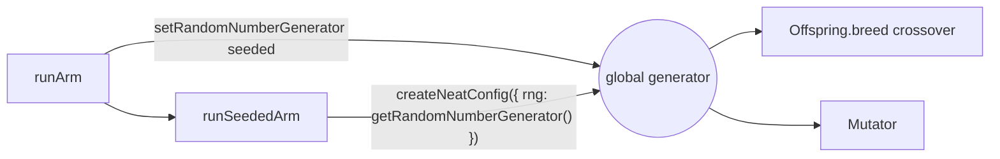

## Summary

The pre-selection A/B harness now runs crossover and mutation from the seeded
generator it installs. Before this change, `runSeededArm` called
`createNeatConfig` with no `seed` or `rng`, and that call installed an unseeded
generator, so every crossover and mutation in the Issue #3932 A/B was unseeded.
The config now receives the generator `runArm` seeded. A new test asserts that
two runs with the same seed return identical results. The #3932 study has been
re-run, and its evidence is refreshed and now reproducible from its seeds.

Closes #4170.

## Spec

### Intent and Rationale

- `createNeatConfig` (`src/config/NeatConfig.ts`) always calls
  `setRandomNumberGenerator`: it uses `options.rng`, otherwise a generator
  seeded from `options.seed`, otherwise an unseeded one.
- I passed `rng: getRandomNumberGenerator()` rather than `seed: settings.seed`.
  The config then keeps the generator `runArm` installed instead of building a
  second one from the same seed. As a result, the seeding and restore code in
  `runArm` is the single place that decides the arm's generator.

### Essential Design Decisions

- The determinism test compares every `ABResult` and `ABGeneration` field except
  `screenMs`, which is a wall-clock reading. It does not compare
  `ABResult.surrogate`.
- Re-running the study changed some findings, and every doc sentence that quoted
  the old ones was rewritten (see Evidence). The stage still ships off.

### Undiscoverable Facts

- The harness for the #3933 surrogate-uncertainty A/B
  (`scripts/surrogate_uncertainty_ab.ts`) calls the same `runArm`. Its committed
  evidence, `docs/evidence/surrogate-uncertainty-3933.md`, was therefore
  produced with unseeded crossover and mutation. This PR fixes that harness too,
  because both share the code. It does not re-run that study, because the issue
  asks only for the #3932 refresh.
- Neuron UUIDs are still minted with `crypto.randomUUID()`. In the two
  invocations compared below, they changed no reported number.

## Evidence

Backend/script change; no UI file touched.

- **Red run:**
  `test/scripts/PreSelectionAB.ts::pre-selection A/B — two runs with the same seed return identical results`
  failed on the unfixed code with "Values are not equal". For example,
  `candidatesConsidered` was 75 against 65, and `finalScore` was -0.135218…
  against -0.134405….
- **Green run:** after the fix, the whole file passed 3 times in a row (6
  tests).
- **Study re-run:** I ran
  `deno task pre-selection-ab --generations=30 --replicates=10 --json=…` twice
  on the fixed code. The text output matched once the timings were stripped, and
  the JSON artefacts matched once the `screenMs` fields were removed. The first
  artefact replaces `docs/evidence/pre-selection-3932.json`.
- **Findings that changed** in `docs/evidence/pre-selection-3932.md`:
  - **Equal record budget:** `"sampled"` is now +6.58e-3 better on the mean, but
    on only 5 of 10 seeds. The other two over-generated arms are behind control.
    The reading is still "no improvement demonstrated".
  - **Equal generations:** both screened arms now beat `random-only`.
  - **Diversity:** only `"sampled"` cuts mean genetic distance (−0.0270).
    `"surrogate"` now raises it (+0.0244), and `random-only` sits at control
    (+0.0015).
  - **Run-to-run variability:** the paragraph that blamed it on
    `crypto.randomUUID()` now says the cause was this bug, and that results are
    reproducible. It also says which generators are seeded where: the corpus,
    starting population and parent draws use generators the harness seeds
    itself, and crossover and mutation use the global generator, seeded with the
    same seed.
  - **Crossover shortfall:** control bred a mean of 5.6 offspring per generation
    against 22 slots. That is the artefact's mean `candidatesConsidered` (192.2)
    minus the 24 seed creatures, divided by 30 generations.
- **Same sentence updated elsewhere:** `docs/PRE_SELECTION.md` (Failure
  detection section), `docs/config/TRAINING.md` (the `preSelection` paragraph)
  and `CHANGELOG.md` (an `[Unreleased]` / Fixed entry).
- **Issue numbers cited in the diff:**
  - #4170: "pre-selection A/B harness runs crossover and mutation unseeded:
    createNeatConfig replaces the seeded global generator" (this issue).
  - #3932: offspring pre-selection, which was already cited in every touched
    file.

## Test Plan

- Added one test to `test/scripts/PreSelectionAB.ts`. No existing test or
  assertion was edited or removed.
- `deno fmt`, `deno lint` and `deno check` are clean on the changed files.
- Full gate:
  `./quality.sh --rust-scorer-bin=<rust_scorer built from ../NEAT-AI-scorer outside the checkout>`
  passed with 10,600 tests passed, 0 failed and 50 ignored.
- **Docs swept:** I grepped `docs/` and `README.md` for `3932`, "no arm
  improved", "both screens" and "genetic distance". Every sentence that quoted
  the old #3932 result is updated. `docs/README.md` describes the stage, not the
  result, so it is unchanged.

Not done: the #3933 surrogate-uncertainty study was not re-run (see
Undiscoverable Facts).

🤖 Generated with [Claude Code](https://claude.com/claude-code)
