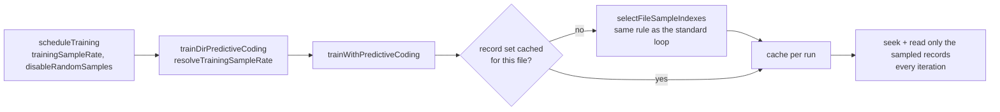

## Summary

The predictive-coding trainer now honours `trainingSampleRate` and
`disableRandomSamples`. Each iteration reads only the records that
`selectFileSampleIndexes` picks from each file, the same rule the standard
TypeScript loop uses. `trainDirPredictiveCoding` forwards the resolved rate,
`disableRandomSamples` and `feedbackLoop`. A scheduled task on a large corpus
therefore works through `ceil(rate × records)` per file per iteration instead of
the whole corpus. Closes #4180.

## Spec

### Intent and Rationale

- Before this change, `trainWithPredictiveCoding` read every record of every
  file on each iteration, and `trainDirPredictiveCoding` never passed the
  scheduler's `trainingSampleRate` on. On production-size creatures one
  iteration outlasted the task deadline, so the task returned `unmeasured` and
  trained nothing.
- The record selection is not copied. The trainer calls the existing
  `selectFileSampleIndexes` (`src/architecture/training/TrainingSamples.ts`), so
  the two trainers cannot drift apart.

### Essential Design Decisions

- The sampled set is chosen **once per run** and cached per file, as
  `runSingleEpoch` does through `EpochState.indxMap`. Every iteration's error is
  then measured on the same records, so the trainer's best-iteration restore
  compares like with like.
- The new trainer options are optional and default to `trainingSampleRate: 1`
  and `disableRandomSamples: false`. That keeps the direct
  `trainWithPredictiveCoding` API, and its about 20 existing test and bench
  callers, reading the whole corpus, matching the `TrainOptions` default. The
  `trainDir` path always passes an explicit value through
  `resolveTrainingSampleRate`.
- A rate outside (0, 1], including NaN, now throws a `ValidationError` naming
  `trainingSampleRate`. Without the check, a rate of 0 would fall through to the
  less specific "No samples were processed" error.
- `fileRecords` is `floor(size / bytesPerRecord)`, so a trailing partial record
  is still ignored, as the old read-to-EOF loop did. A short read of a selected
  record now logs a warning and the record is skipped, mirroring the standard
  loop.

### Undiscoverable Facts

- The issue's field evidence (tasks still running after 346 s on creatures of
  about 63,000 synapses) comes from the #4146 log. Large-creature timings were
  not re-measured here.

## Evidence

Backend change; no UI file touched.

- `test/architecture/training/PredictiveCodingSampling.ts::predictive-coding trainDir with disableRandomSamples trains on each file's leading share`:
  a 10-record file where every record has input [0, 0]. Each target is the
  creature's untrained output `o` plus 1 (first 5 records) or plus 10 (last 5),
  so the per-record errors are 1 and 100 whatever the random creature outputs.
  At rate 0.5, `trainDir`'s first-iteration error is 1, the error over the
  leading 5 records. At rate 1 (the control) it is 50.5, the error over all 10.
  The test also asserts that the two expected values differ by more than 10.
- `test/architecture/training/PredictiveCodingSampling.ts::predictive-coding trainDir random sampling trains on ceil(rate × records) records per file`:
  shuffled selection. Same input on every record; record k's target is
  `o + sqrt(2^k)`, so its error is exactly 2^k. `trainDir`'s error is the mean
  over the records read, so `error × n` must be a whole number below 1024 with
  exactly n set bits, one per distinct record. The test asserts this for n = 10
  at rate 1, n = 5 at rate 0.5 and n = 1 at rate 0.01. It asserts only the
  `trainDir` result, not how the trainer is clocked.
- `test/predictiveCoding/PredictiveCodingTrainer.ts::PC trainer refuses a trainingSampleRate outside (0, 1]`:
  0, 1.5 and NaN each throw a `ValidationError` naming `trainingSampleRate`. The
  control rate of 1 trains.
- Red run on the unfixed code, run with `--no-check` because the new option did
  not type-check there:
  - the leading-share test got error `50.5` instead of `1`, the whole file's
    error;
  - the random-sampling test got `error × 5 = 511.5` at rate 0.5, the mean over
    all 10 records rather than a sum of 5;
  - the refusal test failed with "Expected function to throw".
- Issue numbers cited in the diff: #4180 (this issue) and #4146 ("Recurrence of
  #4119 on 7.1.12 + engine 0.1.50: training tasks still overrun the per-task
  deadline …", already cited in the touched files; this diff cites it only in
  the summary).

## Test Plan

- Added `test/architecture/training/PredictiveCodingSampling.ts`, with the two
  tests above. Neither depends on the random creature's output: each target is
  an offset from it. Both passed 40 of 40 consecutive runs at the head.
- Added one test to `test/predictiveCoding/PredictiveCodingTrainer.ts`. No
  existing test or assertion was edited or removed.
- Existing coverage of the touched paths still passes:
  `test/architecture/training/PredictiveCodingDeadline.ts`,
  `test/predictiveCoding/PredictiveCodingDeadline.ts` and
  `test/architecture/training/PredictiveCodingBackendReport.ts`. These include
  the deadline tests whose clock counters depend on the per-sample read: at rate
  1 the set covers every record, so their counts are unchanged.
- Full gate:
  `./quality.sh --rust-scorer-bin=<rust_scorer built from ../NEAT-AI-scorer outside the checkout>`
  passed with 10,594 tests passed, 0 failed and 50 ignored.
- Docs updated:
  - `docs/PREDICTIVE_CODING.md`: a new paragraph after the deadline paragraph in
    the overview. I read the section, and a grep for other "every sample/record"
    claims found none about iterations.
  - The `trainingSampleRate` JSDoc in `src/config/TrainOptions.ts`.
  - The module and parameter docs in
    `src/predictiveCoding/PredictiveCodingTrainer.ts` and
    `src/architecture/training/TrainingPredictiveCoding.ts`.

Not done: large-creature timings were not measured. The fix bounds per-iteration
work by the sample rate, and that is shown by the counted samples above, not by
a timing.

🤖 Generated with [Claude Code](https://claude.com/claude-code)
