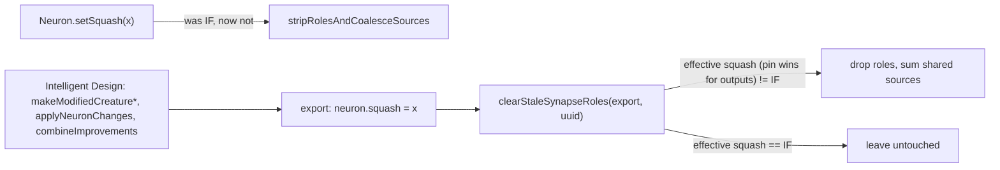

## Summary

A neuron changed away from `IF` now drops the `condition` / `positive` /
`negative` roles on its inward synapses. This holds for live creatures and for
exported-creature substitutions, so the result can be scored or exported
straight away. Closes #4185.

- **Live creatures:** `Neuron.setSquash` calls the existing
  `stripRolesAndCoalesceSources` when the squash goes from `IF` to anything
  else. That helper strips the roles and sums rows that now share a source.
- **Exports:** the new `clearStaleSynapseRoles(creatureExport, neuronUuid)` in
  `src/architecture/StaleSynapseRoles.ts` is exported from the package root for
  downstream callers. It decides by the **effective** squash: for an output
  neuron, an active `Activations` output pin takes precedence over the squash in
  the export.
- **Intelligent Design:** the four places that write `squash` into an export now
  call it after each write. They are `makeModifiedCreature` and
  `applyNeuronChanges` (`TacitKnowledge.ts`), and
  `makeModifiedCreatureWithPrevious` and `combineImprovements`
  (`ImproveSquash.ts`).

## Spec

### Intent and Rationale

- Only an `IF` target reads roles. A neuron that leaves `IF` but keeps its typed
  rows carries roles it cannot read. Two roles from one source then remain two
  rows, which validation refuses for a non-`IF` target.
- The live path reuses `stripRolesAndCoalesceSources` (already called by
  `IF.fix`, `fix()` and `downgradeToIdentity`) instead of a second copy of the
  same strip-and-sum rule.

### Essential Design Decisions

- The live strip runs only when the old squash was `IF` and the new one is not.
  Every other `setSquash` call (the mutation hot path) does no synapse scan.
- `clearStaleSynapseRoles` works on one target and is idempotent. Combined
  substitutions call it once per changed neuron, in any order. A role on an edge
  into a neuron that is still `IF` (IF → IF) is never touched.
- Rows into the changed neuron that share a source are summed into the first
  row, and their tags are merged. Endpoints, other synapses, biases and neuron
  tags are left as they were.
- `setSquash` still does not delete `creature.uuid`, as AGENTS.md documents.
  Callers that change a squash already shed identity, and the role strip is part
  of the same edit.

### Undiscoverable Facts

- On base, `setSquash("RELU")` on an `IF` neuron leaves typed rows that pass
  `creatureValidate`, survive `exportJSON` and reload unchanged. I observed this
  with a scratch script before the fix.
- Discovery's own export squash writes (`DiscoveryNeuronAddition.ts`,
  `CandidateApplicationOps.ts`, `ApplyCoordinatedStructuralCandidate.ts`) are
  outside the sites the issue names and are not changed here.

## Evidence

Backend-only change; no UI files touched.

- Red against base: with base `Neuron.ts`, `ImproveSquash.ts` and
  `TacitKnowledge.ts` restored and the new tests kept, the run was
  `FAILED | 6 passed | 8 failed`. All 8 tests that drive the live and
  Intelligent Design paths failed. Of the 6 that passed, 4 exercise the new
  export op directly and 2 are the no-change controls (`setSquash("IF")`, and
  the IF pin keeping its roles). With the fix, every test passes.
- Full gate: `./quality.sh --rust-scorer-bin=<built rust_scorer>` passed with
  `ok | 10591 passed (5 steps) | 0 failed | 50 ignored`. The native
  `rust_scorer` was not on this host, so I built it from a scratch clone of
  `stSoftwareAU/NEAT-AI-scorer` outside the repository.
- Docs updated: `AGENTS.md` (the "🔑 Synapse identity" section, read through),
  `docs/ACTIVATION_FUNCTIONS.md` (the output-squash pin section), `CHANGELOG.md`
  (`[Unreleased]` → `### Fixed`). I also updated the
  `stripRolesAndCoalesceSources` doc comment so it lists `Neuron.setSquash`
  among its callers.

## Test Plan

- Added `test/architecture/IfSquashChangeClearsRoles.ts`:
  - Two connected `IF` neurons with typed inputs. After `setSquash("RELU")` on
    the first, every row into it has no `type`, before scoring and after an
    export/reload round trip.
  - The edge into the second `IF` keeps `positive`.
  - Weights, endpoints and tags are preserved, and two roles from one source are
    summed (0.6 + 0.25 into one row).
  - `setSquash("IF")` is a no-op.
  - Pinned output: an `IDENTITY` pin clears the roles; an `IF` pin keeps them.
  - The export op, imported from `mod.ts`, gives the same results, judges the
    effective squash under both pins, returns 0 and changes nothing for an
    effective `IF`, and throws on an unknown uuid with the uuid in the message.
- Added `test/intelligentDesign/IfSubstitutionClearsRoles.ts`:
  - Single substitutions through `makeModifiedCreature` and
    `makeModifiedCreatureWithPrevious`.
  - Combined substitutions through `applyNeuronChanges` and
    `combineImprovements`. One case leaves `if-b` as `IF`, so the IF → IF role
    is kept; one changes both, so both targets are cleared. Each result reloads
    and validates. `scoreDir` is stubbed as in
    `test/intelligentDesign/TacitKnowledgeApplyNeuronChanges.ts`.
- Edited `test/fix/IfRoleAssignmentCoalesce.ts`, test "Issue #3880:
  coalesceInwardDuplicates sums every role on a non-IF target":
  - Obsolete behaviour: its setup relied on `setSquash("IDENTITY")` leaving the
    roles in place. The issue makes that untrue: "When the neuron changes to
    ReLU or any other non-IF squash, those branch roles must be removed
    automatically".
  - The setup now writes `gate.squash` directly, so the test still builds typed
    rows into a non-`IF` target. Every assertion is unchanged, so the coalesce
    behaviour it protects is still covered.
- Re-ran the existing setSquash-related tests (every file matching
  `grep -rl setSquash test`), plus `NeuronUuidStability`,
  `SemanticVersionStability`, `StaleUuidAfterStructuralChange` and the
  Intelligent Design tests. All passed: 151 tests in 20 files, before the full
  gate above.

Not done or not checked: discovery's export squash writers (listed above) do not
call `clearStaleSynapseRoles`. The GPU scorer lane (`--gpu-scorer`) was not run.
