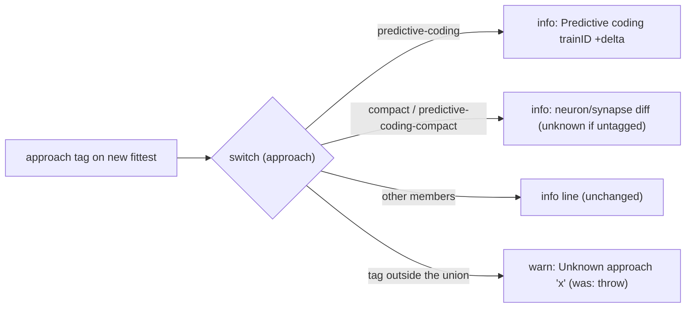

## Summary

`logApproach()` no longer aborts `evolveDir` when a predictive-coding training
result becomes the new fittest. The fix is done; the issue's last
Definition-of-done item needs a GRQ log line after the release, so this PR is
Part of #4188.

- `src/NEAT/LogApproach.ts`:
  - New `predictive-coding` case: logs one line with the train ID and the
    fitness gain.
  - `predictive-coding-compact` now shares the `compact` branch and its
    neuron/synapse diff, with its own label.
  - The `default:` branch now does `const unreachable: never = approach` and
    then logs a warning. It no longer throws `ValidationError`.
  - The shared compact branch logs `unknown` for a missing `old-neurons` or
    `old-synapses` tag, where it used to fail an assert.
- Tests: `test/NEAT/LogApproach.ts` and
  `test/blackbox/FineTunePopulationZeroScore.ts`.
- `CHANGELOG.md`: new entry under [Unreleased] / Fixed.

## Spec

### Intent and Rationale

- A function that only prints an info line must never be able to end a run. The
  two predictive-coding tags (`src/NEAT/ProcessCompletedResults.ts:73-117`) had
  no case, so they hit the throwing `default:`.
- The `never` assignment turns a forgotten `Approach` member into a `deno check`
  error. A tag outside the union still arrives at run time through
  `getTag(...) as Approach`, and that case now warns.

### Essential Design Decisions

- **Assumption:** the shared compact branch must read `old-neurons` /
  `old-synapses` without asserting. The aggressive compact variant
  (`src/compact/CompactCreature.ts:102`) is tagged `compact` and never gets
  `old-neurons` itself. The training path can return it as the compact export
  through `selectCompactVariant`, and that export is what gets tagged
  `predictive-coding-compact`. Keeping the assert would leave the same crash in
  place for that case.
- The `compact` log text is unchanged ("Compacting increased fitness by"). The
  predictive-coding variant says "Predictive-coding compacting increased fitness
  by".
- The score `assert`s at the top of `logApproach` stay. Every caller passes
  creatures that have been scored.

### Undiscoverable Facts

- The crash was seen on GRQ-24 (neat-ai 7.1.28) at 2026-11-20 17:42:20 AEDT. The
  log was deleted during triage and is quoted only in the issue.

## Evidence

Backend-only change. No UI files changed.

Issue numbers cited: #4188 (logApproach() throws 'Unknown approach
predictive-coding-compact' and kills evolveDir).

## Reproduction

- **symptom** —
  `error: Uncaught (in promise) ValidationError: Unknown approach
  'predictive-coding-compact'`
  at `logApproach` (`LogApproach.ts:147`), called from `FindTunePopulation.make`
  (`FineTunePopulation.ts:162`). The sampler stage exited 1.
- **status** — `verified` — these tests failed against the base
  `src/NEAT/LogApproach.ts` (`FAILED | 8 passed | 6 failed`):
  - `ValidationError: Unknown approach 'predictive-coding-compact'`, raised at
    `FindTunePopulation.make (src/blackbox/FineTunePopulation.ts:162:9)`.
  - `ValidationError: Unknown approach 'predictive-coding'`.
  - `AssertionError: Old neurons must be defined`.

  With the fix they pass (`ok | 16 passed | 0 failed`).
- **regression test** —
  `test/blackbox/FineTunePopulationZeroScore.ts::FineTunePopulation - a predictive-coding-compact fittest does not abort make() (regression #4188)`

## Acceptance Criteria

<!-- vibe-spec-review inputs="diff+issue-body" -->

- **met** — `logApproach` handles `"predictive-coding"` and
  `"predictive-coding-compact"` (PC compact can share the `compact` branch's
  neuron/synapse diff) — evidence: `src/NEAT/LogApproach.ts`,
  `test/NEAT/LogApproach.ts::logApproach: predictive-coding-compact logs the compacted result without throwing (issue #4188)`
  — reviewer: met
- **met** — The `switch` is made exhaustive at compile time
  (`const unreachable: never = approach`), and an unknown runtime tag **warns**
  instead of throwing — evidence:
  `test/NEAT/LogApproach.ts::logApproach: warns and does not throw for an unknown approach tag (issue #4188)`
  — reviewer: met
- **met** — Regression test: a creature tagged
  `approach="predictive-coding-compact"` (with `old-neurons`/`old-synapses`) and
  a different `previous` passed to `logApproach` does not throw and logs one
  line; same for `"predictive-coding"`. Plus a test that iterates every member
  of `Approach` and asserts `logApproach` accepts it — evidence:
  `test/NEAT/LogApproach.ts::logApproach: predictive-coding logs the training result without throwing (issue #4188)`,
  `test/NEAT/LogApproach.ts::logApproach: every member of Approach is accepted without a warning (issue #4188)`
  — reviewer: met
- **missing** — GRQ picks up the release; closing needs a quoted GRQ-24 (or any
  host) sampler log line showing a `Predictive-coding*` improvement followed by
  a normal `[stage] done` — not inspection — reviewer: missing — reason: needs
  this fix released and run in GRQ production; no such log line can exist before
  the merge
- **unrequested** — the `compact` branch no longer asserts on `old-neurons` and
  logs `unknown` instead — reviewer: unrequested — reason:
  `predictive-coding-compact` shares this branch, and the aggressive compact
  variant has no `old-neurons` tag, so the assert would still kill a run

## Standards Review

<!-- vibe-standards-review inputs="diff+CODING-STANDARDS.md" -->

This repository has no `CODING-STANDARDS.md`, so the reviewer checked the diff
against `AGENTS.md` and `docs/ENGINEERING_PRINCIPLES.md`.

- **clean** — Checked and found compliant:
  - Logging only through `getLogger()`, with no `console.*` or `@std/log` added.
  - Error handling.
  - Tests check behaviour, not implementation.
  - No timing APIs or `Deno.env` changes in tests.
  - Test conventions.
  - Neuron UUID, creature UUID and semantic-version invariants.
  - UUID-only wire fixtures.
  - Australian English.
  - Terminology.
  - CHANGELOG accuracy.

  The changed unknown-approach expectation still fails without the fix. Neither
  standards file marks any rule as enforced by review only.

## Test Plan

- `test/NEAT/LogApproach.ts`:
  - New tests:
    - predictive-coding-compact logs one info line with the old counts 7 and 12
      after `was:`, and no warning.
    - predictive-coding logs one info line with the train ID.
    - Every `Approach` member, listed in a `Record<Approach, true>` so that
      `deno check` fails when a member is missing, logs one info line and no
      warning with only score and approach tags.
    - A `compact` creature without `old-*` tags logs `was: unknown`.
  - Edited test: "should throw error for truly unknown approaches" is now "warns
    and does not throw for an unknown approach tag (issue #4188)".
    - The old expectation, a `ValidationError` throw, is removed because the
      issue says an unknown runtime tag "**warns** instead of throwing".
    - The new test still names the tag: it asserts one warn line containing
      `Unknown approach 'invalid-approach'`, and no info line.
  - Other existing tests are unchanged.
- `test/blackbox/FineTunePopulationZeroScore.ts`: new entry-point test through
  `FindTunePopulation.make`.
  - The previous fittest has a different UUID and a lower score, so `make()`
    reaches the `logApproach` call. Base code failed there with the issue's
    stack trace.
- Targeted run:
  `deno test --allow-all test/NEAT/LogApproach.ts test/NEAT/LogApproachDiscoveryReplay.ts test/blackbox/FineTunePopulationZeroScore.ts`
  gave `ok | 16 passed | 0 failed`. The same tests against the base
  `LogApproach.ts` gave `FAILED | 8 passed | 6 failed`.
- Full gate:
  `./quality.sh --rust-scorer-bin=<rust_scorer built from NEAT-AI-scorer 742c5df>`
  gave `ok | 10596 passed (5 steps) | 0 failed | 50 ignored`.
- Tests removed: none.
- Docs checked:
  - No manual outside `docs/archive/` mentions `logApproach` or "Unknown
    approach".
  - The module doc comment in `src/NEAT/LogApproach.ts` was updated.

Not done or not checked:

- The GRQ production log line that criterion 4 asks for.
- The file-level doc comment of `test/blackbox/FineTunePopulationZeroScore.ts`
  still describes only #3506, though the file now also holds the #4188
  regression.

🤖 Generated with [Claude Code](https://claude.com/claude-code)
