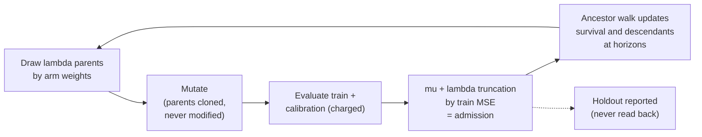

# Offspring admission versus durable lineage contribution, measured (Issue #4163)

Whether an offspring being admitted to the population says anything about its
lasting contribution, and whether biasing parent choice by what recent admission
suggests helps at the same cost. Produced by
[`scripts/admission_persistence_study.ts`](../../scripts/admission_persistence_study.ts)
(library
[`scripts/lib/admissionPersistenceStudy.ts`](../../scripts/lib/admissionPersistenceStudy.ts));
the machine-readable artefact is
[`admission-persistence-4163.json`](admission-persistence-4163.json), and the
full per-species table is
[`admission-persistence-4163-species.csv`](admission-persistence-4163-species.csv).

## Question and scope

The question is a **hypothesis**, not an established improvement: does the
quality of an offspring at admission predict how much of the population descends
from it many generations later, and would weighting parents by that signal beat
choosing them uniformly?

The issue cites arXiv 2611.06522. Neither the abstract page nor the HTML or API
(application programming interface) copy could be fetched from this host: the
egress proxy refused `arxiv.org` and `export.arxiv.org` (HTTP 403). A web search
identifies the paper as "From Admission to Retention: Predicting Durable
Offspring in Quality-Diversity Search" (Calamita, Mendicini, Ferrari and
Bertamini, submitted 4 November 2026). According to the search result, it builds
on Dominated Novelty Search in an unstructured quality-diversity archive, uses a
capacity of 1024 and a retention horizon of H = 1000 generations, and reports
that some selection signals reverse direction between entry and retention. That
description comes from a search engine's summary, not from the paper, and the
full method was **not** read. No method detail or number from it is used. The
harness implements this repository's own reading of the issue text. It is
**not** a reproduction of the paper.

## Reproduce

```bash
deno task admission-persistence-study \
  --json=docs/evidence/admission-persistence-4163.json \
  --species-csv=docs/evidence/admission-persistence-4163-species.csv
```

Each seed runs in its own child process. The 20 predeclared seeds are the
default.

### Manifest

| Item         | Value                                         |
| ------------ | --------------------------------------------- |
| Code commit  | `e131ebfe2df4f35e18ade97c2dc03506c6f34d00`    |
| Dirty tree   | `false`                                       |
| NEAT-AI      | 7.1.22                                        |
| NEAT-AI-core | `1d44889e405e4e0cfb553321b44cc39e7d771f5f`    |
| Deno         | 2.9.8 (V8 15.0.245.2-rusty, TypeScript 6.0.3) |
| Corpus       | `synthetic-quadrant-v1`                       |
| Seeds        | 4163 to 4182 (20)                             |
| Settings     | see the table below                           |

| Setting                  | Value         |
| ------------------------ | ------------- |
| Records per split        | 100           |
| Population (N, mu)       | 12            |
| Offspring per generation | 12 (lambda)   |
| Generations              | 1100          |
| Horizons (generations)   | 10, 100, 1000 |
| Odds cap                 | 2             |
| Diversity probe cadence  | every 50      |

## Predeclared design

The settings, arms and thresholds are constants in code, and the run was made
from a clean tree at the commit above. They were fixed before the run, and no
criterion was changed afterwards. Later commits changed only console labels,
provenance capture timing, command-line argument validation and comments in
`scripts/`, not the measured loop, so rerunning at the head gives the same
numbers.

- **Controls:** uniform parent selection is the control. The `biased` arm is the
  treatment: it weights parents by the rank of their calibration mean squared
  error (MSE, [glossary](../GLOSSARY.md#-acronyms)) only, with best-to-worst
  odds capped at 2:1.
- **Seeds and sample size:** 20 seeds, numbered 4163 to 4182, each run in both
  arms with the same starting population, so the comparison is paired.
- **Compute limits:** 1100 generations per run. Each arm is charged 52,848,000
  records in total (2,642,400 per seed, 264,240 evaluations, 264,000 offspring),
  and the two arms are identical on every one of those counts.
- **Success criteria** (`SUCCESS_CRITERIA`, reused from Issue #4155). The
  treatment **benefits** only if all three hold against the control:
  1. The upper bound of the bootstrap 95% confidence interval (CI) of the mean
     paired holdout-MSE difference is below 0.
  2. It wins on at least 70% of seeds.
  3. The median behavioural-diversity ratio is at least 0.8.
- **Failure criterion:** it is **harmful** if the CI lower bound is above 0.
  Otherwise the verdict is **no-benefit**.

### Definitions

Taken from the artefact's `manifest.definitions`.

| Term                    | Definition                                                                                                                    |
| ----------------------- | ----------------------------------------------------------------------------------------------------------------------------- |
| Initial acceptance      | An offspring is admitted when it is among the N survivors of the birth selection (train MSE, ties to the older individual).   |
| Individual survival     | The individual itself is in the population exactly h generations after its birth.                                             |
| Descendant contribution | At least one member of the population h generations after its birth is the individual or descends from it.                    |
| Right-censoring         | An individual born after G - h has no h-generation reading. It is excluded from that horizon's rates and counted as censored. |
| Turnover                | Admitted offspring in a generation divided by N.                                                                              |
| Lineage depth           | 0 for a seed, parent depth + 1 for an offspring.                                                                              |
| Species / team          | Both groupings are reported: the Genus species key (`Species.calculateKey`) at birth, and the founder clade.                  |

### Leakage and calibration policy

- _Train_ drives admission (the birth selection).
- _Calibration_ drives the parent bias only.
- _Holdout_ is for reporting only. It is read once at the final generation and
  never by selection, mutation or parent weighting, and it is never charged.

### Cost policy

`recordsScored` charges the train and calibration records of every evaluation,
seeds included. Holdout records (24,000 per arm in total) are reported
separately and never charged. The behavioural-diversity probe activations
(353,280 per arm in total) are counted as `diagnosticRecords` and also never
charged. No wall-clock time is recorded, by either script or in the artefact.
Cost is counted in records only.

### One generation



## Results

Twenty seeds ran to completion in both arms (coverage 20/20 paired). Every
number is in the artefact's `summary`, `comparisons` and `runs[]` blocks.

### (a) Observation: admission and persistence

Pooled over the 20 seeds. "Given admitted" restricts to offspring admitted at
birth. Individuals born too late to be read at a horizon are censored there.

| Arm       | Horizon | Eligible | Censored | Admission rate | Survival given admitted | KM survival given admitted | Contribution given admitted | Per-seed median (min, max) |
| --------- | ------- | -------- | -------- | -------------- | ----------------------- | -------------------------- | --------------------------- | -------------------------- |
| `uniform` | 10      | 261,600  | 2,400    | 0.201          | 0.0995                  | 0.108                      | 0.273                       | 0.275 (0.218, 0.384)       |
| `uniform` | 100     | 240,000  | 24,000   | 0.201          | 0                       | 0                          | 0.111                       | 0.113 (0.104, 0.118)       |
| `uniform` | 1000    | 24,000   | 240,000  | 0.201          | 0                       | 0                          | 0.109                       | 0.109 (0.0825, 0.134)      |
| `biased`  | 10      | 261,600  | 2,400    | 0.200          | 0.100                   | 0.107                      | 0.274                       | 0.282 (0.189, 0.336)       |
| `biased`  | 100     | 240,000  | 24,000   | 0.200          | 0                       | 0                          | 0.115                       | 0.115 (0.102, 0.128)       |
| `biased`  | 1000    | 24,000   | 240,000  | 0.200          | 0                       | 0                          | 0.112                       | 0.112 (0.0940, 0.137)      |

The Kaplan-Meier (KM) column is the unweighted mean over seeds of each seed's
estimate of the survival curve, which is derived from `runs[]` rather than the
command-line `summary`. Admitted offspring were 52,985 of 264,000 in the
`uniform` arm and 52,826 of 264,000 in the `biased` arm.

**Individual survival is 0 at 100 and 1000 generations in both arms.** No
individual outlives a population that turns over about a fifth of its members
every generation. Durability therefore shows only as **descendant
contribution**: about 11% of admitted offspring still have a descendant (or are
themselves present) 100 generations on, and about 11% again at 1000 generations
(0.111 and 0.109 uniform; 0.115 and 0.112 biased).

#### Admission-rank quartiles

Admitted offspring are split into quartiles by admission rank (0 is best).
Pooled contribution rate by quartile, derived from `runs[]` as the per-seed
rates weighted by the number of eligible offspring:

| Arm       | Horizon | Quartile 0 | Quartile 1 | Quartile 2 | Quartile 3 |
| --------- | ------- | ---------- | ---------- | ---------- | ---------- |
| `uniform` | 10      | 0.623      | 0.209      | 0.0811     | 0.0313     |
| `uniform` | 100     | 0.271      | 0.0692     | 0.0309     | 0.0122     |
| `uniform` | 1000    | 0.261      | 0.0714     | 0.0353     | 0.0149     |
| `biased`  | 10      | 0.614      | 0.209      | 0.0785     | 0.0311     |
| `biased`  | 100     | 0.270      | 0.0710     | 0.0291     | 0.0151     |
| `biased`  | 1000    | 0.273      | 0.0657     | 0.0317     | 0.0118     |

Admission rank is strongly associated with later contribution: the best quartile
contributes roughly 20 times as often as the worst at 100 and 1000 generations.
This is an association within the admitted set, and the same in both arms.

#### Population dynamics

Per seed, mean over the 20 seeds, with the range in brackets (derived from
`runs[]`).

| Quantity                        | `uniform`            | `biased`             |
| ------------------------------- | -------------------- | -------------------- |
| Mean turnover                   | 0.201 (0.131, 0.263) | 0.200 (0.152, 0.294) |
| Final mean lineage depth        | 294 (199, 369)       | 301 (222, 424)       |
| Final maximum lineage depth     | 297 (204, 374)       | 304 (224, 426)       |
| Founder clades alive at the end | 1 (1, 1)             | 1 (1, 1)             |
| Species count at the end        | 2.35 (1, 5)          | 2.20 (1, 4)          |

Every run starts with 12 founder clades (one per seed individual) and ends with
exactly one, so after 1100 generations every population descends from a single
founder. The founder-clade breakdown is reported as a count only. A per-founder
table (`byFounder`, offspring, admitted and contributors) is in
`runs[].persistence.horizons[]`.

#### Persistence per Genus species

Each individual records at birth the species key that `Genus` groups by
(`Species.calculateKey`: hidden-neuron count bucket, connectivity bucket and
squash mix). The key depends only on architecture, so the same key names the
same species in every seed, and rows are pooled across seeds by key. The JSON
artefact holds a digest per arm and horizon in
`summary.<arm>.horizons[].bySpecies`. The full table, one row per species with
at least one admitted offspring, is the CSV. The spread columns cover species
with at least 30 admitted eligible offspring.

| Arm     | Horizon | Species | With an admission | Never admitted (offspring) | In 2+ seeds | Species in spread | Contribution given admitted: min / median / max |
| ------- | ------- | ------- | ----------------- | -------------------------- | ----------- | ----------------- | ----------------------------------------------- |
| uniform | 100     | 9,969   | 2,748             | 7,221 (12,527)             | 252         | 338               | 0 / 0.130 / 0.333                               |
| uniform | 1000    | 1,253   | 497               | 756 (1,261)                | 171         | 59                | 0 / 0.125 / 0.333                               |
| biased  | 100     | 10,382  | 2,844             | 7,538 (12,474)             | 176         | 368               | 0 / 0.131 / 0.367                               |
| biased  | 1000    | 1,257   | 524               | 733 (1,078)                | 140         | 68                | 0 / 0.134 / 0.275                               |

Individual survival given admission is 0 in every species at 100 and 1000
generations, as it is pooled. Speciation by architecture bucket splits the
offspring into many small species: most are seen in one seed only, and most
never have an offspring admitted. The median contribution rate per species
(0.125 to 0.134) sits slightly above the pooled rate (0.109 to 0.115), and the
spread across species is wide. It is not tested against chance, so it does not
show that any species persists better than another. The final population holds
only 1 to 5 species (see the table above): architecture changes under mutation,
so species turn over faster than founder clades do.

### (b) Comparison: biased against uniform

Final holdout MSE, `biased` minus `uniform`, paired by seed (n = 20); negative
is better.

| Metric              | Mean diff | Median diff | CI95                 | Wins  | Losses | Diversity ratio | Verdict      |
| ------------------- | --------- | ----------- | -------------------- | ----- | ------ | --------------- | ------------ |
| `bestHoldout`       | -4.58e-4  | -1.37e-4    | [-1.08e-3, +1.38e-4] | 11/20 | 9/20   | x0.912          | `no-benefit` |
| `populationHoldout` | -4.75e-4  | -1.06e-4    | [-1.11e-3, +1.29e-4] | 11/20 | 9/20   | x0.912          | `no-benefit` |

CI95 is the bootstrap 95% confidence interval of the mean paired difference.
Persistence across seeds (part a) is reported only as pooled rates with the
per-seed median, minimum and maximum; there is no interval for those. Only the
paired holdout comparisons carry a bootstrap 95% CI.

Neither arm reached the records-to-target threshold in any seed, so no
records-to-target comparison exists.

### Coverage and failures

- Coverage is 20/20 paired: 20 seeds requested, 20 completed in each arm, 20
  paired.
- `failuresRun` is empty (no seed failed to run).
- The per-run `failures` count is 0 in all 40 runs.

## Findings

**What "admission" means here.** Admission is survival of this harness's own
mutation-only mu + lambda truncation by train MSE. It is a stand-in for, not a
reproduction of, NEAT-AI's production selection and speciation pipeline
(`src/NEAT/`). The result describes the mechanism on a synthetic task, not
NEAT-AI's production admission.

**Censoring.** The 1000-generation rates cover only offspring born in
generations 1 to 100, because all later births are right-censored. They describe
the early part of each run. The 100-generation rates cover births in generations
1 to 1000.

This is a **negative result**. The capped 2:1 bias gives no benefit by the
predeclared criteria. Both verdicts are `no-benefit`: the CI on the mean paired
difference spans zero for both holdout measures, the biased arm wins 11 of 20
seeds against the required 14, and the 0.912 diversity ratio clears its 0.8
floor but is not enough on its own.

- Admission and durability are linked in this task. Better-ranked admissions
  contribute descendants much more often, but individual survival is 0 at 100
  and 1000 generations, and only about 11% of admitted offspring leave a
  descendant at either horizon.
- Weighting parents by calibration rank did not change those rates in any way
  the criteria can distinguish from seed-to-seed variation.

These are **predictive associations from one synthetic task**. They do not
establish that admission, rank or lineage membership has causal value.

## Deviations

- The first 20-seed attempt ran the V8 JavaScript engine's heap out of memory at
  seed 12, because the heap grew across seeds inside one process. The CLI was
  changed to run each seed in its own process and the full run was repeated. The
  11 seeds the first attempt completed printed identical per-seed numbers, so
  the change did not alter results.
- The per-species breakdown was added after the first reported run, and the
  predeclared 20 seeds were run again from a clean tree at the commit above.
  Recording the species key reads the creature and draws no random numbers, so
  every per-seed number and both paired comparisons are identical to the first
  reported run (commit `308ae6ee`).

## Preparation and search costs

Every run made for this study besides the reported one, so that all costs are
counted:

- A 1-seed, 1100-generation smoke run of both arms.
- A 2-seed, 60-generation smoke run of the per-seed child-process mode.
- The aborted first 20-seed attempt: 11 seeds completed and part of the 12th ran
  before the heap ran out (see Deviations).
- The first complete 20-seed run (commit `308ae6ee`), before the per-species
  breakdown.
- A 1-seed, 1100-generation run used to estimate how long the re-run would take.
- A 20-seed run with the per-species breakdown that kept every species row per
  run, which made a 38 MB artefact. It was discarded and the output was changed
  to the digest and the CSV, then run again for the reported result.

The settings (1100 generations, N = 12, lambda = 12, 100 records per split) were
chosen before any run and not tuned on results. Unit-test runs are synthetic and
tiny and are not counted as study cost.

## Maintenance decision

Nothing under `src/` changed. The bias exists only inside the opt-in harness, so
there is no optional production code to remove. The harness is kept as the
reproducible command for this result. The commit hash and dirty flag are read by
the shared helper `scripts/lib/gitProvenance.ts`.

## What this does not say

- **Nothing about production-scale creatures.** This is a synthetic task with
  small creatures and no private corpus.
- **Nothing about the paper.** Its full method was not read, only a search
  engine's summary of it.
- **Nothing that changes ordinary behaviour.** Interfaces and defaults are
  untouched.

---

**Up to:** [`docs/README.md`](../README.md) (topic index).
