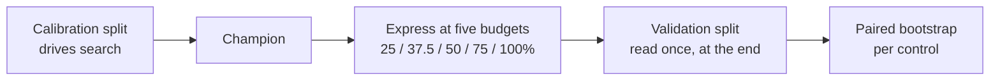

# Budget-conditioned genome expressed at several connection budgets (Issue #4161)

Whether one genome, selected under several connection budgets at once and
expressed by an evolved priority gene, yields smaller networks that generalise
better than separate searches or a pruned full-size network. Produced by
[`scripts/budget_conditioned_study.ts`](../../scripts/budget_conditioned_study.ts)
(library code in
[`scripts/lib/budgetConditionedStudy.ts`](../../scripts/lib/budgetConditionedStudy.ts));
the machine-readable artefact is
[`budget-conditioned-4161.json`](budget-conditioned-4161.json).

## Verdict: Negative

The pre-declared outcome is `failure`. On the unseen budgets (37.5% and 75%) the
conditioned genome is **harmful** against independent per-budget searches: mean
validation MSE difference +0.07841 (95% CI [0.05120, 0.1068]), 2 wins and 18
losses over 20 seeds.

It does beat the magnitude-pruned full-size network on the unseen-budget mean
(difference -0.04982, 95% CI [-0.1018, -0.004165], 13 wins and 7 losses), but
that does not rescue it. It loses to the pruned network at full size (difference
+0.04793, 95% CI [0.03450, 0.06222], 0 wins of 20) and at 75% (difference
+0.1348, 1 win and 19 losses).

The conditioned genome does not interpolate between its training budgets. Its
median validation MSE at 75% (unseen) is 0.1729, worse than at 50% (0.05819) and
at 100% (0.08455), both of which it was trained on.

No genome format, default or `src/` behaviour changes. The harness stays only so
the finding can be reproduced.

## What was compared

All three arms share one candidate topology: 4 inputs, 8 hidden neurons and 1
output, plus input-to-output skips, 44 candidate synapses in all. A budget keeps
the top share of candidates, then drops any hidden neuron left without an
inbound or an outbound kept synapse. Budgets map to synapse counts: 25% is 11,
37.5% is 17, 50% is 22, 75% is 33 and 100% is 44.

- **Conditioned**: one search. Fitness is the mean calibration MSE over the
  training budgets (25%, 50%, 100%). The champion is expressed at all five
  budgets by its evolved priority gene, including the two unseen ones.
- **Independent**: five separate searches, one per evaluation budget, each with
  a fifth of the records.
- **Pruned**: one full-size search. The champion is expressed at smaller budgets
  by ranking its frozen weights by magnitude, with no retraining.

Each arm is charged the same calibration records per seed, 300,000. The runs
charged 299,700 for conditioned (333 evaluations at 900 records each, the three
budgets per candidate), and 300,000 for independent (1,000 evaluations across
its five searches) and for pruned (1,000 evaluations).

This is a generative experiment, distinct from NEAT-AI-Ockham's frozen-weight
pruning. Ockham prunes a finished network's frozen weights; here the expression
order is an evolved, heritable gene selected under the budgets. The `pruned` arm
is the frozen-weight ranking stand-in, and is what the conditioned arm has to
beat.



### Predeclared design

- Seeds 4161–4180 (20 seeds), corpus seed 4161.
- 300 calibration and 300 validation records. Calibration is the corpus's train
  split, used for search fitness only; validation is its holdout split, read
  only after the search has finished.
- (μ+λ) search with μ = λ = 10, gene mutation rate 0.2 and σ 0.3.
- Bootstrap: 10,000 resamples, seed 4161.
- Criteria, verbatim from the manifest: "Primary metric: per-seed mean
  validation MSE over the unseen budgets (37.5%, 75%). benefit iff the
  paired-bootstrap 95% CI of (conditioned - control) lies below 0, harm iff it
  lies above 0, insufficient-data when fewer than 5 paired seeds, otherwise
  no-benefit. Success iff benefit against both independent and pruned controls
  and the full-size (100%) validation MSE against pruned is not harm. Per-budget
  comparisons are exploratory."

## Results

Validation MSE per arm and budget, over 20 seeds. Upper quartile is the 75th
percentile of validation MSE; expressivity is the mean over seeds.

| Arm         | Budget | Median validation | Upper-quartile validation | Median effective synapses | Mean expressivity | Invalid |
| ----------- | ------ | ----------------- | ------------------------- | ------------------------- | ----------------- | ------- |
| conditioned | 25%    | 0.04849           | 0.05751                   | 4                         | 0.3455            | 0       |
| conditioned | 37.5%  | 0.04953           | 0.08818                   | 9.5                       | 0.5324            | 0       |
| conditioned | 50%    | 0.05819           | 0.07929                   | 13                        | 0.6364            | 0       |
| conditioned | 75%    | 0.1729            | 0.2748                    | 28                        | 0.8394            | 0       |
| conditioned | 100%   | 0.08455           | 0.1054                    | 44                        | 1.000             | 0       |
| independent | 25%    | 0.02642           | 0.02815                   | 3                         | 0.3227            | 0       |
| independent | 37.5%  | 0.03093           | 0.03852                   | 6                         | 0.3824            | 0       |
| independent | 50%    | 0.03945           | 0.05163                   | 10.5                      | 0.4545            | 0       |
| independent | 75%    | 0.06772           | 0.09144                   | 25.5                      | 0.7833            | 0       |
| independent | 100%   | 0.08393           | 0.1115                    | 44                        | 1.000             | 0       |
| pruned      | 25%    | 0.2986            | 0.3687                    | 1                         | 0.1227            | 0       |
| pruned      | 37.5%  | 0.2615            | 0.3881                    | 4                         | 0.2500            | 0       |
| pruned      | 50%    | 0.1711            | 0.3440                    | 8                         | 0.3727            | 0       |
| pruned      | 75%    | 0.06172           | 0.07316                   | 23                        | 0.6712            | 0       |
| pruned      | 100%   | 0.03568           | 0.04301                   | 44                        | 1.000             | 0       |

Exploratory per-budget comparisons (conditioned minus control, not
confirmatory): against independent the conditioned genome is harmful at 25%,
37.5%, 50% and 75% (mean differences +0.02768, +0.02530, +0.02276 and +0.1315)
and no-benefit at 100% (-0.006366, 10 wins and 10 losses). Against pruned it
benefits at 25%, 37.5% and 50% (differences -0.3210, -0.2344 and -0.1405, with
20, 20 and 17 wins) and is harmful at 75% and 100%. The pruned network's
collapse at small budgets drives the unseen-budget benefit against it.

## Expressivity, size and latency

Expressivity is the effective synapses divided by the kept synapses, after
dangling hidden neurons are dropped. Every expression was validated; the
`invalid` count is 0 in every cell. Coverage was complete: 60 of 60 runs, no
failures.

Latency figures in the JSON are microseconds per activation, taken on a shared
host with tests running in parallel. They are indicative only, never feed a
verdict, and are excluded from the reproducibility comparison.

## Reproducibility

```bash
deno task budget-conditioned-study --code-version=f6c60651 \
  --json=docs/evidence/budget-conditioned-4161.json
```

The run takes about 19 s of wall time (indicative). It was run twice at the same
commit and the two JSON files were identical apart from the latency fields.
Versions, from the manifest: NEAT-AI 7.1.19, Deno 2.9.8, code commit `f6c60651`.

## Limitations

- A synthetic 4-input regression with tiny networks.
- The genome and the (μ+λ) search are harness-level, not NEAT-AI's
  `Offspring.breed` or `Mutator`.
- arXiv 2611.06895 was not read: there was no network access in this run. The
  method is this repository's reading of the issue.
- A single host, and no production corpus.

---

**Up to:** [`docs/README.md`](../README.md) (topic index).
