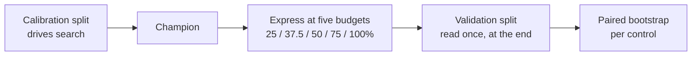

# Budget-conditioned genome expressed at several connection budgets (Issue #4161)

Whether one genome, selected under several connection budgets at once and
expressed by an evolved priority gene, yields smaller networks that generalise
better than separate searches or a pruned full-size network. Produced by
[`scripts/budget_conditioned_study.ts`](../../scripts/budget_conditioned_study.ts)
(library code in
[`scripts/lib/budgetConditionedStudy.ts`](../../scripts/lib/budgetConditionedStudy.ts));
the machine-readable artefact is
[`budget-conditioned-4161.json`](budget-conditioned-4161.json).

## Verdict: Negative

The pre-declared outcome is `failure`. On the unseen budgets (37.5% and 75%) the
conditioned genome is **harmful** against independent per-budget searches: mean
validation MSE difference +0.07841 (95% CI [0.05120, 0.1068]), 2 wins and 18
losses over 20 seeds.

It does beat the magnitude-pruned full-size network on the unseen-budget mean
(difference -0.04982, 95% CI [-0.1018, -0.004165], 13 wins and 7 losses), but
that does not rescue it. It loses to the pruned network at full size (difference
+0.04793, 95% CI [0.03450, 0.06222], 0 wins of 20) and at 75% (difference
+0.1348, 1 win and 19 losses).

The conditioned genome does not interpolate between its training budgets. Its
median validation MSE at 75% (unseen) is 0.1729, worse than at 50% (0.05819) and
at 100% (0.08455), both of which it was trained on.

A second hypothesis, declared before its first run, is also negative. The
`budgetInput` arm takes the budget as an input to expression: each candidate
synapse's priority and weight are linear in the budget. Its pre-declared outcome
is `failure`, for all three reasons. On the unseen budgets it is **harmful**
against independent per-budget searches (mean validation MSE difference +0.1598,
95% CI [0.1151, 0.2100], 0 wins and 20 losses). It is no-benefit against the
pruned network (+0.03158, CI [-0.03595, 0.1044], 8 wins and 12 losses). At full
size it is harmful against pruned (+0.1712, CI [0.1398, 0.2033], 0 wins of 20).
It is also worse than the conditioned arm on the unseen budgets (exploratory:
+0.08140, CI [0.03031, 0.1378], 6 wins and 14 losses, harm). It does not
interpolate either: its median validation MSE at 75% (unseen) is 0.2755, worse
than at 50% (0.1073) and at 100% (0.2082).

No genome format, default or `src/` behaviour changes. The harness stays only so
the finding can be reproduced.

## Source method (pinned)

The cited paper is arXiv [2611.06895](https://arxiv.org/abs/2611.06895) v1,
_Learning Time-Varying Connectomes for Stable Behavior Across Development_
(Christof Fehrman, Jacob J. Morra, Eva A. Naumann; submitted 2026-11-04;
q-bio.NC, cross-listed cs.NE). It was read on 2026-11-15, 2026-11-16 and
2026-11-20 through search-indexed excerpts of the abstract page and the
[HTML full text](https://arxiv.org/html/2611.06895), covering Sections 2.2, 3.3,
3.4, 3.5 and 3.6 and Tables 1 and 3. This host's proxy refused a direct fetch of
arxiv.org, its HTML and PDF, and the SciRate, alphaXiv, Hugging Face and
Semantic Scholar mirrors, and the PMC (PMC13781166) and Europe PMC copies. The
full text was never read whole, so the JSON records
`manifest.paper.fullTextRead: false`. The same pin is in the JSON as
`manifest.paper`.

| Paper (as read)                                                                                                                                                                                                                                                                                                                                                                   | This study                                                                                                                                                                                                     | Fidelity |
| --------------------------------------------------------------------------------------------------------------------------------------------------------------------------------------------------------------------------------------------------------------------------------------------------------------------------------------------------------------------------------- | -------------------------------------------------------------------------------------------------------------------------------------------------------------------------------------------------------------- | -------- |
| One HyperNEAT CPPN takes developmental time as an extra input and generates age-specific recurrent connectivity                                                                                                                                                                                                                                                                   | Conditioned arm: one genome with an evolved priority gene; a budget keeps the top-k synapses. The genome has no budget input                                                                                   | departs  |
| The CPPN (HyperNEAT-LEO) is queried per permitted source–target pair with seven inputs: source and target coordinates at age T, half their differences, and T. It starts with 2 hidden nodes and 2 tanh outputs (weight, expression gate); a link is expressed iff the expression output is > 0. Connection parameters start from N(0, 1), biases from N(0, 0.1²)                 | No CPPN and no coordinates: each synapse has its own uniformly initialised genes. A budget keeps the top-k by priority, so the budget sets the expressed count; there is no expression output thresholded at 0 | departs  |
| Developmental time is an input to the generator, so connectivity and weights can change with age rather than only grow or shrink. T reached an output in 58 of the 60 aware runs                                                                                                                                                                                                  | Budget-input arm: each synapse's priority and weight are linear in the budget, so the kept set need not nest. A linear rule per synapse, not a CPPN over coordinates                                           | analogue |
| The substrate (neuron birth, position, sensory organisation, time constants) is prescribed per age                                                                                                                                                                                                                                                                                | One fixed candidate topology; the budget sets how many of its 44 synapses are expressed                                                                                                                        | analogue |
| Aware conditions optimise mean fitness over 3, 5 or 15 evenly spaced snapshots                                                                                                                                                                                                                                                                                                    | Mean calibration MSE over 3 budgets: 25%, 50%, 100% (not evenly spaced)                                                                                                                                        | analogue |
| Evaluated over the whole interval, at trained and unseen ages, on 20 test trials with unseen start states and stimuli                                                                                                                                                                                                                                                             | Validation MSE at trained budgets and at unseen 37.5% and 75%                                                                                                                                                  | analogue |
| In testing, the substrate's developmental age and the CPPN time input are set separately; for aware controllers both equal the testing age                                                                                                                                                                                                                                        | Budget-input arm: the budget input equals the evaluation budget, which also sets the synapse count; the two are not separated                                                                                  | analogue |
| Controls: HyperNEAT at the initial substrate only (T=0) and "Reverse" HyperNEAT at the mature substrate only (T=1), time input held at its training value (T=0 and T=1). Both fail at the three unseen times                                                                                                                                                                      | Independent per-budget searches (including the unseen budgets) and a magnitude-pruned full-size search                                                                                                         | analogue |
| Five runs per condition, populations of 100 genomes, 200 generations. Table 3: add-connection and add-node probabilities 0.10 per offspring, compatibility threshold 1.0                                                                                                                                                                                                          | 20 seeds per arm, stopped by an equal charged-record budget; a (μ+λ) search with μ = λ = 10, uniform crossover, Gaussian gene mutation (rate 0.2, σ 0.3), no structural mutation, no speciation                | departs  |
| Two substrates (Fish, Ring), two closed-loop visuomotor tasks: optomotor response (follow moving gratings) and phototaxis (approach a stationary light within a detection radius that grows from 20 to 40). Each step the agent turns by ωΔt, then moves vΔt, clipped at the boundaries. Behaviour is shown as heading error (optomotor) and distance to the emitter (phototaxis) | One synthetic 4-input regression                                                                                                                                                                               | departs  |
| Substrates follow g(T): Fish g(T)=T (cohort ranks outside to inside), Ring g(T)=T² (inside to outside); τ(T)=0.4−0.2T (Fish), 0.4−0.2T² (Ring); coordinates used without normalisation                                                                                                                                                                                            | No developmental substrate: the topology and squashes are fixed; only the number and choice of expressed synapses varies                                                                                       | departs  |
| Fitness: step rewards averaged per stimulus block, blocks to an episode, episodes per age, ages to the genome fitness. Training uses 15 episodes per genome per generation, split equally across its training ages                                                                                                                                                                | Mean calibration MSE over the arm's training budgets, each scored on the whole calibration split; cost counted in charged records, not episodes                                                                | analogue |
| Rewards: optomotor — positive for facing the stimulus direction while moving forward, negative for facing more than 90° away while moving forward, zero for no forward command; phototaxis — depends on the luminance at the agent's centre. Motor limits: maximum turn rate 240°, maximum speed 30, per time unit                                                                | Negative squared error against a synthetic regression target                                                                                                                                                   | departs  |
| Testing: no further evolution, 11 equally spaced ages; weights regenerated from the testing substrate's coordinates with the evolved CPPN kept; eye geometry, sampling and time constant follow their schedules                                                                                                                                                                   | Each searched genome re-expressed without further search at 5 budgets (25%, 37.5%, 50%, 75%, 100%), not 11 evenly spaced                                                                                       | analogue |

The paper reports that single-age controllers generally failed at other ages,
and that optimising at only three snapshots was often enough across the
interval.

**What the excerpts do not pin:** the rest of Table 3 (weight mutation rate and
power, survival threshold, elitism, stagnation, and the hidden CPPN nodes'
activation set); the exact equations of Section 3.4 (the excerpts give the
reward rules and the averaging, but not the reward magnitudes, the luminance
function or the block length); and which of the 11 test ages are the three
unseen developmental times the baselines fail at. The full text was never read
whole, so this list may be incomplete. None of these is guessed here.

**What this means for the verdict.** The paper's core mechanism is a generator
that takes the condition as an input. The conditioned arm tests a nested,
gene-ordered expression of one genome. The budget-input arm adds the paper's key
ingredient, the condition as an input, in its simplest per-synapse linear form.
It too fails here. Neither is the paper's CPPN over substrate coordinates, so
the result is evidence against these two encodings on this task, not against the
paper's generator.

## What was compared

All four arms share one candidate topology: 4 inputs, 8 hidden neurons and 1
output, plus input-to-output skips, 44 candidate synapses in all. A budget keeps
the top share of candidates, then drops any hidden neuron left without an
inbound or an outbound kept synapse. Budgets map to synapse counts: 25% is 11,
37.5% is 17, 50% is 22, 75% is 33 and 100% is 44.

- **Conditioned**: one search. Fitness is the mean calibration MSE over the
  training budgets (25%, 50%, 100%). The champion is expressed at all five
  budgets by its evolved priority gene, including the two unseen ones.
- **Budget input**: searched exactly like conditioned (training budgets 25%,
  50%, 100%). Each candidate synapse's priority and weight are linear in the
  budget (priority + slope × budget, weight + slope × budget), so the budget is
  an input to expression and the kept sets need not nest. The champion is
  expressed at all five budgets, including the two unseen ones.
- **Independent**: five separate searches, one per evaluation budget, each with
  a fifth of the records.
- **Pruned**: one full-size search. The champion is expressed at smaller budgets
  by ranking its frozen weights by magnitude, with no retraining.

Each arm is charged the same calibration records per seed, 300,000. The runs
charged 299,700 for conditioned and for budgetInput (333 evaluations at 900
records each, the three budgets per candidate), and 300,000 for independent
(1,000 evaluations across its five searches) and for pruned (1,000 evaluations).

This is a generative experiment, distinct from NEAT-AI-Ockham's frozen-weight
pruning. Ockham prunes a finished network's frozen weights; here the expression
order is an evolved, heritable gene selected under the budgets. The `pruned` arm
is the frozen-weight ranking stand-in, and is what the conditioned arm has to
beat.



### Predeclared design

- Seeds 4161–4180 (20 seeds), corpus seed 4161.
- 300 calibration and 300 validation records. Calibration is the corpus's train
  split, used for search fitness only; validation is its holdout split, read
  only after the search has finished.
- (μ+λ) search with μ = λ = 10, gene mutation rate 0.2 and σ 0.3.
- Bootstrap: 10,000 resamples, seed 4161.
- Criteria, verbatim from the manifest: "Primary metric: per-seed mean
  validation MSE over the unseen budgets (37.5%, 75%). benefit iff the
  paired-bootstrap 95% CI of (conditioned - control) lies below 0, harm iff it
  lies above 0, insufficient-data when fewer than 5 paired seeds, otherwise
  no-benefit. Success iff benefit against both independent and pruned controls
  and the full-size (100%) validation MSE against pruned is not harm. Per-budget
  comparisons are exploratory."
- Second criterion for the `budgetInput` arm, verbatim from the manifest
  (`criteriaBudgetInput`), declared before that arm's first run: "Second
  hypothesis, declared on 2026-11-16 before the budgetInput arm's first run: the
  same rule as CRITERIA applied to budgetInput in place of conditioned (benefit
  against both independent and pruned on the unseen-budget mean, and full-size
  validation MSE against pruned not harm). budgetInput minus conditioned on the
  unseen-budget mean is exploratory."

## Results

Validation MSE per arm and budget, over 20 seeds. Upper quartile is the 75th
percentile of validation MSE; expressivity is the mean over seeds.

| Arm         | Budget | Median validation | Upper-quartile validation | Median effective synapses | Mean expressivity | Invalid |
| ----------- | ------ | ----------------- | ------------------------- | ------------------------- | ----------------- | ------- |
| conditioned | 25%    | 0.04849           | 0.05751                   | 4                         | 0.3455            | 0       |
| conditioned | 37.5%  | 0.04953           | 0.08818                   | 9.5                       | 0.5324            | 0       |
| conditioned | 50%    | 0.05819           | 0.07929                   | 13                        | 0.6364            | 0       |
| conditioned | 75%    | 0.1729            | 0.2748                    | 28                        | 0.8394            | 0       |
| conditioned | 100%   | 0.08455           | 0.1054                    | 44                        | 1.000             | 0       |
| budgetInput | 25%    | 0.1151            | 0.1560                    | 6                         | 0.4864            | 0       |
| budgetInput | 37.5%  | 0.09627           | 0.1822                    | 8                         | 0.5235            | 0       |
| budgetInput | 50%    | 0.1073            | 0.1351                    | 13.5                      | 0.6227            | 0       |
| budgetInput | 75%    | 0.2755            | 0.4044                    | 27.5                      | 0.8409            | 0       |
| budgetInput | 100%   | 0.2082            | 0.2609                    | 44                        | 1.000             | 0       |
| independent | 25%    | 0.02642           | 0.02815                   | 3                         | 0.3227            | 0       |
| independent | 37.5%  | 0.03093           | 0.03852                   | 6                         | 0.3824            | 0       |
| independent | 50%    | 0.03945           | 0.05163                   | 10.5                      | 0.4545            | 0       |
| independent | 75%    | 0.06772           | 0.09144                   | 25.5                      | 0.7833            | 0       |
| independent | 100%   | 0.08393           | 0.1115                    | 44                        | 1.000             | 0       |
| pruned      | 25%    | 0.2986            | 0.3687                    | 1                         | 0.1227            | 0       |
| pruned      | 37.5%  | 0.2615            | 0.3881                    | 4                         | 0.2500            | 0       |
| pruned      | 50%    | 0.1711            | 0.3440                    | 8                         | 0.3727            | 0       |
| pruned      | 75%    | 0.06172           | 0.07316                   | 23                        | 0.6712            | 0       |
| pruned      | 100%   | 0.03568           | 0.04301                   | 44                        | 1.000             | 0       |

Exploratory per-budget comparisons (conditioned minus control, not
confirmatory): against independent the conditioned genome is harmful at 25%,
37.5%, 50% and 75% (mean differences +0.02768, +0.02530, +0.02276 and +0.1315)
and no-benefit at 100% (-0.006366, 10 wins and 10 losses). Against pruned it
benefits at 25%, 37.5% and 50% (differences -0.3210, -0.2344 and -0.1405, with
20, 20 and 17 wins) and is harmful at 75% and 100%. The pruned network's
collapse at small budgets drives the unseen-budget benefit against it.

Exploratory per-budget comparisons for budgetInput (budgetInput minus control):
against independent it is harmful at every budget (mean differences +0.09596 at
25%, +0.09391 at 37.5%, +0.06352 at 50%, +0.2257 at 75% and +0.1169 at 100%).
Against pruned it benefits at 25%, 37.5% and 50% (differences -0.2528, -0.1658
and -0.09978, with 19, 17 and 15 wins) and is harmful at 75% (+0.2290) and 100%
(+0.1712). As with conditioned, the pruned network's collapse at small budgets
produces those benefits.

## Expressivity, size and latency

Expressivity is the effective synapses divided by the kept synapses, after
dangling hidden neurons are dropped. Every expression was validated; the
`invalid` count is 0 in every cell. Coverage was complete: 80 of 80 runs, no
failures.

Latency figures in the JSON are microseconds per activation, taken on a shared
host with tests running in parallel. They are indicative only, never feed a
verdict, and are excluded from the reproducibility comparison.

## Reproducibility

```bash
deno task budget-conditioned-study --code-version=4e908a10 \
  --json=docs/evidence/budget-conditioned-4161.json
```

The run takes about 20 s of wall time (indicative). It was run twice at the same
commit and the two JSON files were identical apart from the latency fields.
Versions, from the manifest: NEAT-AI 7.1.28, Deno 2.9.8, code commit `4e908a10`.
The three original arms reproduce the previous artefact, at `429f66b9`, exactly:
their runs, and their primary, full-size, per-budget and outcome results, are
identical ignoring latency, `codeVersion`, versions and the manifest's `paper`
and `criteriaBudgetInput` fields. Against the `35e22395` artefact, only latency,
`codeVersion` and the manifest's `paper` field differ. Against the `37dfc1bb`
artefact, only latency, `codeVersion`, `neatAiVersion` and the manifest's
`paper` field differ.

## Limitations

- A synthetic 4-input regression with tiny networks.
- The genome and the (μ+λ) search are harness-level, not NEAT-AI's
  `Offspring.breed` or `Mutator`.
- arXiv 2611.06895 was read from search-indexed excerpts on 2026-11-15,
  2026-11-16 and 2026-11-20, not a direct download; the unpinned details are
  listed under [Source method (pinned)](#source-method-pinned).
- The paper's generator, a CPPN over substrate coordinates, is not reproduced.
  The `budgetInput` arm takes the budget as an input in the simplest linear
  per-synapse form, which is closer but is not that generator; see the
  departures in that table.
- A single host, and no production corpus.

---

**Up to:** [`docs/README.md`](../README.md) (topic index).
