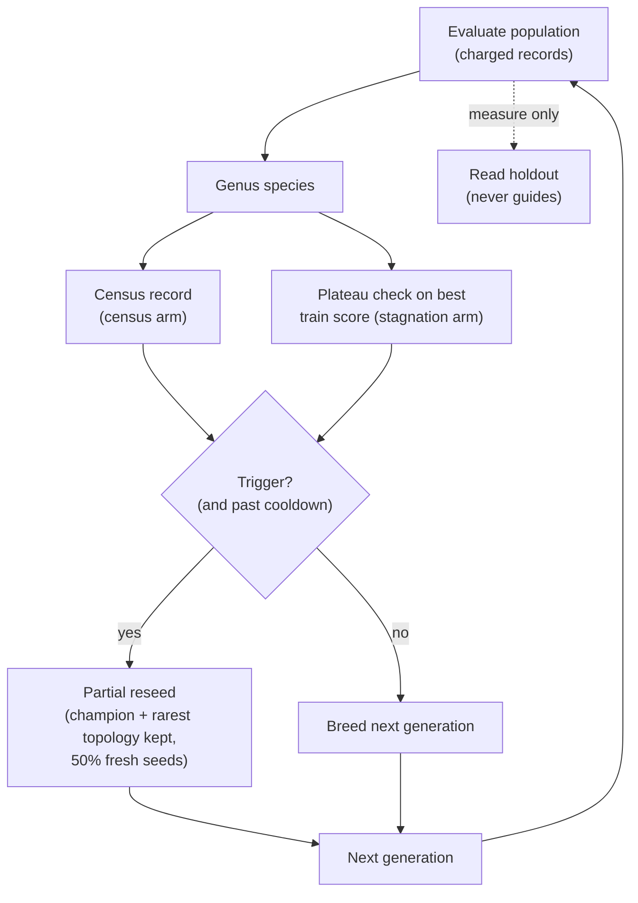

# Offspring-census restarts against stagnation restarts (Issue #4157)

**Finding: negative.** No arm meets the benefit criterion and none is harm. All
three confidence intervals span zero. The census trigger fires earlier than the
stagnation trigger, but the earlier restart does not buy better held-out error.
Do not read this as evidence for the census idea. Do not read it as evidence
against it at production scale either (see [Limitations](#limitations)).

Harness:
[`scripts/census_restart_study.ts`](../../scripts/census_restart_study.ts). Arms
and loop:
[`scripts/lib/censusRestartStudy.ts`](../../scripts/lib/censusRestartStudy.ts).
Tests:
[`test/scripts/CensusRestartStudy.ts`](../../test/scripts/CensusRestartStudy.ts).
Artefact: [`census-restart-4157.json`](./census-restart-4157.json). The harness
changes no production behaviour, and nothing under `src/` imports it.

## What was asked

Does restarting a run when the **offspring census** says the search has stopped
finding new genomes beat restarting when the **best score** has stopped
improving? Three arms:

- **none** — no restarts. The control.
- **stagnation** — restart when the existing `detectPlateau` fires over the best
  train score (window 5, minimum improvement 0.01).
- **census** — restart when the Good–Turing unseen estimate falls below 0.5. The
  estimate is singletons / n over the (species, quantised-genome key) identities
  seen in a rolling window of W generations. The key is
  `CreatureUtil.getTopologyHash` plus biases and weights quantised to step q.

Both restart arms use the **identical partial reseed**: keep the champion and
the rarest-topology individual, replace 50% of the population with fresh seeds,
then hold a 5-generation cooldown. Only the trigger differs.



## Predeclared

- Validation seeds **4157–4186** (30). Calibration seeds **94157–94161** (5).
  Corpus seed **4157** (400 train, 400 holdout records, 64 diversity-probe
  records; synthetic tanh-quadratic corpus).
- Budget: **240,000 charged train records per run**. All 90 validation runs
  spent it in full. The holdout is read every generation for measurement only
  and never guides selection or restarts.
- Population 24, elitism 2, restart cooldown 5 generations, reseed fraction 0.5.
- **Benefit:** CI95 upper bound below 0, win fraction at least 0.6, and
  diversity ratio at least 0.8. **Harm:** CI95 lower bound above 0.
- The census setting (q, W) was chosen on the calibration seeds only, before any
  validation run.

## Calibration and collision sensitivity

Median over 5 calibration seeds of the census arm. Collision rate is the share
of creatures whose key matched another's. Holdout target (median calibration
`none` holdout MSE): **0.01478**.

| q    | W | Median train MSE | Median restarts | Median first restart (records) | Collision rate | Unseen estimate |
| ---- | - | ---------------- | --------------- | ------------------------------ | -------------- | --------------- |
| 0.01 | 3 | 0.01352          | 0               | n/a                            | 0.0727         | 0.876           |
| 0.01 | 6 | 0.01352          | 0               | n/a                            | 0.0893         | 0.855           |
| 0.05 | 3 | 0.01352          | 0               | n/a                            | 0.101          | 0.831           |
| 0.05 | 6 | 0.01352          | 0               | n/a                            | 0.122          | 0.806           |
| 0.2  | 3 | 0.01183          | 2               | 80,000                         | 0.217          | 0.668           |
| 0.2  | 6 | 0.01231          | 1               | 80,000                         | 0.228          | 0.657           |

Chosen: **q = 0.2, W = 3**. Calibration cost: **8,400,000 records** charged,
reported and not part of any validation budget.

## Results

Held-out MSE, arm minus baseline (negative is better), 30 paired seeds.

| Contrast             | Mean diff | CI95                  | Wins  | Diversity ratio | SD ratio (CI95)      | Verdict    |
| -------------------- | --------- | --------------------- | ----- | --------------- | -------------------- | ---------- |
| stagnation vs none   | -0.002768 | [-0.007659, +0.00035] | 8/30  | x1.17           | 0.779 [0.635, 1.001] | no-benefit |
| census vs none       | -0.003062 | [-0.008364, +0.00103] | 12/30 | x9.74           | 0.890 [0.520, 0.990] | no-benefit |
| census vs stagnation | -0.00029  | [-0.004065, +0.0034]  | 12/30 | x8.30           | 1.143 [0.720, 1.353] | no-benefit |

Per-arm summary (30/30 runs completed in every arm):

| Arm        | Median holdout MSE | To-target hits | Median records to target | Median restarts | Median restart delay (records) | Unfilled slots |
| ---------- | ------------------ | -------------- | ------------------------ | --------------- | ------------------------------ | -------------- |
| none       | 0.01467            | 15             | 131,600                  | 0               | n/a                            | 210            |
| stagnation | 0.01484            | 15             | 159,200                  | 1               | 0                              | 58             |
| census     | 0.01486            | 15             | 155,200                  | 2               | -22,400                        | 22             |

Mean species, mean collision rate and mean unseen estimate per arm are in the
JSON (`results`).

## Findings

- **Negative.** No arm meets benefit. None is harm. Every CI spans zero.
- The census fires about **22,400 records before** the stagnation signal (median
  delay -22,400), but is **not better than stagnation**: diff -0.00029, CI
  [-0.0041, +0.0034].
- The trigger is **sensitive to quantisation**. With q at 0.05 or finer the
  census never fired on the calibration seeds (collision rate 0.07–0.12), so
  there was nothing to compare.
- The census arm's diversity ratio (x9.7 against none) comes from freshly
  reseeded random creatures with a large output spread. It is not evidence of
  useful diversity: the mean is dominated by the reseed generations.
- Wins count only strict improvements, and a seed with no restart is identical
  to `none` (diff 0). That is why win counts are low even where the mean moves.

## Limitations

- Synthetic two-input regression with small creatures. It says nothing about
  production-scale creatures.
- arXiv 2610.22211 was **not fetched** (curl to arxiv returned a 403 from the
  proxy in this container). The method is this repository's reading of the
  issue.
- Offspring probabilities are non-stationary and unequal, so the Good–Turing
  estimate is a trigger heuristic, not an accurate estimate of unseen genomes.
- Neuron uuids are part of the topology hash, so only clone families share a
  topology.
- Declined clone pairings (`Offspring.breed` refuses clones) are not observed by
  the census, which can leave it silent when a population has fully stalled.
- Wall-clock is measured (median about 0.4 s per run), not capped.

## Reproduce

```bash
deno task census-restart-study --code-version=$(git rev-parse HEAD) --json=docs/evidence/census-restart-4157.json
```

The JSON was produced at code commit `08c5747f` (the manifest's `codeVersion`).
