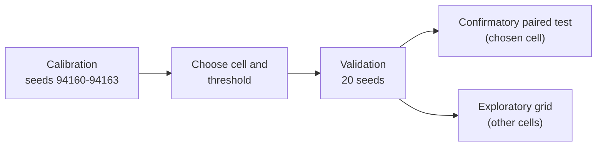

# Initial connectivity and input fan-out as priors (Issue #4160)

Whether starting evolution from a sparse, input-reachable topology beats the
current fully connected initialisation. Produced by
[`scripts/connectivity_prior_study.ts`](../../scripts/connectivity_prior_study.ts);
the machine-readable artefact is
[`connectivity-prior-4160.json`](connectivity-prior-4160.json).

## Verdict

**Negative.** The one cell chosen on calibration seeds, `d3-f1` (hidden mean
in-degree 3, input fan-out 1), is **harmful** against the control in the
confirmatory paired test: mean holdout MSE difference +0.02862 (95% CI [0.01459,
0.04385]), 5 wins and 15 losses over 20 seeds. In the exploratory grid no cell
shows a benefit: six cells are harmful and three are no-benefit. No optional
prior is added; the harness stays only so the finding can be reproduced.

## What was compared

- **Control** is the current initialisation,
  `new Creature(4, 1, { layers: [{ count: 8 }] })`: fully connected, hidden
  in-degree 4 and input fan-out 8.
- **Grid** is 3 × 3: hidden mean in-degree {1.5, 2, 3} × input fan-out {1, 2,
  3}. Each creature is built so every hidden neuron is reachable from an input
  and reaches the output. All arms are forward-only, with `TANH` hidden and
  `IDENTITY` output neurons.
- **Budget** is the same in every arm: 60,000 charged train records, population
  20, (μ+λ) truncation, with the real `Offspring.breed` and `Mutator`.



### Predeclared design

- Validation seeds 4160–4179 (20 seeds), 300 train and 300 holdout records, a
  budget of 60,000 charged train records, population 20, mutation rate 0.5, at
  most 1,000 generations, stalled after 50 generations without progress.
- Bootstrap: 10,000 resamples, seed 4160.
- Calibration seeds 94160–94163 choose the cell by **median train MSE** and set
  the records-to-threshold target to the control's median calibration train MSE.
  The holdout never guides either choice.
- Benefit requires the paired-bootstrap 95% CI of (arm − control) holdout MSE to
  lie below 0, the median holdout MSE to be lower, and the upper-quartile
  holdout MSE (the lower-quartile performance) to be lower. Harm is a CI above
  0. Anything else is no-benefit.
- Only the calibration-chosen cell is confirmatory; every other cell is
  exploratory.

## Results

Chosen cell `d3-f1`; threshold train MSE 0.06356.

### Confirmatory

| Cell    | Mean diff | CI95               | W/L  | Verdict |
| ------- | --------- | ------------------ | ---- | ------- |
| `d3-f1` | +0.02862  | [0.01459, 0.04385] | 5/15 | harm    |

### Exploratory (not confirmatory)

| Cell      | Mean diff | CI95                | W/L   | Verdict    |
| --------- | --------- | ------------------- | ----- | ---------- |
| `d1.5-f1` | +0.03310  | [0.01624, 0.04990]  | 3/17  | harm       |
| `d1.5-f2` | +0.01097  | [-0.00251, 0.02539] | 10/10 | no-benefit |
| `d1.5-f3` | +0.00662  | [-0.00316, 0.01767] | 9/11  | no-benefit |
| `d2-f1`   | +0.03088  | [0.01245, 0.05095]  | 8/12  | harm       |
| `d2-f2`   | +0.01503  | [0.00075, 0.03206]  | 7/13  | harm       |
| `d2-f3`   | +0.00297  | [-0.00697, 0.01417] | 10/10 | no-benefit |
| `d3-f1`   | +0.02862  | [0.01459, 0.04385]  | 5/15  | harm       |
| `d3-f2`   | +0.02752  | [0.00779, 0.04933]  | 10/10 | harm       |
| `d3-f3`   | +0.02120  | [0.00328, 0.04025]  | 7/13  | harm       |

Positive differences mean the arm's holdout MSE is higher (worse) than the
control's.

### Per arm

| Arm                | n  | Median holdout | Upper-quartile holdout | Median train | Median records to threshold | Reached | Stalled |
| ------------------ | -- | -------------- | ---------------------- | ------------ | --------------------------- | ------- | ------- |
| `control`          | 20 | 0.03729        | 0.04695                | 0.03469      | 2.160e+4                    | 19/20   | 0       |
| `d1.5-f1`          | 20 | 0.06908        | 0.09615                | 0.06177      | 3.825e+4                    | 10/20   | 0       |
| `d1.5-f2`          | 20 | 0.03762        | 0.07496                | 0.03415      | 1.920e+4                    | 14/20   | 0       |
| `d1.5-f3`          | 20 | 0.03691        | 0.05376                | 0.03467      | 2.325e+4                    | 16/20   | 0       |
| `d2-f1`            | 20 | 0.06089        | 0.09893                | 0.05435      | 2.550e+4                    | 11/20   | 0       |
| `d2-f2`            | 20 | 0.04600        | 0.05448                | 0.04432      | 3.300e+4                    | 17/20   | 0       |
| `d2-f3`            | 20 | 0.04169        | 0.05583                | 0.03835      | 2.910e+4                    | 19/20   | 0       |
| `d3-f1`            | 20 | 0.05734        | 0.08857                | 0.05598      | 2.475e+4                    | 12/20   | 0       |
| `d3-f2`            | 20 | 0.04411        | 0.09332                | 0.04268      | 2.385e+4                    | 14/20   | 0       |
| `d3-f3`            | 20 | 0.05416        | 0.07527                | 0.05312      | 4.290e+4                    | 15/20   | 0       |
| `control-selfloop` | 20 | 0.04488        | 0.06514                | 0.04025      | 3.795e+4                    | 16/20   | 0       |

### Calibration cost and coverage

Calibration consumed 2,640,000 charged records (all eleven arms, including the
self-loop arm). Coverage was complete: 264 expected runs, 264 completed, 0
failures.

### Search economics

The control reached the threshold in 19 of 20 runs at a median of 21,600
records. No sparse cell matched that reach: the nearest were `d2-f3` (19/20, at
29,100 records) and `d2-f2` (17/20). Only `d1.5-f2` reached it in fewer median
records (19,200), and it did so in 14 of 20 runs, with a worse upper-quartile
holdout (0.07496 against 0.04695). Starting sparse did not buy a cheaper search.

### Self-loops

Tested only on the already-supported recurrent path; no forward-only engine was
changed. The grid cells run forward-only (the production default). One
exploratory arm, `control-selfloop`, is the control topology plus a self-loop on
every hidden neuron (8 self-loops), built with `forwardOnly: false` and evolved
with `feedbackLoop: true` and `disableRandomSamples: true`. It is also _scored_
on the recurrent path: `scoreCreature` is called with `feedbackLoop: true`, so
state carries from one record to the next in corpus order, from a state cleared
once per score. (The stateless default resets state before every record, which
zeroes a self-loop's contribution; an earlier run of this study scored the arm
that way and its self-loop result is withdrawn.) The arm is never a calibration
candidate.

| Arm (vs control)   | Mean diff | CI95                 | W/L  | Verdict      |
| ------------------ | --------- | -------------------- | ---- | ------------ |
| `control-selfloop` | +0.01213  | [−0.001913, +0.0277] | 9/11 | `no-benefit` |

Its median holdout MSE (0.04488) and upper quartile (0.06514) are higher (worse)
than the control's (0.03729 and 0.04695), but the CI spans zero. In all 20
validation runs the best creature had **no self-loops left** (`selfLoops.final`
is 0): evolution removed them. On this static regression, self-loops are neither
kept nor a benefit.

## Limitations

- A synthetic 4-input regression with one distractor input and small creatures;
  not production scale.
- arXiv 2610.33498 was not read (the fetch failed during the issue audit). The
  method is this repository's reading of the issue.
- The hidden count is fixed at 8.
- There is no wall-clock cap; records stand in for compute.
- Outcome: no optional prior is added. The harness stays only to reproduce this
  finding.

## Reproduce

```bash
deno task connectivity-prior-study --code-version=20b8f005 \
  --json=docs/evidence/connectivity-prior-4160.json
```

---

**Up to:** [`docs/README.md`](../README.md) (topic index).
