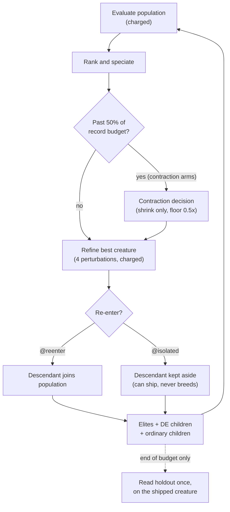

# Differential-weight offspring and delayed contraction (Issue #4156)

**Finding: negative, and the paper's method is untested.** No arm meets the
benefit criterion and none is harm. On a synthetic objective,
differential-weight (DE) offspring were not better on held-out error and, in the
`@isolated` arms, had about twice the spread across seeds. Delayed population
contraction was about neutral. Do not read this as evidence for either idea; do
not read it as evidence against them at GRQ scale either (see
[Limits](#limits)). The paper the issue cites was never read, so this is a test
of this repository's reading of the issue, **not** of the paper's method (see
[Paper not read](#paper-not-read)).

Harness:
[`scripts/differential_weight_study.ts`](../../scripts/differential_weight_study.ts).
Arms and loop:
[`scripts/lib/differentialWeightStudy.ts`](../../scripts/lib/differentialWeightStudy.ts).
Tests:
[`test/scripts/DifferentialWeightStudy.ts`](../../test/scripts/DifferentialWeightStudy.ts).
Artefact: [`differential-weight-4156.json`](./differential-weight-4156.json).
The harness changes no production behaviour, and nothing under `src/` imports
it.

## What was asked

A 2×2 of two opt-in ideas:

- **DE weight-only offspring** — about 20% of offspring slots are built by
  differential evolution, within a species, over homologous genes.
- **Delayed contraction** — shrink the population once the run is well advanced,
  rather than from the start.

Each cell is crossed with whether **local-refinement descendants re-enter the
population** (`@reenter`) or are kept aside (`@isolated`). That gives eight
arms. The budget is equal: every arm is charged the same number of training
records.

## Method

- **DE offspring.** DE/rand/1/bin, weight-only, within the target's Genus
  species, over homologous genes keyed by neuron uuid and by the synapse
  `(fromUUID, toUUID, type)`. F = 0.5, CR = 0.9. Topology, squashes and uuids
  are unchanged, so genome alignment and activation semantics are preserved.
  Parents are cloned through export and never modified.
- **Delayed contraction.** Reuses the runner's existing shrink rule,
  `computeAdaptivePopulationSize` in
  [`src/NEAT/AdaptivePopulationSizer.ts`](../../src/NEAT/AdaptivePopulationSizer.ts),
  with `detectPlateau`. It is gated until 50% of the record budget, can never
  grow, and stops at a floor of 0.5× the starting population. Two deviations
  from production, stated plainly:
  - `highDiversityThreshold` is **0**, against a production default of 0.8.
  - The grow branch is neutralised with `lowDiversityThreshold` **0**.

  The reason for both: a 3-seed pilot showed 1.3–2.3 species per 24 creatures,
  so the shrink branch never fired and the grow branch always did. With the
  production values the contraction arms would have been identical to the
  control.

- **Local refinement** is a stand-in for production backprop: 4 Gaussian weight
  perturbations of the best creature each generation (σ = 0.1), charged in every
  arm. `@reenter` arms let the improved descendant join the population, as
  trained creatures do in production. `@isolated` arms keep it aside, so it can
  ship but never breeds.
- **Ordinary offspring** are topped up with retries. Slots that still cannot be
  filled are reported per arm in [Coverage](#coverage).



## Predeclared

- **Seeds.** Validation seeds are 14156–14185 (30), a range no earlier run used
  (see [Preparation and search cost](#preparation-and-search-cost)); the CLI
  refuses any validation range that overlaps 4156–4185, the range the earlier
  runs used. Calibration seeds are 94156–94160 (5), a disjoint range, used only
  to set the time-to-target threshold: the median final train MSE of
  `control@reenter`, which came out at **0.01406**. Calibration cost 1,200,000
  records and is reported separately from the arms.
- **Budget.** 240,000 charged train records per run, population 24, elitism 2,
  400 train and 400 holdout records. The diversity probe uses 64 train records
  and is uncharged.
- **Holdout** is read once, at the end, on the shipped creature, and never
  guides anything.
- **Criteria.** _Benefit_ iff the paired held-out MSE CI95 upper bound is < 0,
  the win fraction is ≥ 0.6, and the behavioural diversity ratio is ≥ 0.8.
  _Harm_ iff the CI95 lower bound is > 0. Otherwise _no-benefit_. The bootstrap
  uses 10,000 resamples with seed 4156.

## Versions

| Item              | Value                                                                  |
| ----------------- | ---------------------------------------------------------------------- |
| NEAT-AI           | 7.1.18                                                                 |
| NEAT-AI-core      | rev `1d44889e405e4e0cfb553321b44cc39e7d771f5f`                         |
| Deno              | 2.9.8                                                                  |
| Corpus            | `synthetic-tanh-quadratic-v1`, seed 4156                               |
| Run `codeVersion` | `eccc679237c09bcb231ea31e1b746f26a9d28d0d+review-fix-4165-uncommitted` |

The run was made from commit `eccc6792` plus the working-tree changes that
answer the review of PR #4165 (the time-to-target fix and the new tests); those
changes are the PR head. Re-running on the PR head reproduces the artefact apart
from `wallMs` and the version fields (`codeVersion`, `neatAiVersion`).

## Results

Held-out MSE, arm minus control; negative is better. Values are from the
`comparisons` array of the JSON, at 4 significant figures.

| Contrast                                        |  Mean diff |                     CI95 |  Wins | SD ratio [CI95]        | Time to target (arm / control; median paired diff) | Diversity | Species | Wall median | Verdict    |
| ----------------------------------------------- | ---------: | -----------------------: | ----: | ---------------------- | -------------------------------------------------- | --------: | ------: | ----------: | ---------- |
| `de@reenter` vs `control@reenter`               |  +0.001011 |   [−0.003855, +0.006055] | 13/30 | 1.083 [0.8564, 1.591]  | 13 / 18; −29,600 records (12 pairs)                |     0.956 |   0.842 |       1.018 | no-benefit |
| `contraction@reenter` vs `control@reenter`      | −0.0004414 | [−0.001045, +0.00002327] | 12/30 | 1.003 [0.9730, 1.028]  | 20 / 18; 0 records (18 pairs)                      |     0.911 |   0.930 |       1.052 | no-benefit |
| `de+contraction@reenter` vs `control@reenter`   | +0.0009067 |   [−0.003977, +0.005996] | 15/30 | 1.087 [0.8590, 1.600]  | 13 / 18; −29,600 records (12 pairs)                |     0.924 |   0.788 |       1.013 | no-benefit |
| `de@isolated` vs `control@isolated`             |  +0.009092 |    [−0.001477, +0.02131] | 13/30 | 1.967 [1.022, 3.071]   | 10 / 16; −42,000 records (8 pairs)                 |     0.993 |   0.889 |       0.872 | no-benefit |
| `contraction@isolated` vs `control@isolated`    | −0.0003739 | [−0.001037, +0.00007308] |  8/30 | 0.9728 [0.8907, 1.027] | 17 / 16; 0 records (16 pairs)                      |     0.980 |   0.991 |       1.085 | no-benefit |
| `de+contraction@isolated` vs `control@isolated` |  +0.009771 |   [−0.0006339, +0.02190] | 12/30 | 1.970 [1.056, 3.062]   | 10 / 16; −42,000 records (8 pairs)                 |     0.970 |   0.867 |       0.814 | no-benefit |
| `control@isolated` vs `control@reenter`         |  −0.002859 |    [−0.01138, +0.003644] | 12/30 | 0.6739 [0.4014, 1.243] | 16 / 18; +34,000 records (12 pairs)                |     0.914 |   1.081 |       1.272 | no-benefit |

"Wins" counts the seeds on which the arm beat its control. Time to target counts
the seeds (of 30) that reached the 0.01406 train-MSE threshold; the median
difference is over seeds where both reached it, and a negative value means the
arm took fewer records.

**How time to target is read.** The threshold is met the moment _any_ scored
creature reaches it: a member of the population, or a refined descendant whether
it re-enters or is kept aside. It is read when the creature is scored, at the
records charged by then. Every creature that can ship is therefore covered, and
a run whose shipped creature has `finalTrainMse` at or below the threshold
always reports a time. In the JSON, the number of seeds with a time equals the
number of seeds with `finalTrainMse` at or below 0.01406 in every arm (18, 13,
20, 13, 16, 10, 17 and 10 across the arms in coverage order). An earlier
reading, which looked only at the breeding population's best, missed creatures
that shipped from an isolated refinement; that run is counted under
[preparation cost](#preparation-and-search-cost) and not reported.

## Coverage

Every arm completed 30/30 seeds with no failures.

| Arm                       | Completed | Generations | Evals per generation | Unfilled slots |
| ------------------------- | --------: | ----------: | -------------------: | -------------: |
| `control@reenter`         |     30/30 |         720 |                 25.0 |             46 |
| `de@reenter`              |     30/30 |         798 |                 22.6 |          2,088 |
| `contraction@reenter`     |     30/30 |         817 |                 22.0 |            724 |
| `de+contraction@reenter`  |     30/30 |         864 |                 20.8 |          1,527 |
| `control@isolated`        |     30/30 |         700 |                 25.7 |            124 |
| `de@isolated`             |     30/30 |         693 |                 26.0 |             26 |
| `contraction@isolated`    |     30/30 |         724 |                 24.9 |            139 |
| `de+contraction@isolated` |     30/30 |         717 |                 25.1 |             53 |

Unfilled slots are concentrated in a few seeds whose population has converged,
where `Offspring.breed` returns clones and declines them. One `de@reenter` seed
runs 101 generations and accounts for 2,038 of that arm's 2,088 unfilled slots;
a `de+contraction@reenter` seed accounts for 1,167 of 1,527. Generations and
evaluations per generation differ between arms for the same reason, so the
equal-records budget does not mean equal generations.

DE slots: across `de@reenter`, 3,076 slots were requested, 2,348 became DE
children and 728 fell back to ordinary breeding because no species held four
scored members.

## Finding

- **DE is not better on held-out MSE** (+0.001011 for `de@reenter` and +0.009092
  for `de@isolated`, each CI spanning 0). It has more spread across seeds under
  isolation: the SD ratio is 1.97 for `de@isolated` and
  `de+contraction@isolated` and its CI excludes 1 ([1.022, 3.071] and [1.056,
  3.062]); under re-entry it is 1.08–1.09 with CIs spanning 1. DE reaches the
  time-to-target threshold on fewer seeds (13 against 18 under re-entry, 10
  against 16 isolated), and when both reach it, DE takes fewer records (−29,600
  and −42,000 median paired). Behavioural diversity is held (ratios 0.92–0.99,
  all above the 0.8 floor).
- **Delayed contraction is about neutral.** Under re-entry the difference is
  −0.0004414 with CI [−0.001045, +0.00002327], and it wins on 12/30 seeds;
  isolated it is −0.0003739 with CI [−0.001037, +0.00007308], 8/30. The upper
  ends are just above zero and the win fractions are well under 0.6, so neither
  meets the benefit criterion, however small the absolute effect.
- **Isolating refinement descendants versus re-entry is not distinguishable.**
  The difference is −0.002859 (isolated slightly better), CI [−0.01138,
  +0.003644]. The earlier discarded run on seeds 4156–4185 had the opposite sign
  for this contrast, which is what noise looks like here.
- No contrast meets the benefit criterion, and no contrast meets the harm
  criterion, since every CI spans 0.

## Preparation and search cost

The validation arms are not the only records the study spent. The manifest
(`preparation` in the JSON) records the rest, with the most each run could have
charged (240,000 records per run is the cap):

| Run                                                                                                                              | Seeds                                                | Records charged                                                  |
| -------------------------------------------------------------------------------------------------------------------------------- | ---------------------------------------------------- | ---------------------------------------------------------------- |
| Calibration (reported)                                                                                                           | 94156–94160                                          | 1,200,000                                                        |
| Pilot that set `contractionHighDiversityThreshold` to 0                                                                          | **not recorded**                                     | **not recorded**; at most 3 seeds × 8 arms × 240,000 = 5,760,000 |
| First full run, discarded: ordinary breeding left slots empty, so the top-up retry was added                                     | **not recorded**; the CLI default then was 4156–4185 | **not recorded**; at most 30 × 8 × 240,000 = 57,600,000          |
| Second full run on 4156–4185, discarded: time to target ignored shippable creatures that were not the population's best (review) | 4156–4185                                            | at most 30 × 8 × 240,000 = 57,600,000                            |
| Reported validation                                                                                                              | 14156–14185                                          | 30 × 8 × 240,000 = 57,600,000                                    |

The pilot's and the first full run's seeds and records were not written down
when they were made, and cannot be recovered. The honest reading is that the
earlier full runs probably used the CLI default, which was the validation range
4156–4185. The pilot and those runs shaped three decisions: the contraction
thresholds, the top-up retry and the time-to-target reading. So the original
validation seeds had been seen before the harness was finalised. The reported
validation was therefore **re-run on a fresh range, 14156–14185, which no
earlier run used**, rather than defending the claim that 4156–4185 was
untouched. Nothing was changed after seeing the 14156–14185 results.

The calibration threshold (0.01406) was set on 94156–94160 and is unchanged by
the time-to-target fix: that fix changes what is measured, not any trajectory.

## Paper not read

The issue says to read and pin the paper's full method before reproducing it.
That was not done: arXiv 2610.26202 could not be fetched (proxy 403). The DE
variant (DE/rand/1/bin), F = 0.5, CR = 0.9, the 20% share, the contraction
schedule and the refinement stand-in are this repository's own reading of the
issue. The manifest records `paper.methodRead: false`. This PR therefore does
**not** close the issue: it is part of #4156, and the prerequisite stays open
until the paper's method is obtained, pinned, and either confirmed against this
harness or the harness adjusted. Until then the negative result applies to this
reading and says nothing about the paper's method.

## Limits

- The objective is synthetic and the creatures are small. The result says
  nothing about GRQ-scale corpora.
- Local refinement is a perturbation stand-in, not backprop.
- The contraction arms use deviated diversity thresholds (above), so they test
  the policy's shape, not production's tuning.
- The paper (<https://arxiv.org/abs/2610.26202>) was not read, so the method is
  this repository's reading of the issue and **untested against the paper**.
- Seeds and records of the pilot and the first full run were not recorded (see
  [Preparation and search cost](#preparation-and-search-cost)).
- Wall-clock was measured but not capped; the budget held equal is records.

## Reproduce

```bash
deno task differential-weight-study --code-version=$(git rev-parse HEAD) --json=docs/evidence/differential-weight-4156.json
```
