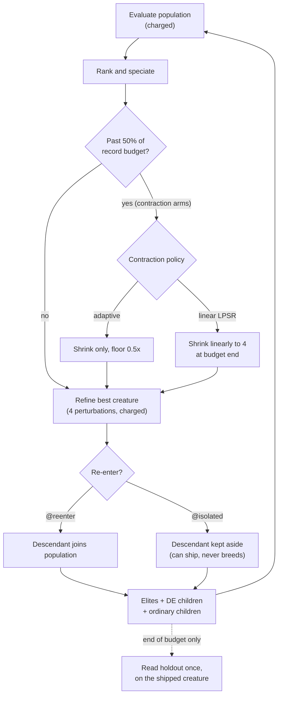

# Differential-weight offspring and delayed contraction (Issue #4156)

**Finding: negative on fresh validation seeds, mixed at equal wall-clock, and
the paper's method is only partly pinned.** At equal records no arm meets the
benefit criterion and none is harm. On a synthetic objective,
differential-weight (DE) offspring were not better on held-out error. Delayed
population contraction, by the existing adaptive rule, was about neutral. The
paper's own mechanism, a delayed linear population-size reduction (LPSR, section
3.3 of [arXiv 2610.26202](https://arxiv.org/abs/2610.26202)), was tested as well
and was not better here either: it also cut behavioural diversity below the 0.8
floor. Do not read this as evidence for any of these ideas; do not read it as
evidence against them at GRQ scale either (see [Limits](#limits)). The paper's
full text could not be fetched, so only part of its method is pinned (see
[Paper (partly pinned)](#paper-partly-pinned)). When wall-clock, not records, is
the budget held equal, one contrast is harm by the predeclared criteria
(`contraction@reenter`, a difference of +0.0003255) and `lpsr@reenter` leans
better but fails the diversity floor (see
[Equal wall-clock](#equal-wall-clock)).

Harness:
[`scripts/differential_weight_study.ts`](../../scripts/differential_weight_study.ts).
Arms and loop:
[`scripts/lib/differentialWeightStudy.ts`](../../scripts/lib/differentialWeightStudy.ts).
Tests:
[`test/scripts/DifferentialWeightStudy.ts`](../../test/scripts/DifferentialWeightStudy.ts).
Artefact: [`differential-weight-4156.json`](./differential-weight-4156.json).
The harness changes no production behaviour, and nothing under `src/` imports
it.

## What was asked

Two opt-in ideas, with the second taken in three policies:

- **DE weight-only offspring** — about 20% of offspring slots are built by
  differential evolution, within a species, over homologous genes. Two settings:
  off or on.
- **Delayed contraction** — shrink the population once the run is well advanced,
  rather than from the start. Three policies: none, the repository's existing
  adaptive rule, and the paper's delayed L-SHADE linear population-size
  reduction.

That is 2 DE settings × 3 contraction policies. Each cell is crossed with
whether **local-refinement descendants re-enter the population** (`@reenter`) or
are kept aside (`@isolated`), which gives twelve arms: per re-entry setting,
`control`, `de`, `contraction`, `de+contraction`, `lpsr` and `de+lpsr`. The
budget is equal: every arm is charged the same number of training records.

The LPSR arms were added to test the paper's mechanism alongside the existing
rule. The issue asks for existing mechanisms to be reused, which the adaptive
rule does; the paper's delayed LPSR is a different schedule and is tested
separately so that neither stands in for the other.

## Method

- **DE offspring.** DE/rand/1/bin, weight-only, within the target's Genus
  species, over homologous genes keyed by neuron uuid and by the synapse
  `(fromUUID, toUUID, type)`. F = 0.5, CR = 0.9. Topology, squashes and uuids
  are unchanged, so genome alignment and activation semantics are preserved.
  Parents are cloned through export and never modified.
- **Delayed contraction (adaptive).** Reuses the runner's existing shrink rule,
  `computeAdaptivePopulationSize` in
  [`src/NEAT/AdaptivePopulationSizer.ts`](../../src/NEAT/AdaptivePopulationSizer.ts),
  with `detectPlateau`. It is gated until 50% of the record budget, can never
  grow, and stops at a floor of 0.5× the starting population. Two deviations
  from production, stated plainly:
  - `highDiversityThreshold` is **0**, against a production default of 0.8.
  - The grow branch is neutralised with `lowDiversityThreshold` **0**.

  The reason for both: a 3-seed pilot showed 1.3–2.3 species per 24 creatures,
  so the shrink branch never fired and the grow branch always did. With the
  production values the contraction arms would have been identical to the
  control.

- **Delayed LPSR.** The paper's delayed L-SHADE linear population-size reduction
  (`delayedLinearSize`). The population is held at the base size of 24 until 50%
  of the record budget (`contractionDelayFraction`), then N = round((24 − 4) ·
  (1 − progress)) + 4, where progress runs from 0 at the delay to 1 at budget
  exhaustion. It falls linearly to N_min = 4 (`lpsrMinPopulationSize`, L-SHADE's
  N_min per Tanabe & Fukunaga 2014) and never grows. Every LPSR run therefore
  ends at size 4. The 50% delay is this study's choice, because the paper's
  delay cap was not obtained.
- **Local refinement** is a stand-in for production backprop: 4 Gaussian weight
  perturbations of the best creature each generation (σ = 0.1), charged in every
  arm. `@reenter` arms let the improved descendant join the population, as
  trained creatures do in production. `@isolated` arms keep it aside, so it can
  ship but never breeds.
- **Ordinary offspring** are topped up with retries. Slots that still cannot be
  filled are reported per arm in [Coverage](#coverage).



## Predeclared

- **Seeds.** Validation seeds are 24156–24185 (30), a fresh range. The CLI
  refuses any validation range that overlaps 4156–4185, 14156–14185 or
  34156–34185, because all three were seen: 4156–4185 shaped the harness,
  14156–14185 produced PR #4165's reported 8-arm validation and a 12-arm re-run,
  and 34156–34185 was the first equal-wall-clock phase (see
  [Preparation and search cost](#preparation-and-search-cost)). Calibration
  seeds are 94156–94160 (5), a disjoint range, used only to set the
  time-to-target threshold: the median final train MSE of `control@reenter`,
  which came out at **0.01406** and is unchanged. Calibration cost 1,200,000
  records and is reported separately from the arms.
- **LPSR settings.** The delay (50% of the record budget) and N_min (4) were
  fixed from the paper and from L-SHADE before the 24156 run, and nothing was
  changed after seeing it. The 8-arm results on 14156–14185 were known before
  the LPSR arms were designed; that is disclosed here and is why validation
  moved to a fresh range.
- **Budget.** 240,000 charged train records per run, population 24, elitism 2,
  400 train and 400 holdout records. The diversity probe uses 64 train records
  and is uncharged.
- **Holdout** is read once, at the end, on the shipped creature, and never
  guides anything.
- **Criteria.** _Benefit_ iff the paired held-out MSE CI95 upper bound is < 0,
  the win fraction is ≥ 0.6, and the behavioural diversity ratio is ≥ 0.8.
  _Harm_ iff the CI95 lower bound is > 0. Otherwise _no-benefit_. The bootstrap
  uses 10,000 resamples with seed 4156.

## Versions

| Item              | Value                                          |
| ----------------- | ---------------------------------------------- |
| NEAT-AI           | 7.1.23                                         |
| NEAT-AI-core      | rev `1d44889e405e4e0cfb553321b44cc39e7d771f5f` |
| Deno              | 2.9.8                                          |
| Corpus            | `synthetic-tanh-quadratic-v1`, seed 4156       |
| Run `codeVersion` | `d85139e6` + review fix (see below)            |

The run was made from commit `d85139e6` plus the working-tree change that
answers review of PR #4177 (the manifest's `codeVersion` is
`d85139e6919353cd3ccdfd107e2296cd8a5397f6+uncommitted-review-fix`). That change
was uncommitted when the study ran, because the review-fix worker cannot commit;
it is committed straight after, and `git diff d85139e6 HEAD -- scripts test` on
the pushed head is the code the run used. The change touches only the
equal-wall-clock path and the result collection. Evidence that the record-budget
phase is unchanged: its 360 results equal those of the run at `b224f0df` field
for field, apart from `wallMs`, and its 11 contrasts equal that run's apart from
`wallClockMedianRatio` and the new `attempted` field. The equal-wall-clock phase
uses a real clock, so it is not bit-reproducible.

## Results

Held-out MSE, arm minus control; negative is better. Values are from the
`comparisons` array of the JSON, at 4 significant figures.

| Contrast                                        |  Mean diff |                      CI95 |  Wins | SD ratio [CI95]        | Time to target (arm / control; median paired diff) | Diversity | Species | Wall median | Verdict    |
| ----------------------------------------------- | ---------: | ------------------------: | ----: | ---------------------- | -------------------------------------------------- | --------: | ------: | ----------: | ---------- |
| `de@reenter` vs `control@reenter`               |  +0.001649 |    [−0.004733, +0.007948] | 17/30 | 0.878 [0.4918, 4.010]  | 18 / 18; +9,200 records (15 pairs)                 |      1.07 |   0.866 |       1.042 | no-benefit |
| `contraction@reenter` vs `control@reenter`      | −0.0002824 | [−0.0007422, +0.00002502] |  9/30 | 1.008 [0.9957, 1.074]  | 18 / 18; 0 records (18 pairs)                      |     0.972 |   0.973 |       1.053 | no-benefit |
| `de+contraction@reenter` vs `control@reenter`   |  +0.002744 |    [−0.003932, +0.009217] | 16/30 | 0.9034 [0.5141, 4.240] | 17 / 18; +7,000 records (14 pairs)                 |      1.03 |   0.831 |       1.091 | no-benefit |
| `lpsr@reenter` vs `control@reenter`             |  +0.001361 |    [−0.001069, +0.005618] | 16/30 | 1.150 [0.9956, 3.489]  | 19 / 18; 0 records (18 pairs)                      |     0.723 |   0.686 |       1.114 | no-benefit |
| `de+lpsr@reenter` vs `control@reenter`          |  +0.002630 |    [−0.004513, +0.009868] | 16/30 | 0.9899 [0.4911, 4.921] | 18 / 18; +7,000 records (16 pairs)                 |     0.846 |   0.630 |      0.9695 | no-benefit |
| `de@isolated` vs `control@isolated`             |  +0.001957 |    [−0.001639, +0.005254] |  7/30 | 1.106 [0.8699, 1.282]  | 12 / 13; +24,400 records (11 pairs)                |      1.07 |   0.857 |      0.9437 | no-benefit |
| `contraction@isolated` vs `control@isolated`    | +0.0001788 |    [−0.001087, +0.001201] |  3/30 | 0.9682 [0.8291, 1.110] | 12 / 13; 0 records (12 pairs)                      |     0.957 |   0.969 |       1.013 | no-benefit |
| `de+contraction@isolated` vs `control@isolated` |  +0.001967 |    [−0.001602, +0.005188] |  6/30 | 1.100 [0.8623, 1.274]  | 11 / 13; +14,600 records (10 pairs)                |      1.07 |   0.835 |       1.083 | no-benefit |
| `lpsr@isolated` vs `control@isolated`           |  +0.002685 |   [−0.0002460, +0.006183] | 11/30 | 1.167 [1.012, 1.445]   | 13 / 13; 0 records (11 pairs)                      |     0.650 |   0.652 |       1.068 | no-benefit |
| `de+lpsr@isolated` vs `control@isolated`        |  +0.002231 |    [−0.001424, +0.006005] | 11/30 | 1.066 [0.7866, 1.387]  | 14 / 13; +15,000 records (12 pairs)                |     0.875 |   0.628 |       1.016 | no-benefit |
| `control@isolated` vs `control@reenter`         |  +0.002116 |    [−0.004805, +0.008168] | 16/30 | 0.7495 [0.4521, 3.746] | 13 / 18; +14,000 records (11 pairs)                |      1.01 |    1.09 |       1.097 | no-benefit |

"Wins" counts the seeds on which the arm beat its control. Time to target counts
the seeds (of 30) that reached the 0.01406 train-MSE threshold; the median
difference is over seeds where both reached it, and a negative value means the
arm took fewer records.

**How time to target is read.** The threshold is met the moment _any_ scored
creature reaches it: a member of the population, or a refined descendant whether
it re-enters or is kept aside. It is read when the creature is scored, at the
records charged by then. Every creature that can ship is therefore covered, and
a run whose shipped creature has `finalTrainMse` at or below the threshold
always reports a time. In the JSON, the number of seeds with a time equals the
number of seeds with `finalTrainMse` at or below 0.01406 in every arm (18, 18,
18, 17, 19, 18, 13, 12, 12, 11, 13 and 14 across the arms in coverage order). An
earlier reading, which looked only at the breeding population's best, missed
creatures that shipped from an isolated refinement; that run is counted under
[preparation cost](#preparation-and-search-cost) and not reported.

## Equal wall-clock

The issue asks to hold evaluation **and** wall-clock budgets equal. The
record-budget phase above holds records equal and only measures wall-clock. A
second phase therefore holds wall-clock equal:

- Every arm gets the same **600 ms** per run (`WALL_CLOCK_BUDGET_MS`). The value
  was fixed before this phase ran, at the order of one record-budget run here.
- The cap is checked before every generation, every creature scored and every
  refinement **candidate**, and no breeding starts once it is spent. At most one
  evaluation that began before the deadline finishes after it. An earlier
  version of this phase checked only before the whole refinement batch, so up to
  three further candidates (four by default) could be scored after the deadline.
  Review found that, and the phase was re-run on fresh seeds.
- The record budget is raised to 2,400,000 (ten times the primary) so the clock,
  not the records, stops each run.
- The contraction schedules read budget progress from the elapsed share of the
  600 ms, so the 50% delay and the LPSR line run on time.
- Fresh seeds 44156–44185, disjoint from every other range. 34156–34185 was the
  first version's range and is now refused. Runs are seed-major, and at each
  seed the arm order is rotated, so drift in machine load falls on every arm
  alike.
- A run that ends with no scored creature (for example, a clock spent during
  set-up) is **censored**: it is listed under `censored` with its reason and
  costs, is left out of every paired statistic, and is counted in coverage. A
  contrast with no paired seed has the verdict `insufficient-data`, not
  `no-benefit`. No run was censored here.

**Budgets held.** All 360 runs (12 arms × 30 seeds) were stopped by the clock,
with no failures and none censored. The median wall-clock per arm was 601–603
ms. The arms converted that equal time into different numbers of records:
medians run from 222,000 (`control@reenter`) to 252,600 (`de@reenter`). Two runs
overshot by more than 50 ms: `de+contraction@reenter` at seed 44168 took 1,620
ms and `lpsr@isolated` at seed 44174 took 771 ms, charging only 118,400 records.
Both look like machine stalls. They are kept in the results.

| Contrast (arm vs control)                       |  Mean diff |                      CI95 |  Wins | Diversity | Verdict    |
| ----------------------------------------------- | ---------: | ------------------------: | ----: | --------: | ---------- |
| `de@reenter` vs `control@reenter`               |  +0.001537 |    [−0.001390, +0.005233] | 17/30 |      1.04 | no-benefit |
| `contraction@reenter` vs `control@reenter`      | +0.0003255 | [+0.00004435, +0.0006819] |  7/30 |     0.959 | **harm**   |
| `de+contraction@reenter` vs `control@reenter`   |  +0.001476 |    [−0.001396, +0.005050] | 16/30 |      1.02 | no-benefit |
| `lpsr@reenter` vs `control@reenter`             |  −0.002561 |  [−0.006084, −0.00008183] | 18/30 |     0.729 | no-benefit |
| `de+lpsr@reenter` vs `control@reenter`          |  +0.001958 |    [−0.001037, +0.005569] | 16/30 |     0.870 | no-benefit |
| `de@isolated` vs `control@isolated`             |  +0.002643 |    [−0.002483, +0.007725] | 13/30 |     0.976 | no-benefit |
| `contraction@isolated` vs `control@isolated`    |  +0.001633 |  [−0.00008441, +0.004103] |  9/30 |     0.990 | no-benefit |
| `de+contraction@isolated` vs `control@isolated` |  +0.003510 |    [−0.001975, +0.008828] | 14/30 |     0.969 | no-benefit |
| `lpsr@isolated` vs `control@isolated`           |  +0.001044 |    [−0.002485, +0.004406] | 15/30 |     0.757 | no-benefit |
| `de+lpsr@isolated` vs `control@isolated`        |  +0.004678 |     [−0.001138, +0.01050] | 13/30 |     0.753 | no-benefit |
| `control@isolated` vs `control@reenter`         |  +0.001987 |    [−0.003150, +0.007368] |  8/30 |      1.02 | no-benefit |

This phase is **not** a repeat of the record-budget result, and it is not simply
negative:

- **`contraction@reenter` is harm** by the predeclared criterion, since its CI95
  lower bound is above zero (+0.00004435). The difference is +0.0003255 on a
  control that scores around 0.01–0.04, so it is very small, and it is one of 11
  contrasts, so a single such result is about what chance gives. Under
  isolation, the same arm is +0.001633 with a CI that spans zero.
- **`lpsr@reenter` leans better.** Its CI95 upper bound is below zero
  (−0.00008183) and it wins 18 of 30, which meets the win fraction of 0.6. It is
  **not** a benefit, because its behavioural diversity is 0.729 of the
  control's, below the 0.8 floor. That floor was predeclared and is why the
  verdict is `no-benefit`. At equal records the same arm was +0.001361 with a CI
  that spanned zero, and `lpsr@isolated` here is +0.001044, so the direction
  does not hold across the pair.
- No DE arm is better, and the DE lean under isolation seen on the first
  wall-clock seeds (21, 18 and 23 wins) did **not** replicate: 13, 14 and 13
  wins. Isolation versus re-entry is again not distinguishable (8 wins of 30).

None of this is established at this sample size, and 600 ms on a shared
container is far from the paper's 15 minutes. Per-run results, coverage and
contrasts are under `wallClockPhase` in the artefact. The earlier run's table on
34156–34185 (the version that scored refinement candidates after the deadline)
is superseded, and its cost is counted in
[Preparation and search cost](#preparation-and-search-cost).

## Coverage

Every arm completed 30/30 seeds with no failures and no censored runs.

| Arm                       | Completed | Generations | Evals per generation | Unfilled slots |
| ------------------------- | --------: | ----------: | -------------------: | -------------: |
| `control@reenter`         |     30/30 |         726 |                 24.8 |            169 |
| `de@reenter`              |     30/30 |         721 |                 25.0 |             22 |
| `contraction@reenter`     |     30/30 |         755 |                 23.8 |            312 |
| `de+contraction@reenter`  |     30/30 |         766 |                 23.5 |            159 |
| `lpsr@reenter`            |     30/30 |       1,161 |                 15.5 |          1,606 |
| `de+lpsr@reenter`         |     30/30 |       1,075 |                 16.7 |            674 |
| `control@isolated`        |     30/30 |         700 |                 25.7 |            135 |
| `de@isolated`             |     30/30 |         695 |                 25.9 |             14 |
| `contraction@isolated`    |     30/30 |         751 |                 24.0 |            544 |
| `de+contraction@isolated` |     30/30 |         717 |                 25.1 |             21 |
| `lpsr@isolated`           |     30/30 |       1,207 |                 14.9 |          2,261 |
| `de+lpsr@isolated`        |     30/30 |       1,045 |                 17.2 |            591 |

Unfilled slots are concentrated in seeds whose population has converged or has
shrunk, where `Offspring.breed` returns clones and declines them; the largest
single-seed count is 367 (`contraction@isolated`, seed 24161). The LPSR arms run
more generations, with fewer evaluations per generation, because the population
shrinks to 4: every LPSR run ends at size 4, and the first contraction came
between 123,200 and 133,200 records charged. Adaptive-contraction runs end
between 12 and 24. Generations and evaluations per generation differ between
arms for these reasons, so the equal-records budget does not mean equal
generations.

DE slots: across `de@reenter`, 2,764 slots were requested, 2,459 became DE
children and 305 fell back to ordinary breeding because no species held four
scored members.

## Finding

- **DE is not better on held-out MSE in any arm.** The differences are +0.001649
  (`de@reenter`) and +0.001957 (`de@isolated`), every CI spans 0, and it wins on
  17/30 seeds under re-entry and 7/30 isolated. The earlier range's "about twice
  the spread under isolation" did **not** replicate: `de@isolated` has an SD
  ratio of 1.106 [0.8699, 1.282]. When both arms reach the target, DE takes more
  records, not fewer (+9,200 under re-entry and +24,400 isolated, median
  paired).
- **Adaptive delayed contraction is about neutral.** Under re-entry the
  difference is −0.0002824 with CI [−0.0007422, +0.00002502], so the upper end
  is just above zero, and it wins on 9/30 seeds; isolated it is +0.0001788,
  3/30. Neither meets the benefit criterion.
- **The paper's delayed LPSR is not better.** The differences are +0.001361
  (`lpsr@reenter`) and +0.002685 (`lpsr@isolated`), both CIs span 0. It cuts
  behavioural diversity to 0.723 and 0.650 of control, below the 0.8 floor, and
  the species count to about 0.65–0.69. `lpsr@isolated` also has more spread
  across seeds: SD ratio 1.167, CI [1.012, 1.445], which excludes 1. This does
  not reproduce the paper's improvement of three adaptive DE variants in 40 of
  51 comparisons. The caveats are real: a different problem class, a delay cap
  that differs from the paper's, and a harness that is not an L-SHADE.
- **Re-entry versus isolation is not distinguishable on held-out MSE.** The
  difference is +0.002116 for isolated, CI [−0.004805, +0.008168]. Isolation
  does reach the time-to-target threshold on fewer seeds (13 against 18), the
  same direction as the paper's ablation, but that is not established at this
  sample size.
- No contrast meets the benefit criterion, and no contrast meets the harm
  criterion, since every CI spans 0.

## Preparation and search cost

The validation arms are not the only records the study spent. The manifest
(`preparation` in the JSON) records the rest. Where a run's cost was written
down it is given exactly; where it was not, the most it could have charged is
given (240,000 records per run is the cap). The CLI has run the five-seed
calibration phase (1,200,000 records) since its first commit, so every full run
through it paid that phase as well.

| Run                                                                                                                                                                                         | Seeds                                                | Records charged                                                                                                                           |
| ------------------------------------------------------------------------------------------------------------------------------------------------------------------------------------------- | ---------------------------------------------------- | ----------------------------------------------------------------------------------------------------------------------------------------- |
| Calibration (reported)                                                                                                                                                                      | 94156–94160                                          | 1,200,000                                                                                                                                 |
| Pilot that set `contractionHighDiversityThreshold` to 0                                                                                                                                     | **not recorded**                                     | **not recorded**; at most 3 × 8 × 240,000 = 5,760,000, plus up to 1,200,000 for a calibration phase if it ran through the CLI (not known) |
| First full run, discarded: ordinary breeding left slots empty, so the top-up retry was added                                                                                                | **not recorded**; the CLI default then was 4156–4185 | **not recorded**; at most 30 × 8 × 240,000 = 57,600,000, plus 1,200,000 calibration = 58,800,000                                          |
| Second full run on 4156–4185, discarded: time to target ignored shippable creatures that were not the population's best (review)                                                            | 4156–4185                                            | **recorded** (artefact at commit `eccc6792`): 57,594,400 validation + 1,200,000 calibration = 58,794,400                                  |
| PR #4165's reported validation on 14156–14185 (8 arms), superseded                                                                                                                          | 14156–14185                                          | 57,596,400 validation + 1,200,000 calibration (the sum of `recordsCharged` over 240 runs)                                                 |
| 12-arm re-run at `ccf3d612` on 14156–14185, superseded                                                                                                                                      | 14156–14185                                          | 86,337,200 + 1,200,000 = 87,537,200                                                                                                       |
| 12-arm run at `23bd8e8f` on 24156–24185, superseded by the run that added the wall-clock phase                                                                                              | 24156–24185                                          | recorded (artefact at commit `32f346c5`): 86,345,600 + 1,200,000 = 87,545,600                                                             |
| 12-arm run at `b224f0df` with the first wall-clock phase, superseded after review found a refinement batch ran past the deadline and a run with no scored creature was counted as completed | 24156–24185 and 34156–34185                          | recorded (artefact at commit `1439479d`): 86,345,600 + 1,200,000 + 81,493,600 (wall-clock phase) = 169,039,200                            |
| Reported run at `d85139e6` + review fix: validation 24156–24185 (12 arms) and equal wall-clock 44156–44185                                                                                  | 24156–24185 and 44156–44185                          | validation 86,345,600 (budget 30 × 12 × 240,000 = 86,400,000) + 1,200,000 calibration + 84,250,800 (wall-clock phase)                     |

So the preparation cost is **not fully counted**: the later runs and the
calibration are exact, but the pilot's and the first full run's costs are
bounded, not measured. Counting the superseded runs that are recorded, the
searches before the reported run charged 58,794,400 + 58,796,400 + 87,537,200 +
87,545,600 + 169,039,200 = 461,712,800 records, plus the two bounded runs above
(at most 58,800,000, and at most 5,760,000 + 1,200,000).

The pilot's and the first full run's seeds and records were not written down
when they were made, and cannot be recovered. The honest reading is that the
earlier full runs probably used the CLI default, which was the validation range
4156–4185. The pilot and those runs shaped three decisions: the contraction
thresholds, the top-up retry and the time-to-target reading. So the original
validation seeds had been seen before the harness was finalised, and the
reported validation was re-run on 14156–14185. That range was then seen too: it
produced PR #4165's 8-arm validation, and the 12-arm re-run at `ccf3d612`
reproduced that PR's 8 original arms exactly. Validation therefore moved to the
fresh range 24156–24185, and the CLI now refuses both seen ranges. Nothing was
changed after seeing the 24156–24185 results.

The calibration threshold (0.01406) was set on 94156–94160 and is unchanged by
the time-to-target fix: that fix changes what is measured, not any trajectory.

## Paper (partly pinned)

The paper is arXiv 2610.26202, "Hybrid metaheuristics for architectural design
optimization under small evaluation and wall-clock budgets", Luciano Ambrosini,
v1 submitted 2026-10-19, 39 pages.

**What was read.** Search-engine excerpts of the abstract page and of the PDF
text, retrieved 2026-11-16. A second attempt the same day reached two more
secondary sources through github.com: a copy of the abstract
(`vip3001003/nofx-papers`), and a third party's reading note
(`Lee2817794840/feishu-wenxian`). The note covers only the abstract, sections
4.5, 5.5 and 7.5 and table 6. From it: the shell runs give each solver 5 runs of
15 minutes, some external tools ran to a preset evaluation count, and the
1,200-evaluation cap does not apply to the shell. The paper warns that comparing
at equal evaluations and at equal wall-clock can rank solvers differently. That
is why this study now reports both. Neither source gives section 3. Direct
fetches of arxiv.org (abstract and PDF) were refused by the container proxy
(`CONNECT tunnel failed, response 403`), so the full text was **not** read. A
third attempt on 2026-11-20 was refused the same way (curl:
`CONNECT tunnel failed, response 403`; WebFetch:
`proxy refused the connection`). A GitHub code search for `2610.26202` found
only the two secondary sources above. Search-engine excerpts retrieved that day
added the two facts marked (2026-11-20) below; they are second-hand and
unchecked against the full text. The committed manifest, generated before that
attempt, records `paper.methodRead: "partial"`.

**Pinned.**

- MERLIN is CMA-ES whose sampling is enriched with DE trial vectors added as
  extra offspring; removing them leaves CMA-ES.
- RAPTOR is a particle swarm with success-history parameter adaptation, DE
  injection and local refinement.
- L-SHADE-SW is L-SHADE with interleaved Solis–Wets local search whose result
  replaces the worst population member.
- A budget-aware delay of L-SHADE's linear population-size reduction (section
  3.3, figure 2) improves three adaptive DE variants in 40 of 51 comparisons
  with no loss.
- A hard cap of 1,200 evaluations, all counted (the finite-element problem is at
  equal wall-clock, 15 minutes per run).
- Ablations attribute the gain to the injection and find that local search pays
  off only when its result re-enters the population.
- MERLIN is described in section 3.1, "CMA-ES with interleaved
  differential-evolution injection" (2026-11-20).
- In the paper's Grasshopper (parametric design tool) runs, the L-SHADE variants
  ran with a constant population, and MERLIN without its Solis–Wets step. So the
  delayed contraction was not used in those Grasshopper runs (2026-11-20).

**Not pinned.** The delay formula and delay cap, the DE variant, F and CR, the
injection fraction, and the Solis–Wets parameters.

**How the harness maps.**

- DE injection maps to the issue's 20% DE weight-only slots (DE/rand/1/bin, F =
  0.5, CR = 0.9, this repository's choices).
- Delayed contraction maps to both the existing adaptive rule and the paper's
  delayed LPSR. The 50% delay is this study's choice. The paper's Grasshopper
  runs used no contraction (above), so they say nothing about this arm.
- Re-entry: `@reenter` puts the refined descendant into the next population in
  place of one ordinary child. This is close to the paper's "replaces the worst
  member", since the population size is fixed.
- The refinement is Gaussian perturbation, not Solis–Wets.
- Budget scale: 240,000 records at 400 per evaluation is about 600 evaluations
  per run, the same order as the paper's 1,200.

The full text still needs reading to pin the delay cap, F and CR, and the
injection fraction. The issue's paper-method criterion is therefore only partly
met, and this work does **not** close the issue.

## Limits

- The objective is synthetic and the creatures are small. The result says
  nothing about GRQ-scale corpora.
- Local refinement is a perturbation stand-in, not backprop.
- The contraction arms use deviated diversity thresholds (above), so they test
  the policy's shape, not production's tuning.
- The paper (<https://arxiv.org/abs/2610.26202>) is only partly pinned and its
  full text was not read (see [Paper (partly pinned)](#paper-partly-pinned)).
  The LPSR delay cap is this study's choice, and DE variant, F, CR and injection
  fraction are this repository's reading of the issue.
- The harness is not CMA-ES, PSO or L-SHADE, so DE injection is tested in
  NEAT-AI's GA-style breeding, not in the paper's optimisers.
- Seeds and records of the pilot and the first full run were not recorded (see
  [Preparation and search cost](#preparation-and-search-cost)).
- Wall-clock is held equal only in the second phase, at 600 ms per run on a
  shared container. That phase is not bit-reproducible, and 600 ms is far from
  the paper's 15 minutes. The clock is read between evaluations, so one
  evaluation in flight at the deadline finishes after it, and the uncharged
  speciation and holdout work also run past it. Two of 360 runs were machine
  stalls of more than 50 ms over the cap.

## Reproduce

```bash
deno task differential-weight-study --code-version=$(git rev-parse HEAD) --json=docs/evidence/differential-weight-4156.json
```
