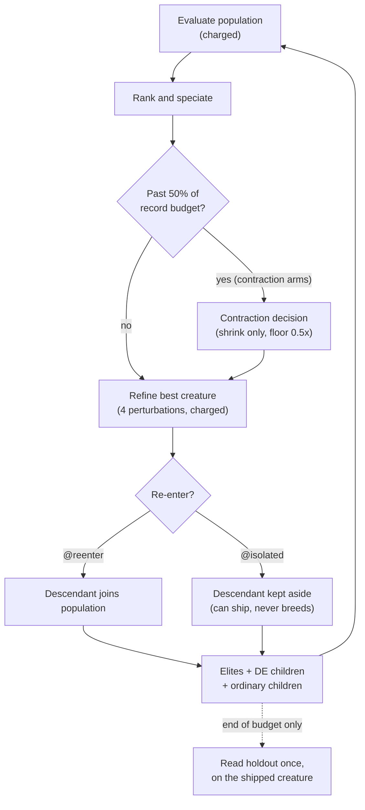

# Differential-weight offspring and delayed contraction (Issue #4156)

**Finding: negative.** No arm meets the benefit criterion and none is harm. On a
synthetic objective, differential-weight (DE) offspring tended to be slightly
_worse_ on held-out error, with more variance across seeds. Delayed population
contraction was about neutral. Do not read this as evidence for either idea; do
not read it as evidence against them at GRQ scale either (see
[Limits](#limits)).

Harness:
[`scripts/differential_weight_study.ts`](../../scripts/differential_weight_study.ts).
Arms and loop:
[`scripts/lib/differentialWeightStudy.ts`](../../scripts/lib/differentialWeightStudy.ts).
Tests:
[`test/scripts/DifferentialWeightStudy.ts`](../../test/scripts/DifferentialWeightStudy.ts).
Artefact: [`differential-weight-4156.json`](./differential-weight-4156.json).
The harness changes no production behaviour, and nothing under `src/` imports
it.

## What was asked

A 2×2 of two opt-in ideas:

- **DE weight-only offspring** — about 20% of offspring slots are built by
  differential evolution, within a species, over homologous genes.
- **Delayed contraction** — shrink the population once the run is well advanced,
  rather than from the start.

Each cell is crossed with whether **local-refinement descendants re-enter the
population** (`@reenter`) or are kept aside (`@isolated`). That gives eight
arms. The budget is equal: every arm is charged the same number of training
records.

## Method

- **DE offspring.** DE/rand/1/bin, weight-only, within the target's Genus
  species, over homologous genes keyed by neuron uuid and by the synapse
  `(fromUUID, toUUID, type)`. F = 0.5, CR = 0.9. Topology, squashes and uuids
  are unchanged, so genome alignment and activation semantics are preserved.
  Parents are cloned through export and never modified.
- **Delayed contraction.** Reuses the runner's existing shrink rule,
  `computeAdaptivePopulationSize` in
  [`src/NEAT/AdaptivePopulationSizer.ts`](../../src/NEAT/AdaptivePopulationSizer.ts),
  with `detectPlateau`. It is gated until 50% of the record budget, can never
  grow, and stops at a floor of 0.5× the starting population. Two deviations
  from production, stated plainly:
  - `highDiversityThreshold` is **0**, against a production default of 0.8.
  - The grow branch is neutralised with `lowDiversityThreshold` **0**.

  The reason for both: a 3-seed pilot showed 1.3–2.3 species per 24 creatures,
  so the shrink branch never fired and the grow branch always did. With the
  production values the contraction arms would have been identical to the
  control.

- **Local refinement** is a stand-in for production backprop: 4 Gaussian weight
  perturbations of the best creature each generation (σ = 0.1), charged in every
  arm. `@reenter` arms let the improved descendant join the population, as
  trained creatures do in production. `@isolated` arms keep it aside, so it can
  ship but never breeds.
- **Ordinary offspring** are topped up with retries. Slots that still cannot be
  filled are reported per arm in [Coverage](#coverage).



## Predeclared

- **Seeds.** Validation seeds are 4156–4185 (30). Calibration seeds are
  94156–94160 (5), a disjoint range, used only to set the time-to-target
  threshold: the median final train MSE of `control@reenter`, which came out at
  **0.01406**. Calibration cost 1,200,000 records and is reported separately
  from the arms.
- **Budget.** 240,000 charged train records per run, population 24, elitism 2,
  400 train and 400 holdout records. The diversity probe uses 64 train records
  and is uncharged.
- **Holdout** is read once, at the end, on the shipped creature, and never
  guides anything.
- **Criteria.** _Benefit_ iff the paired held-out MSE CI95 upper bound is < 0,
  the win fraction is ≥ 0.6, and the behavioural diversity ratio is ≥ 0.8.
  _Harm_ iff the CI95 lower bound is > 0. Otherwise _no-benefit_. The bootstrap
  uses 10,000 resamples with seed 4156.

## Versions

| Item              | Value                                                                   |
| ----------------- | ----------------------------------------------------------------------- |
| Code commit       | `codeVersion` in the JSON manifest is the commit the run was made from. |
| NEAT-AI           | 7.1.17                                                                  |
| NEAT-AI-core      | rev `1d44889e405e4e0cfb553321b44cc39e7d771f5f`                          |
| Deno              | 2.9.8                                                                   |
| Corpus            | `synthetic-tanh-quadratic-v1`, seed 4156                                |
| Run `codeVersion` | `52a59186eb839e5054dc064e1ff1e742fdb992ac`                              |

## Results

Held-out MSE, arm minus control; negative is better. Values are from the
`comparisons` array of the JSON, at 4 significant figures.

| Contrast                                        |   Mean diff |                      CI95 |  Wins | SD ratio [CI95]        | Time to target (arm / control; median paired diff) | Diversity | Species | Wall median | Verdict    |
| ----------------------------------------------- | ----------: | ------------------------: | ----: | ---------------------- | -------------------------------------------------- | --------: | ------: | ----------: | ---------- |
| `de@reenter` vs `control@reenter`               |   +0.003921 |     [−0.003362, +0.01394] | 16/30 | 1.347 [0.7536, 3.576]  | 17 / 20; +19,600 records (13 pairs)                |     1.066 |   0.878 |       0.826 | no-benefit |
| `contraction@reenter` vs `control@reenter`      |   −0.001019 |   [−0.003148, +0.0002171] |  9/30 | 0.9678 [0.6536, 1]     | 19 / 20; 0 records (19 pairs)                      |    0.8985 |   0.892 |       1.078 | no-benefit |
| `de+contraction@reenter` vs `control@reenter`   |   +0.005238 |     [−0.001626, +0.01501] | 14/30 | 1.360 [0.8905, 3.598]  | 16 / 20; +19,600 records (13 pairs)                |     1.042 |   0.821 |       1.103 | no-benefit |
| `de@isolated` vs `control@isolated`             |   +0.004009 |     [−0.004294, +0.01453] | 14/30 | 1.399 [0.9074, 3.166]  | 15 / 14; −30,800 records (9 pairs)                 |     1.108 |   0.828 |       1.047 | no-benefit |
| `contraction@isolated` vs `control@isolated`    | +0.00004165 | [−0.00004919, +0.0001431] |  5/30 | 0.9992 [0.9962, 1.014] | 13 / 14; 0 records (13 pairs)                      |    0.9576 |   0.950 |       0.771 | no-benefit |
| `de+contraction@isolated` vs `control@isolated` |  −0.0009533 |    [−0.005765, +0.003610] | 16/30 | 0.9948 [0.7364, 1.283] | 14 / 14; −30,800 records (9 pairs)                 |     1.074 |   0.791 |       0.741 | no-benefit |
| `control@isolated` vs `control@reenter`         |   +0.003428 |   [−0.0002902, +0.007591] |  8/30 | 1.020 [0.8728, 1.484]  | 14 / 20; +69,400 records (10 pairs)                |    0.9464 |   1.132 |       1.167 | no-benefit |

"Wins" counts the seeds on which the arm beat its control. Time to target counts
the seeds (of 30) that reached the 0.01406 train-MSE threshold; the median
difference is over seeds where both reached it, and a positive value means the
arm took more records.

## Coverage

Every arm completed 30/30 seeds with no failures.

| Arm                       | Completed | Generations | Evals per generation | Unfilled slots |
| ------------------------- | --------: | ----------: | -------------------: | -------------: |
| `control@reenter`         |     30/30 |         727 |                 24.8 |            257 |
| `de@reenter`              |     30/30 |         720 |                 25.0 |             13 |
| `contraction@reenter`     |     30/30 |         864 |                 20.8 |          1,416 |
| `de+contraction@reenter`  |     30/30 |         769 |                 23.4 |             67 |
| `control@isolated`        |     30/30 |         699 |                 25.8 |            108 |
| `de@isolated`             |     30/30 |         695 |                 25.9 |             14 |
| `contraction@isolated`    |     30/30 |         765 |                 23.5 |            639 |
| `de+contraction@isolated` |     30/30 |         745 |                 24.2 |             14 |

The contraction arms leave more slots unfilled, because a contracted, converged
population breeds clones that `Offspring.breed` declines. DE arms fill nearly
every slot, since a DE child is a new weight vector rather than a clone.

## Finding

- **DE tends to be worse on held-out MSE** (+0.003921, CI spanning 0) and to
  have higher variance across seeds (SD ratio 1.35–1.40 for `de@reenter`,
  `de+contraction@reenter` and `de@isolated`; 0.995 for
  `de+contraction@isolated`; every SD-ratio CI spans 1), though behavioural
  diversity is maintained (ratios 1.04–1.11).
- **Delayed contraction is about neutral.** Under re-entry the difference is
  −0.001019 with CI [−0.003148, +0.0002171], and it wins on only 9/30 seeds. The
  isolated contrast is +0.00004165, which is noise.
- **Isolating refinement descendants is slightly worse than re-entry**
  (+0.003428, CI [−0.0002902, +0.007591]; time to target reached on 14 seeds
  against 20).
- No contrast meets the benefit criterion, and no contrast meets the harm
  criterion, since every CI spans 0.

## Limits

- The objective is synthetic and the creatures are small. The result says
  nothing about GRQ-scale corpora.
- Local refinement is a perturbation stand-in, not backprop.
- The contraction arms use deviated diversity thresholds (above), so they test
  the policy's shape, not production's tuning.
- The paper (<https://arxiv.org/abs/2610.26202>) could not be fetched (proxy
  403), so the method is this repository's reading of the issue.
- Wall-clock was measured but not capped; the budget held equal is records.

## Reproduce

```bash
deno task differential-weight-study --code-version=$(git rev-parse HEAD) --json=docs/evidence/differential-weight-4156.json
```
