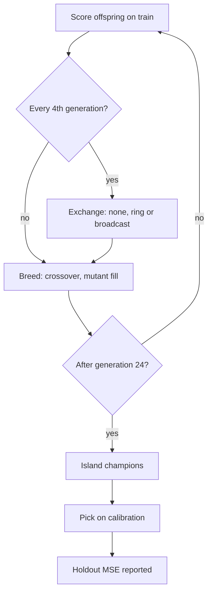

# Island exchange topology, measured (Issue #4159)

Does a neighbour-only exchange of topology-diverse Pareto members beat the
fleet's global champion broadcast? Produced by
[`scripts/island_exchange_study.ts`](../../scripts/island_exchange_study.ts);
the machine-readable artefact is
[`island-exchange-4159.json`](island-exchange-4159.json).

```bash
deno task island-exchange-study --json=docs/evidence/island-exchange-4159.json
```

The command refuses to run when `scripts/` or `src/` have uncommitted changes,
so the recorded `commit` always names the code that ran. `--allow-dirty`
overrides that and records `dirty: true`.

This is a hypothesis test, not an established improvement. The paper cited in
the issue (arXiv 2610.35373) could not be fetched in this run (the proxy refused
the connection), so the design follows the issue text. MOEA/D theory is
motivation only.

## Versions

- NEAT-AI 7.1.18. The artefact records `commit`
  (`7eabf57c3db36176fe15d7e8c41950bb652dc3ac`), `dirty` (`false`) and
  `sourceSha256`
  (`ebb9cf08cbea8456877560496d6a5cbe285e923ad82c8ff940ede9b002e5e3a5`). The 20
  seeds were run from that commit with `scripts/` and `src/` clean, so checking
  it out and running the command above reproduces the artefact apart from the
  wall-clock fields (`evaluationMs`, `improvementPerEvaluationHour`,
  `transportMs`); this was checked by diffing against the previous artefact,
  which had been run with `--allow-dirty` on the same harness (identical
  `sourceSha256`). The artefact is a later commit than the one it names, because
  it is committed after the run; only `scripts/` and `src/` are checked for
  being clean. `sourceSha256` is the SHA-256 of
  `scripts/island_exchange_study.ts`, `scripts/lib/islandExchangeStudy.ts` and
  `scripts/lib/preSelectionAB.ts` (each as `path`, newline, content, newline, in
  that order).
- A synthetic two-input regression from `preSelectionAB.buildCorpus`, seeded per
  study seed. No private data.

## What was run (pre-declared)

20 seeds (4159–4178). Six islands of 10 creatures each, elitism 2, 24
generations. Exchange every 4 generations (5 rounds, at generations 4, 8, 12, 16
and 20), 1 champion per round. Splits: train 300, calibration 150, holdout 300
records, disjoint slices of one corpus.

| Arm         | Exchange                                                                                                                                                                                                     |
| ----------- | ------------------------------------------------------------------------------------------------------------------------------------------------------------------------------------------------------------ |
| `none`      | No exchange.                                                                                                                                                                                                 |
| `ring`      | Island i sends topology-diverse Pareto members to island (i+1) mod 6. Members are non-dominated on train score against neurons plus synapses, chosen greedily for maximum topology distance to the receiver. |
| `broadcast` | The control. The global champion by train score is copied to the other five islands, the shape of the fleet's push-fittest/pull exchange.                                                                    |

**Communication budget.** Broadcast sends champions × (islands − 1) = 5
transfers per round. The ring gets the same 5 per round through
`ringAllocation`, which rotates the one empty edge so every edge sends 5 over a
6-round cycle. A migrant the receiver already holds (same uuid) is not sent, for
both arms.

**Equal evaluation budget.** Every generation each island scores exactly
islandPopulation − elitism new offspring. Migrants keep their train score (same
train split). Crossover that refuses a pair is retried 3 times and the remaining
slots are filled with mutants (`mutationFills`), so every arm charges exactly
350,100 records per seed (train plus calibration). Holdout is reported only:
never charged and never read by a decision. A test runs the same arm and seed
against materially different holdout targets and asserts that the reported
island, calibration error, records, transfers, bytes and per-generation traces
are identical while only the holdout error moves.

**Fills are always real mutants.** A fill copies a parent from the island and
mutates it at rate 1, redrawing until its content uuid differs from the parent's
and from every content uuid the island has already scored or is about to score
(`makeMutantFill`). An earlier run mutated fills at the 0.5 mutation rate, so
about half were exact copies of a parent the island already held; they were
scored again for nothing and made the next crossover refusal likelier. That run
is superseded, and its verdicts were not the same as the ones below. A later run
redrew only against the parent, and a test that counts re-scored fills at the
scoring site found a fill that matched another member of its island; the redraw
now covers the whole island, and the figures below come from that rule.
`fillRedraws` (draws rejected) averages 2.3 per seed for `none`, 0.85 for `ring`
and 1.8 for `broadcast`.

**Budget spent re-scoring content the island already held.** The run counts, at
the point where a creature is scored, each train evaluation whose content uuid
that island had already scored (`rescoredEvaluations`), and the part of it that
was a fill (`rescoredFills`). No fill is re-scored in any of the 60 runs
(`rescoredFills` is 0), and the starting islands hold no duplicates. The rest is
crossover: a child that equals content the island already held. It averages
119.2 per seed in `none`, 80.8 in `ring` and 96.7 in `broadcast`, out of 1,164
train evaluations per run (10.2%, 6.9% and 8.3%). Crossover is not redrawn, so
the arms do not get exactly the same amount of new information from the same
records: `none` spends the most on repeats, and `ring` the least.

**Baseline.** The common zero for "improvement" is the same
select-on-calibration rule applied to the starting islands: 18,900 preparation
records per seed, identical for every arm and not charged to any.

**Success and failure rules** (the harness's `PREDECLARED` block):

- Success: the 95% bootstrap interval of the mean paired difference lies wholly
  below zero, the arm's collapse rate is no higher than the broadcast's, and
  (for the ring) bytes sent are at most 1.25x the broadcast's.
- Failure: the interval lies wholly above zero (worse), or fails the success
  criterion without that (no-benefit). Fewer than 5 paired seeds is
  insufficient-data, not a result.

Topology distance is 1 − `geneticCompatibility`. Collapse means the final mean
pairwise distance between the six island champions is below 0.05.



## Result

Means over 20 seeds.

| Arm         | Held-out MSE | Improvement vs start | Per million records | Per evaluation-hour (indicative) | Final inter-island distance | Within-island distance | Collapse rate | Transfers | Bytes  | Mutant fills |
| ----------- | ------------ | -------------------- | ------------------- | -------------------------------- | --------------------------- | ---------------------- | ------------- | --------- | ------ | ------------ |
| `none`      | 1.198e-2     | 7.357e-2             | 0.210               | 1,579                            | 0.907                       | 0.009                  | 0.00          | 0         | 0      | 301.9        |
| `ring`      | 1.104e-2     | 7.451e-2             | 0.213               | 1,569                            | 0.418                       | 0.031                  | 0.10          | 25        | 28,537 | 193.3        |
| `broadcast` | 1.301e-2     | 7.254e-2             | 0.207               | 1,606                            | 0.004                       | 0.002                  | 0.95          | 24.75     | 32,120 | 207.3        |

Paired comparisons, arm − broadcast (negative means the arm is better), with a
2,000-resample percentile bootstrap:

- `ring` vs `broadcast`: **no benefit**. Mean −1.97e-3, 95% CI [−5.42e-3,
  1.16e-4], ring wins 11/20 seeds, collapse 0.10 vs 0.95, bytes ratio 0.888. The
  mean favours the ring, but the interval spans zero, so the pre-declared rule
  does not call it better.
- `none` vs `broadcast`: **no benefit**. Mean −1.04e-3, 95% CI [−4.81e-3,
  1.33e-3], wins 9/20, collapse 0.00 vs 0.95.

Coverage is 60/60 runs, 0 failures. Transport time (JSON export/import
round-trip) was about 4.2 ms per run for ring and 3.6 ms for broadcast,
indicative only on a shared parallel host. The evaluation-hour figures use
wall-clock on a shared host and are indicative; the records-based column is the
deterministic one.

## Reading

No benefit, in either direction. On this corpus the broadcast collapses the
islands onto one champion in 19 of 20 seeds, and still gives held-out error that
the other two arms cannot be separated from. The ring keeps the islands
topologically diverse (inter-island distance 0.42 vs 0.004, 2 of 20 seeds
collapsed) at 0.89 of the broadcast's bytes, and its mean held-out error is
lower (1.10e-2 against 1.30e-2), but the interval for that difference includes
zero and the ring wins only 11 of 20 seeds. No exchange is also
indistinguishable from the broadcast (mean held-out error 1.20e-2, wins 9 of
20). Diversity is not, here, the bottleneck, and the data do not show that it
helps.

An earlier run of this harness, with unmutated clones among the fills, called
both comparisons **worse**. Making every fill a real mutant changed both
verdicts to no benefit, so that earlier verdict should not be relied on.

Caveats:

- The creatures are tiny and the target is a smooth two-input function, where
  one champion is a good answer for every island.
- Within-island diversity is near zero in every arm (10-creature islands).
- Many offspring are mutant fills (crossover refuses clone pairs): about 25% of
  the train evaluations in `none`, 17% in `ring` and 18% in `broadcast`. They
  are real mutants, new to their island, and are charged the same, but the arms
  still do not run the same share of crossover, and 7% to 10% of evaluations per
  arm re-score a crossover child the island already held (see above).
- No representative production run was made, so this does not show what a ring
  would do on production-size creatures or deceptive objectives.

No default changes and nothing under `src/` changed. The harness is opt-in, and
research runs are separate from CI (the unit tests use tiny settings).

## Reproducibility

`withSeededUuids` replaces `crypto.randomUUID` with a seeded generator inside
the harness only, and the harness passes a seeded `rng` to `createNeatConfig`
(which otherwise installs an unseeded global generator). Two runs of the final
code gave identical results apart from the wall-clock fields (checked again on
this head, including `rescoredEvaluations` and `rescoredFills`), and the test
`island study — one arm and seed reproduce exactly` pins the same property.

Observed while building it: `runArm` in `scripts/lib/preSelectionAB.ts` calls
`createNeatConfig` without `rng` after seeding the global generator, so its
same-seed runs are not reproducible run to run. This is stated as a finding;
this change does not alter that harness's behaviour.

## Coordination

The transport format is the scope of #3910 (still open). This study measures
bytes but does not change the transport.

---

**Up to:** [`docs/README.md`](../README.md) (topic index).
