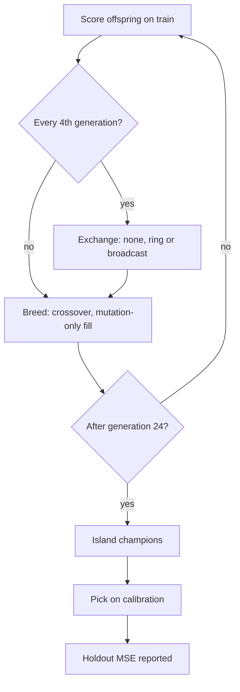

# Island exchange topology, measured (Issue #4159)

Does a neighbour-only exchange of topology-diverse Pareto members beat the
fleet's global champion broadcast? Produced by
[`scripts/island_exchange_study.ts`](../../scripts/island_exchange_study.ts);
the machine-readable artefact is
[`island-exchange-4159.json`](island-exchange-4159.json).

```bash
deno task island-exchange-study --json=docs/evidence/island-exchange-4159.json
```

This is a hypothesis test, not an established improvement. The paper cited in
the issue (arXiv 2610.35373) could not be fetched in this run (the proxy refused
the connection), so the design follows the issue text. MOEA/D theory is
motivation only.

## Versions

- NEAT-AI 7.1.17, code commit `80ce8ff27b298f8d4ce2d14043a47b5c74e34243` (the
  artefact's `version` and `commit` fields).
- A synthetic two-input regression from `preSelectionAB.buildCorpus`, seeded per
  study seed. No private data.

## What was run (pre-declared)

20 seeds (4159–4178). Six islands of 10 creatures each, elitism 2, 24
generations. Exchange every 4 generations (5 rounds, at generations 4, 8, 12, 16
and 20), 1 champion per round. Splits: train 300, calibration 150, holdout 300
records, disjoint slices of one corpus.

| Arm         | Exchange                                                                                                                                                                                                     |
| ----------- | ------------------------------------------------------------------------------------------------------------------------------------------------------------------------------------------------------------ |
| `none`      | No exchange.                                                                                                                                                                                                 |
| `ring`      | Island i sends topology-diverse Pareto members to island (i+1) mod 6. Members are non-dominated on train score against neurons plus synapses, chosen greedily for maximum topology distance to the receiver. |
| `broadcast` | The control. The global champion by train score is copied to the other five islands, the shape of the fleet's push-fittest/pull exchange.                                                                    |

**Communication budget.** Broadcast sends champions × (islands − 1) = 5
transfers per round. The ring gets the same 5 per round through
`ringAllocation`, which rotates the one empty edge so every edge sends 5 over a
6-round cycle. A migrant the receiver already holds (same uuid) is not sent, for
both arms.

**Equal evaluation budget.** Every generation each island scores exactly
islandPopulation − elitism new offspring. Migrants keep their train score (same
train split). Crossover that refuses a pair is retried 3 times and the remaining
slots are filled with mutation-only copies (`mutationFills`), so every arm
charges exactly 350,100 records per seed (train plus calibration). Holdout is
reported only: never charged and never read by a decision (a test proves it).

**Baseline.** The common zero for "improvement" is the same
select-on-calibration rule applied to the starting islands: 18,900 preparation
records per seed, identical for every arm and not charged to any.

**Success and failure rules** (the harness's `PREDECLARED` block):

- Success: the 95% bootstrap interval of the mean paired difference lies wholly
  below zero, the arm's collapse rate is no higher than the broadcast's, and
  (for the ring) bytes sent are at most 1.25x the broadcast's.
- Failure: the interval lies wholly above zero (worse), or fails the success
  criterion without that (no-benefit). Fewer than 5 paired seeds is
  insufficient-data, not a result.

Topology distance is 1 − `geneticCompatibility`. Collapse means the final mean
pairwise distance between the six island champions is below 0.05.



## Result

Means over 20 seeds.

| Arm         | Held-out MSE | Improvement vs start | Per million records | Per evaluation-hour (indicative) | Final inter-island distance | Within-island distance | Collapse rate | Transfers | Bytes  | Mutation fills |
| ----------- | ------------ | -------------------- | ------------------- | -------------------------------- | --------------------------- | ---------------------- | ------------- | --------- | ------ | -------------- |
| `none`      | 1.678e-2     | 6.877e-2             | 0.196               | 1356                             | 0.950                       | 0.007                  | 0.00          | 0         | 0      | 424.5          |
| `ring`      | 1.205e-2     | 7.350e-2             | 0.210               | 1397                             | 0.443                       | 0.081                  | 0.10          | 25        | 29,491 | 230.5          |
| `broadcast` | 1.115e-2     | 7.440e-2             | 0.213               | 1426                             | 0.002                       | 0.004                  | 1.00          | 25        | 32,201 | 271.8          |

Paired comparisons, arm − broadcast (negative means the arm is better), with a
2,000-resample percentile bootstrap:

- `ring` vs `broadcast`: **worse**. Mean +8.96e-4, 95% CI [4.22e-5, 1.82e-3],
  ring wins 8/20 seeds, collapse 0.10 vs 1.00, bytes ratio 0.916.
- `none` vs `broadcast`: **worse**. Mean +5.63e-3, 95% CI [1.61e-3, 1.26e-2],
  wins 3/20, collapse 0.00 vs 1.00.

Coverage is 60/60 runs, 0 failures. Transport time (JSON export/import
round-trip) was about 4 ms per run for ring and broadcast, indicative only on a
shared parallel host. The evaluation-hour figures use wall-clock on a shared
host and are indicative; the records-based column is the deterministic one.

## Reading

A negative finding. On this corpus the broadcast collapses every island onto one
champion in all 20 seeds and still gives the best held-out error. The ring keeps
topology diverse (inter-island distance 0.44 vs 0.002, 2 of 20 seeds collapsed)
but does not convert that into held-out improvement. Its deficit is small and
the interval's lower bound is only just above zero. No exchange is clearly
worst. Diversity is not, here, the bottleneck.

Caveats:

- The creatures are tiny and the target is a smooth two-input function, where
  one champion is a good answer for every island.
- Within-island diversity is near zero in every arm (10-creature islands).
- Many offspring are mutation-only fills (crossover refuses clone pairs), most
  in `none`.
- No representative production run was made, so this does not show what a ring
  would do on production-size creatures or deceptive objectives.

No default changes and nothing under `src/` changed. The harness is opt-in, and
research runs are separate from CI (the unit tests use tiny settings).

## Reproducibility

`withSeededUuids` replaces `crypto.randomUUID` with a seeded generator inside
the harness only, and the harness passes a seeded `rng` to `createNeatConfig`
(which otherwise installs an unseeded global generator). Two runs at the same
commit gave identical results apart from the wall-clock fields.

Observed while building it: `runArm` in `scripts/lib/preSelectionAB.ts` calls
`createNeatConfig` without `rng` after seeding the global generator, so its
same-seed runs are not reproducible run to run. This is stated as a finding;
this change does not alter that harness's behaviour.

## Coordination

The transport format is the scope of #3910 (still open). This study measures
bytes but does not change the transport.

---

**Up to:** [`docs/README.md`](../README.md) (topic index).
