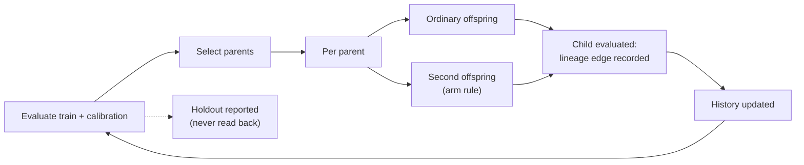

# Lineage-informed targeted offspring, measured (Issue #4155)

Whether recording what each mutation did, and aiming offspring at a parent's
weakest region, beats ordinary mutation at the same cost. Produced by
[`scripts/lineage_targeting_study.ts`](../../scripts/lineage_targeting_study.ts)
(library
[`scripts/lib/lineageTargetingStudy.ts`](../../scripts/lib/lineageTargetingStudy.ts));
the machine-readable artefact is
[`lineage-targeting-4155.json`](lineage-targeting-4155.json).

## Reproduce

```bash
deno task lineage-targeting-study --code-version=$(git rev-parse HEAD) \
  --json=docs/evidence/lineage-targeting-4155.json
```

Thirty seeds is the default (`PREDECLARED_SEEDS`). `--edges=<path>` additionally
writes every lineage edge as JSON Lines.

| Item         | Value                                                     |
| ------------ | --------------------------------------------------------- |
| Code version | the commit named by the artefact's `manifest.codeVersion` |
| NEAT-AI      | 7.1.17                                                    |
| NEAT-AI-core | `1d44889e405e4e0cfb553321b44cc39e7d771f5f`                |
| Deno         | 2.9.8                                                     |
| Corpus       | `synthetic-quadrant-v1`                                   |

## Research starting point

The issue names arXiv 2610.30042. Its fetch failed in the issue audit and failed
again in this run (the proxy refused the connection). The method here is this
repository's own reading of the issue text, **not** a reproduction of the paper,
and no number from the paper is used.

## Predeclared design

The settings, arms, success thresholds and the 30-seed sample size are constants
in code (`DEFAULT_STUDY_SETTINGS`, `SUCCESS_CRITERIA`, `PREDECLARED_SEEDS`), and
`validateSettings` refuses an out-of-range setting. That fixes the design in
code, not in a separately timestamped record, and it was not strict. Two
deviations:

- The diversity criterion was changed from UUID genetic distance to behavioural
  diversity after a one-seed timing run showed genetic distance collapsing to 0
  under mutation-only offspring.
- After independent review, the diversity average was changed to exclude
  generation 1.

Both changes were made before the reported 30-seed run, but after an earlier
30-seed run of the previous harness version, which gave the same holdout results
and the same verdicts (no-benefit on every contrast). The holdout-MSE numbers
were unaffected by either change, because diversity is measurement-only.

- **Seeds:** 30, numbered 4155–4184.
- **Population:** 16, elitism 2.
- **Offspring:** mutation only, one operator each, no crossover. Every lineage
  edge therefore has one parent and the operator is solely attributed. Parents
  are cloned through export/import and never modified.
- **Data:** three disjoint 400-record splits over four quadrant strata.
  - _train_ drives selection.
  - _calibration_ supplies lineage deltas, the worst-stratum choice and the
    targeted screen.
  - _holdout_ is for reporting only. Selection, mutation and targeting never
    read it, and a test proves that.
- **Budget:** 400 exact-evaluation equivalents, which is 320,000 records charged
  per arm. Each exact evaluation charges its train and calibration records, and
  every calibration record scored while screening is charged too. Holdout
  records and the 64-record behavioural-diversity probe are counted separately
  and never charged. The last evaluation may overshoot, so the median charged
  total is 326,400 for the ordinary arms and 332,000 for the targeted arms.
- **Lineage edge:** parent and child UUIDs, the operator, the affected genes
  (added, removed and changed counts, plus up to 16 UUID-keyed gene keys,
  `AFFECTED_GENES_CAP`), the per-stratum calibration delta, the overall
  calibration delta, the train delta and the target stratum. The artefact holds,
  per run and per operator, the count, the mean overall calibration delta, the
  mean calibration delta per stratum and the targeted count, plus the first 40
  full edges (`SAMPLE_EDGE_LIMIT`, with `sampleEdgesTotal`) for the first seed
  of each arm. The full record is available through `--edges`.
- **Behavioural diversity:** mean pairwise RMS difference of the first output
  over the first 64 calibration records, averaged over generations 2 and later
  (generation 1 is the identical seeded population in every arm).

### Arms

A 2×2 of history against targeting. Each pair is one ordinary offspring plus one
non-ordinary offspring, except in the control, where both are ordinary. The
control is therefore the "equally many ordinary offspring" comparison.

| Arm                | Second offspring of each pair                                                                                                              |
| ------------------ | ------------------------------------------------------------------------------------------------------------------------------------------ |
| `ordinary`         | Ordinary (control).                                                                                                                        |
| `history`          | Operator with the lowest historical mean overall calibration delta among K=4 ordinarily proposed operators; ε=0.25 exploration; no screen. |
| `targeted`         | Best of R=3 ordinary candidates on the parent's worst calibration stratum; no history.                                                     |
| `history-targeted` | The same screen, with the candidates' operators chosen by history for that stratum.                                                        |

### Success criteria

An arm **benefits** only if all three hold against the control:

1. The upper bound of the bootstrap 95% CI of the mean paired holdout-MSE
   difference is below 0.
2. It wins on at least 70% of seeds.
3. The median behavioural-diversity ratio is at least 0.8.

It is **harmful** if the CI lower bound is above 0. Otherwise the verdict is
**no-benefit**. The target for records-to-target is fixed per seed at 0.5× the
generation-1 best holdout MSE, identical across arms.

### One generation



## Result

Thirty seeds ran to completion in every arm (coverage 30/30). Every number is in
the artefact's `summary` and `comparisons` blocks. The `generations` traces in
`runs[]` are a **sample** (generations 1, 5, 10, 15, 20, 25 and, when reached,
29), not every generation.

### Per arm

| Arm                | Mean final holdout MSE | Median   | Mean behavioural diversity | Failures | Repeated failures | Seeds reaching target |
| ------------------ | ---------------------- | -------- | -------------------------- | -------- | ----------------- | --------------------- |
| `ordinary`         | 0.039444               | 0.036280 | 0.2653                     | 8307     | 2829              | 28/30                 |
| `history`          | 0.045368               | 0.036858 | 0.2358                     | 8159     | 2584              | 26/30                 |
| `targeted`         | 0.038750               | 0.036062 | 0.2280                     | 6646     | 2203              | 28/30                 |
| `history-targeted` | 0.041220               | 0.035147 | 0.2271                     | 6637     | 2214              | 26/30                 |

Per-seed medians: the ordinary and `history` arms ran 408 evaluations and 392
offspring. The targeted arms ran 352 evaluations and 336 offspring, of which 168
were targeted, and spent a median 50,400 records screening.

### Paired comparisons

Final holdout MSE, arm minus versus; negative is better.

| Arm                | Versus     | Mean diff | Median diff | CI95                   | Wins  | Diversity ratio | Verdict      |
| ------------------ | ---------- | --------- | ----------- | ---------------------- | ----- | --------------- | ------------ |
| `history`          | `ordinary` | +5.924e-3 | +1.159e-3   | [−5.444e-4, +1.395e-2] | 10/30 | ×0.854          | `no-benefit` |
| `targeted`         | `ordinary` | −6.938e-4 | −7.2e-5     | [−4.838e-3, +4.050e-3] | 16/30 | ×0.882          | `no-benefit` |
| `history-targeted` | `ordinary` | +1.776e-3 | −3.272e-4   | [−5.384e-3, +1.268e-2] | 17/30 | ×0.868          | `no-benefit` |
| `history-targeted` | `targeted` | +2.470e-3 | +1.054e-4   | [−6.074e-3, +1.324e-2] | 15/30 | ×0.977          | `no-benefit` |
| `history-targeted` | `history`  | −4.148e-3 | −2.549e-3   | [−1.596e-2, +8.750e-3] | 19/30 | ×0.959          | `no-benefit` |

The `targeted` row is the history ablation under targeting; the `history` row is
the targeting ablation under history.

### Records to target

Paired median difference in records scored, over only the seeds where both arms
reached the target.

| Arm                | Versus     | Paired median diff |
| ------------------ | ---------- | ------------------ |
| `history`          | `ordinary` | −11,200            |
| `targeted`         | `ordinary` | +350               |
| `history-targeted` | `ordinary` | +11,550            |
| `history-targeted` | `targeted` | 0                  |
| `history-targeted` | `history`  | +9,100             |

## Reading

This is a **negative finding**. On this synthetic objective neither history, nor
stratum targeting, nor both together beat ordinary mutation at an equal record
budget.

- Every CI spans zero and the win rates sit near half.
- Every non-control arm has lower behavioural diversity (×0.85 to ×0.88 against
  the control), though still above the 0.8 floor.
- The targeted arms show fewer failures in absolute count, but partly because
  they produce fewer offspring inside the budget (336 against 392 per seed).
- `wallMs` is recorded but indicative only, because the host is shared. No
  verdict uses it.

Behavioural diversity is the criterion because the earlier UUID-based mean
genetic distance collapses to 0 under mutation-only offspring: descendants share
neuron UUIDs. Species count and genetic distance are still in the artefact.

## Design decisions

- The harness keeps its own `LineageEdge` rather than the evaluation archive's
  `parents` link (`src/archive/CreatureLineage.ts`), because the archive record
  has no per-stratum error fields and the issue says not to make shared
  infrastructure a prerequisite for a local pilot.
- No production code was added, so there is nothing optional to remove. The
  harness is kept because it is the reproducible command for this negative
  result.

## What this does not say

- **Nothing about GRQ-scale creatures.** This is a synthetic 2-input regression
  with small creatures and no private corpus.
- **Nothing about crossover, speciation pressure or memetic training.** None is
  in play, and each offspring carries exactly one operator.
- **Nothing that changes ordinary behaviour.** Interfaces and defaults are
  untouched: the code lives only under `scripts/` and nothing in `src/` calls
  it.

---

**Up to:** [`docs/README.md`](../README.md) (topic index).
