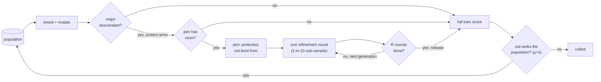

# Short protected refinement for major mutations (Issue #4158)

A mutation that makes a _major_ structural change usually scores badly straight
away, because its new parts have not been tuned yet, so selection culls it
before it can show its worth. This page records one measurement of whether
holding such a child in a small protected pen for a few cheap refinement rounds
buys a better endpoint for the same number of records charged.

Harness:
[`scripts/protected_refinement_study.ts`](../../scripts/protected_refinement_study.ts)
(run with `deno task protected-refinement-study`). Library:
[`scripts/lib/protectedRefinementStudy.ts`](../../scripts/lib/protectedRefinementStudy.ts).
Tests:
[`test/scripts/ProtectedRefinementStudy.ts`](../../test/scripts/ProtectedRefinementStudy.ts).
Artefact: [`protected-refinement-4158.json`](./protected-refinement-4158.json),
written at code commit `0f4d87f0` plus the review change that makes the
`matched-ordinary` control replay `protect-refine`'s refinement spend (see
[Matched allocation](#matched-allocation)). Every arm other than
`matched-ordinary` reproduced its earlier results exactly, apart from `wallMs`
and the NEAT-AI version. Nothing under `src/` imports the harness, and no
selection behaviour changes.

## Verdict

**Negative result. Protection did not help.** Holding major descendants in a pen
lowered how many of them were retained (0.258 against 0.354 for immediate
competition) and did not improve held-out error. Spending the same refinement
records on _ordinary_ descendants (`matched-ordinary`) gave the same held-out
error as spending them on protected majors (10 wins, 10 losses; the criteria
score it `no-benefit`). Removing the protection while keeping the refinement
(`refine-only`) retained the most major descendants of any arm.

An earlier version of this page reported a **harm** verdict against
`matched-ordinary`. That control sized its refinement from its own generation's
major mutations, so seed by seed it spent a different amount from the treatment
(seed 4159: 3,060 records against 2,370; seed 4164: 2,610 against 1,980). It now
replays the treatment's spend, and the harm verdict does not survive.

## What was tested

A **major descendant** is a child whose mutation added a neuron, changed the
synapse set (rewiring) or changed a squash (activation), compared with its
pre-mutation self. A change to weights or biases only is **ordinary**.

| Arm                | What it does                                                                                                                                                                                                                                                                                                                                                           |
| ------------------ | ---------------------------------------------------------------------------------------------------------------------------------------------------------------------------------------------------------------------------------------------------------------------------------------------------------------------------------------------------------------------- |
| `immediate`        | Control. Every descendant competes straight away.                                                                                                                                                                                                                                                                                                                      |
| `protect-refine`   | Up to `penCapacity` 4 major descendants are held in a bounded pen, protected from culling and not bred from. Each generation the pen runs one perturbation-refinement round on a 1-in-10 train sub-sample. After R rounds the child is released, scored on the full train set, and must out-rank the population under the existing full-score rule ((μ+λ) truncation). |
| `protect-only`     | The pen, with no refinement. Ablates refinement.                                                                                                                                                                                                                                                                                                                       |
| `refine-only`      | R refinement rounds now, with no pen. Ablates protection.                                                                                                                                                                                                                                                                                                              |
| `matched-ordinary` | Replays `protect-refine`'s refinement spend for the same seed, generation by generation, in records, on ordinary descendants instead. Each is refined up to R rounds now, with no pen. Matched compute.                                                                                                                                                                |



## Predeclared design

| Parameter         | Value                                                                          |
| ----------------- | ------------------------------------------------------------------------------ |
| Validation seeds  | 4158–4177 (20 runs per arm)                                                    |
| Calibration seeds | 94158–94161 (4 runs per candidate R, disjoint from validation)                 |
| Corpus seed       | 4158                                                                           |
| Bootstrap         | 10,000 resamples, seed 4158                                                    |
| Budget            | 120,000 charged train records per run                                          |
| Population        | 20                                                                             |
| Corpus            | 300 train records, 300 holdout records (holdout is never charged or consulted) |
| Benefit           | CI95 upper < 0 **and** win fraction ≥ 0.6 **and** species ratio ≥ 0.8          |
| Harm              | CI95 lower > 0                                                                 |
| Otherwise         | no-benefit                                                                     |

The difference is the arm minus the baseline holdout MSE, so negative is better.

## Calibration

R was chosen on **training** MSE only, before validation, on its own seeds.

| R | Median train MSE | Records charged |
| - | ---------------: | --------------: |
| 2 |       2.7987e-02 |         476,700 |
| 3 |       2.8706e-02 |         405,630 |
| 4 |       2.9461e-02 |         479,760 |

**R = 2 was chosen.** Calibration cost 1,362,090 records, reported separately
from the per-run budget. The manifest's `settings.refineRounds` is the
pre-calibration default of 3; validation used `chosenRefineRounds` = 2.

## Contrasts

| Contrast                           | Mean diff | CI95                   | W/L   | Species ratio | Verdict    |
| ---------------------------------- | --------: | ---------------------- | ----- | ------------: | ---------- |
| protect-refine vs immediate        | −2.355e-3 | [−2.119e-2, +1.586e-2] | 9/11  |          0.82 | no-benefit |
| protect-refine vs matched-ordinary | +4.231e-4 | [−1.334e-2, +1.264e-2] | 10/10 |          1.14 | no-benefit |
| protect-refine vs refine-only      | +8.051e-3 | [−1.660e-3, +1.978e-2] | 8/12  |          0.68 | no-benefit |
| protect-refine vs protect-only     | +3.175e-4 | [−9.224e-3, +8.031e-3] | 7/13  |          1.10 | no-benefit |

## Per-arm summary

20 runs per arm.

| Arm              | Median holdout MSE | Mean holdout MSE | Major competed | Major retained | Major retained fraction | Ordinary retained fraction | Refinement records (sum) | Stalled runs | Min records charged |
| ---------------- | -----------------: | ---------------: | -------------: | -------------: | ----------------------: | -------------------------: | -----------------------: | -----------: | ------------------: |
| immediate        |            0.01681 |           0.0318 |            720 |            255 |                   0.354 |                      0.628 |                        0 |            0 |             120,000 |
| protect-refine   |            0.01589 |          0.02944 |            627 |            162 |                   0.258 |                      0.596 |                   54,030 |            1 |              91,710 |
| protect-only     |            0.01584 |          0.02913 |            618 |            140 |                   0.227 |                      0.617 |                        0 |            2 |              84,600 |
| refine-only      |            0.01351 |          0.02139 |            684 |            269 |                   0.393 |                      0.598 |                   62,010 |            1 |             114,090 |
| matched-ordinary |            0.01507 |          0.02902 |            656 |            201 |                   0.306 |                      0.565 |                   48,660 |            0 |             119,730 |

Who received refinement, summed over the 20 runs of each arm (a descendant is
counted once, however many rounds it received):

| Arm              | Major descendants refined | Ordinary descendants refined |
| ---------------- | ------------------------: | ---------------------------: |
| immediate        |                         0 |                            0 |
| protect-refine   |                       603 |                            0 |
| protect-only     |                         0 |                            0 |
| refine-only      |                       689 |                            0 |
| matched-ordinary |                         0 |                          597 |

## Matched allocation

`matched-ordinary` is the control for "the same refinement compute, spent on
ordinary descendants". For each seed it replays the refinement records that
`protect-refine` charged in each generation (the run's
`refinementByGeneration`), spending them on ordinary descendants of its own
generation, up to R rounds each, with no pen. Unspent records carry forward, so
the allocation is the treatment's whatever mutation counts, pen occupancy or
ordinary supply the control meets. Both arms share one budget of 120,000
records, so the control spends the same refinement records and has the same
amount left for full evaluations in total; it does not hold the _number_ of
evaluations equal, because the treatment defers full scoring of penned
descendants.

The control cannot always spend the whole quota, because it shares the budget
with its own full evaluations and runs out of it sooner than the treatment (the
pen defers evaluations). Where it ends a run with fewer than 300 records left,
which cannot pay for another full-train score, the unspent quota is reported as
a shortfall. Every one of the 17 seeds with a shortfall ended that way. Three
seeds matched exactly, nine fell short by exactly one 30-record sub-sample
evaluation, and eight by more (4161, 4163, 4165, 4166, 4169, 4170, 4174, 4175).
Overall the control spent 48,660 of the 54,030 refinement records (90.1%). The
per-run fields are `refinementQuota` and `refinementShortfall`, and the per-seed
table is `matchedAllocation` in the JSON.

|      Seed | Quota (protect-refine) | Spent (matched-ordinary) | Shortfall | Records left unspent by the control |
| --------: | ---------------------: | -----------------------: | --------: | ----------------------------------: |
|      4158 |                  2,910 |                    2,880 |        30 |                                 120 |
|      4159 |                  2,370 |                    2,370 |         0 |                                  30 |
|      4160 |                  3,150 |                    3,150 |         0 |                                 150 |
|      4161 |                  3,510 |                    3,030 |       480 |                                 270 |
|      4162 |                  2,700 |                    2,670 |        30 |                                  30 |
|      4163 |                  2,040 |                    1,410 |       630 |                                  90 |
|      4164 |                  1,980 |                    1,950 |        30 |                                 150 |
|      4165 |                  2,430 |                    1,590 |       840 |                                 210 |
|      4166 |                  2,610 |                    2,040 |       570 |                                  60 |
|      4167 |                  2,370 |                    2,340 |        30 |                                  60 |
|      4168 |                  3,060 |                    3,030 |        30 |                                 270 |
|      4169 |                  3,150 |                    2,940 |       210 |                                  60 |
|      4170 |                  3,150 |                    2,340 |       810 |                                  60 |
|      4171 |                  1,710 |                    1,680 |        30 |                                 120 |
|      4172 |                  2,700 |                    2,670 |        30 |                                  30 |
|      4173 |                  3,030 |                    3,030 |         0 |                                 270 |
|      4174 |                  2,520 |                    2,220 |       300 |                                 180 |
|      4175 |                  2,790 |                    1,530 |     1,260 |                                 270 |
|      4176 |                  2,250 |                    2,220 |        30 |                                 180 |
|      4177 |                  3,600 |                    3,570 |        30 |                                  30 |
| **Total** |             **54,030** |               **48,660** | **5,370** |                                     |

## Findings

- Protection lowered retention of major descendants: 0.258 for `protect-refine`
  against 0.354 for `immediate`. It did not improve held-out error (CI95
  straddles zero).
- Refinement records spent on ordinary descendants (`matched-ordinary`, same
  seed, same generation-by-generation spend) did no better or worse than the
  same records spent on protected majors: mean difference +4.2e-4, CI95
  [−1.33e-2, +1.26e-2], 10 wins and 10 losses, `no-benefit`. The control fell
  short of the full quota on 17 seeds (see above), so this is a comparison at
  90% of the refinement spend for `matched-ordinary`.
- Removing protection (`refine-only`) retained the most major descendants
  (0.393).
- Diversity cannot separate the arms. The median final species count is 1–2 and
  the median mean genetic distance is 0.000 in every arm: the toy population
  converges to near-clones.
- **Stalled runs** hit `maxGenerations` (2,000) because crossover declines
  clones, so no offspring are produced. They spent less than the full budget
  (see the minimum records charged above). Counts: `protect-refine` 1,
  `protect-only` 2, `refine-only` 1, `matched-ordinary` 0, `immediate` 0. They
  are kept in the pairs.

## Limitations

- A synthetic two-input regression stand-in, with small creatures. There was no
  production-scale run, so nothing here says how a large creature behaves.
- arXiv 2610.35647 could not be fetched or verified. The method is this
  repository's reading of the issue and does not claim to reproduce the paper.
- Refinement is a Gaussian weight and bias perturbation hill-climb, not
  backpropagation.
- Wall-clock is measured (field `wallMs`) and not capped. Equal charged records
  stand in for equal compute.

## Decision

Nothing under `src/` changed, so there is no production option to remove. The
harness is kept only as the reproduction record.

## Reproduce

```bash
deno task protected-refinement-study \
  --code-version=$(git rev-parse --short=8 HEAD) \
  --json=docs/evidence/protected-refinement-4158.json
```
