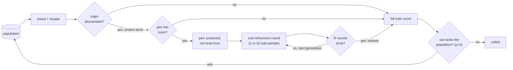

# Short protected refinement for major mutations (Issue #4158)

A mutation that makes a _major_ structural change usually scores badly straight
away, because its new parts have not been tuned yet, so selection culls it
before it can show its worth. This page records one measurement of whether
holding such a child in a small protected pen for a few cheap refinement rounds
buys a better endpoint for the same number of records charged.

Harness:
[`scripts/protected_refinement_study.ts`](../../scripts/protected_refinement_study.ts)
(run with `deno task protected-refinement-study`). Library:
[`scripts/lib/protectedRefinementStudy.ts`](../../scripts/lib/protectedRefinementStudy.ts).
Tests:
[`test/scripts/ProtectedRefinementStudy.ts`](../../test/scripts/ProtectedRefinementStudy.ts).
Artefact: [`protected-refinement-4158.json`](./protected-refinement-4158.json),
written at code commit `d9eace28` plus the review change that restricts the
matched contrast to pairs with equal refinement and evaluation records (see
[Matched allocation](#matched-allocation)). The runs themselves reproduced the
previous artefact exactly, apart from `wallMs`; only the pair classification and
the contrasts built on it changed. Nothing under `src/` imports the harness, and
no selection behaviour changes.

## Verdict

**Negative result. Protection did not help.** Holding major descendants in a pen
lowered how many of them were retained (0.258 against 0.354 for immediate
competition) and did not improve held-out error. Spending the same refinement
records on _ordinary_ descendants (`matched-ordinary`) gave no measurable
difference in held-out error from spending them on protected majors, but the
exactly matched evidence is thin. Only 3 of the 20 seeds (4160, 4163, 4175) are
**exactly matched**: the control spent the treatment's whole refinement
allocation and both arms charged the same evaluation records. On those three the
mean difference is −3.3e-2 (2 wins, 1 loss, CI95 [−9.5e-2, +2.1e-3],
`no-benefit`), which is too few pairs to conclude anything. A further 11 seeds
are **approximately matched** (the same evaluation records, and the control
short by one 30-record sub-sample evaluation, too little to pay for a first
refinement round); with the three exact seeds they make 14 pairs: 6 wins and 8
losses, mean difference −2.7e-3, CI95 straddling zero (`no-benefit`). On all 20
seeds it is 9 wins and 11 losses, also `no-benefit`. Six seeds are
**uncompletable** and are listed, not hidden (see
[Matched allocation](#matched-allocation)). Removing the protection while
keeping the refinement (`refine-only`) retained the most major descendants of
any arm.

Two earlier versions of the control did not hold the refinement spend equal. The
first sized it from its own generation's major mutations, so seed by seed it
spent a different amount from the treatment (seed 4159: 3,060 records against
2,370; seed 4164: 2,610 against 1,980) and reported a **harm** verdict. The
second replayed the treatment's spend generation by generation but let its own
full evaluations spend the budget first, so it fell short on 17 seeds and the
two arms ended with different evaluation counts (seed 4175: 1,530 refinement and
118,200 evaluation records against 2,790 and 117,000). The control now reserves
the allocation, and the harm verdict does not survive either change. The
reserved allocation is still not an exact match on most seeds, so the contrast
is split by how closely each pair matched, below.

## What was tested

A **major descendant** is a child whose mutation added a neuron, changed the
synapse set (rewiring) or changed a squash (activation), compared with its
pre-mutation self. A change to weights or biases only is **ordinary**.

| Arm                | What it does                                                                                                                                                                                                                                                                                                                                                           |
| ------------------ | ---------------------------------------------------------------------------------------------------------------------------------------------------------------------------------------------------------------------------------------------------------------------------------------------------------------------------------------------------------------------- |
| `immediate`        | Control. Every descendant competes straight away.                                                                                                                                                                                                                                                                                                                      |
| `protect-refine`   | Up to `penCapacity` 4 major descendants are held in a bounded pen, protected from culling and not bred from. Each generation the pen runs one perturbation-refinement round on a 1-in-10 train sub-sample. After R rounds the child is released, scored on the full train set, and must out-rank the population under the existing full-score rule ((μ+λ) truncation). |
| `protect-only`     | The pen, with no refinement. Ablates refinement.                                                                                                                                                                                                                                                                                                                       |
| `refine-only`      | R refinement rounds now, with no pen. Ablates protection.                                                                                                                                                                                                                                                                                                              |
| `matched-ordinary` | Reserves `protect-refine`'s total refinement spend for the same seed out of its budget, and spends it, in records, on ordinary descendants instead. Each is refined up to R rounds now, with no pen. Matched compute.                                                                                                                                                  |



## Predeclared design

| Parameter         | Value                                                                          |
| ----------------- | ------------------------------------------------------------------------------ |
| Validation seeds  | 4158–4177 (20 runs per arm)                                                    |
| Calibration seeds | 94158–94161 (4 runs per candidate R, disjoint from validation)                 |
| Corpus seed       | 4158                                                                           |
| Bootstrap         | 10,000 resamples, seed 4158                                                    |
| Budget            | 120,000 charged train records per run                                          |
| Population        | 20                                                                             |
| Corpus            | 300 train records, 300 holdout records (holdout is never charged or consulted) |
| Benefit           | CI95 upper < 0 **and** win fraction ≥ 0.6 **and** species ratio ≥ 0.8          |
| Harm              | CI95 lower > 0                                                                 |
| Otherwise         | no-benefit                                                                     |

The difference is the arm minus the baseline holdout MSE, so negative is better.

## Calibration

R was chosen on **training** MSE only, before validation, on its own seeds.

| R | Median train MSE | Records charged |
| - | ---------------: | --------------: |
| 2 |       2.7987e-02 |         476,700 |
| 3 |       2.8706e-02 |         405,630 |
| 4 |       2.9461e-02 |         479,760 |

**R = 2 was chosen.** Calibration cost 1,362,090 records, reported separately
from the per-run budget. The manifest's `settings.refineRounds` is the
pre-calibration default of 3; validation used `chosenRefineRounds` = 2.

## Contrasts

| Contrast                                             |  n | Mean diff | CI95                   | W/L  | Species ratio | Verdict    |
| ---------------------------------------------------- | -: | --------: | ---------------------- | ---- | ------------: | ---------- |
| protect-refine vs immediate                          | 20 | −2.355e-3 | [−2.119e-2, +1.586e-2] | 9/11 |          0.82 | no-benefit |
| protect-refine vs matched-ordinary (exactly matched) |  3 | −3.317e-2 | [−9.481e-2, +2.113e-3] | 2/1  |          0.71 | no-benefit |
| protect-refine vs matched-ordinary (approx. matched) | 14 | −2.717e-3 | [−2.187e-2, +1.539e-2] | 6/8  |          0.81 | no-benefit |
| protect-refine vs matched-ordinary (all seeds)       | 20 | +5.110e-4 | [−1.355e-2, +1.353e-2] | 9/11 |          1.00 | no-benefit |
| protect-refine vs refine-only                        | 20 | +8.051e-3 | [−1.660e-3, +1.978e-2] | 8/12 |          0.68 | no-benefit |
| protect-refine vs protect-only                       | 20 | +3.175e-4 | [−9.224e-3, +8.031e-3] | 7/13 |          1.10 | no-benefit |

The matched-compute contrast is the first `matched-ordinary` row: it pairs only
the seeds whose control spent the treatment's whole refinement allocation and
charged the same evaluation records as the treatment. With three pairs it cannot
support a verdict either way. The second row is a sensitivity check that adds
the pairs matched to within one sub-sample evaluation of refinement. The third
adds every pair back, including the six uncompletable ones. In the JSON they are
`protect-refine vs matched-ordinary`,
`protect-refine vs matched-ordinary (approximately matched seeds)` and
`protect-refine vs matched-ordinary (all seeds, including uncompletable pairs)`.

## Per-arm summary

20 runs per arm.

| Arm              | Median holdout MSE | Mean holdout MSE | Major competed | Major retained | Major retained fraction | Ordinary retained fraction | Refinement records (sum) | Stalled runs | Min records charged |
| ---------------- | -----------------: | ---------------: | -------------: | -------------: | ----------------------: | -------------------------: | -----------------------: | -----------: | ------------------: |
| immediate        |            0.01681 |           0.0318 |            720 |            255 |                   0.354 |                      0.628 |                        0 |            0 |             120,000 |
| protect-refine   |            0.01589 |          0.02944 |            627 |            162 |                   0.258 |                      0.596 |                   54,030 |            1 |              91,710 |
| protect-only     |            0.01584 |          0.02913 |            618 |            140 |                   0.227 |                      0.617 |                        0 |            2 |              84,600 |
| refine-only      |            0.01351 |          0.02139 |            684 |            269 |                   0.393 |                      0.598 |                   62,010 |            1 |             114,090 |
| matched-ordinary |            0.01403 |          0.02893 |            709 |            223 |                   0.315 |                      0.599 |                   50,190 |            5 |              72,060 |

Who received refinement, summed over the 20 runs of each arm (a descendant is
counted once, however many rounds it received):

| Arm              | Major descendants refined | Ordinary descendants refined |
| ---------------- | ------------------------: | ---------------------------: |
| immediate        |                         0 |                            0 |
| protect-refine   |                       603 |                            0 |
| protect-only     |                         0 |                            0 |
| refine-only      |                       689 |                            0 |
| matched-ordinary |                         0 |                          609 |

## Matched allocation

`matched-ordinary` is the control for "the same refinement compute, spent on
ordinary descendants". Two things aim to keep its allocation equal to the
treatment's:

1. **The quota is reserved.** For each seed the control is handed
   `protect-refine`'s refinement schedule (the run's `refinementSchedule`: the
   refinement records each generation charged, with the evaluation records
   already charged at that point). The records it has not yet spent are set
   aside out of the shared 120,000-record budget, so a full evaluation can never
   take them. It evaluates with what is left, so both arms should stop on the
   budget having charged the same evaluation records, unless a run stalls.
2. **The quota is paid out against evaluation progress, not generation number.**
   The control may spend what the treatment had spent by the time the
   treatment's evaluation reached the control's current evaluation count, so it
   meets the treatment's schedule however many generations it takes to get
   there; in the last generation that can still be scored the remainder is due.
   Unspent records carry forward, so the allocation is the treatment's whatever
   mutation counts, pen occupancy or ordinary supply the control meets.

Because both arms are on the same budget, the whole allocation is spent on
ordinary descendants and the number of full evaluations should stay equal. Each
pair is classified by what the control actually spent:

- **Exactly matched** (3 seeds: 4160, 4163, 4175): the control spent the
  treatment's whole refinement allocation and both arms charged the same
  evaluation records. 7,980 of 7,980 refinement records.
- **Approximately matched** (11 more seeds): the same evaluation records, and
  the control's refinement shortfall is under one first refinement round (60
  records here: a descendant's first round also scores the descendant). Every
  one is 30 records short, one sub-sample evaluation, which cannot pay for a
  first round. With the exact seeds, 14 pairs spent 38,070 of 38,400 refinement
  records (99.1%). They are a sensitivity check, not a matched contrast.
- **Uncompletable** (6 seeds: 4161, 4165, 4171, 4172, 4173, 4176): the arms
  ended on different evaluation records, because a run stalled (the population
  converged to clones, `Offspring.breed` declined them and the run stopped at
  `maxGenerations`, 2,000). Seeds 4161, 4165, 4173 and 4176 stalled in the
  control and spent 7,770 of their 11,220 refinement records. Seed 4171's
  treatment stalled (90,000 evaluation records against 118,200), and seed 4172's
  control stalled (115,200 against 117,300). They stay in the JSON, flagged
  `fullyMatched: false` and `nearlyMatched: false`, and are excluded from both
  matched contrasts.

Overall the control spent 50,190 of the 54,030 refinement records (92.9%). The
per-run fields are `refinementQuota` and `refinementShortfall`, and the per-seed
table, with both arms' evaluation records, is `matchedAllocation` in the JSON.

|      Seed | Quota (protect-refine) | Spent (matched-ordinary) | Shortfall | Status                           | Evaluation records, protect-refine / matched-ordinary |
| --------: | ---------------------: | -----------------------: | --------: | -------------------------------- | ----------------------------------------------------: |
|      4158 |                  2,910 |                    2,880 |        30 | approximately matched            |                                     117,000 / 117,000 |
|      4159 |                  2,370 |                    2,340 |        30 | approximately matched            |                                     117,600 / 117,600 |
|      4160 |                  3,150 |                    3,150 |         0 | exactly matched                  |                                     116,700 / 116,700 |
|      4161 |                  3,510 |                    3,300 |       210 | uncompletable: control stalled   |                                     116,400 / 101,400 |
|      4162 |                  2,700 |                    2,670 |        30 | approximately matched            |                                     117,300 / 117,300 |
|      4163 |                  2,040 |                    2,040 |         0 | exactly matched                  |                                     117,900 / 117,900 |
|      4164 |                  1,980 |                    1,950 |        30 | approximately matched            |                                     117,900 / 117,900 |
|      4165 |                  2,430 |                    1,680 |       750 | uncompletable: control stalled   |                                      117,300 / 97,200 |
|      4166 |                  2,610 |                    2,580 |        30 | approximately matched            |                                     117,300 / 117,300 |
|      4167 |                  2,370 |                    2,340 |        30 | approximately matched            |                                     117,600 / 117,600 |
|      4168 |                  3,060 |                    3,030 |        30 | approximately matched            |                                     116,700 / 116,700 |
|      4169 |                  3,150 |                    3,120 |        30 | approximately matched            |                                     116,700 / 116,700 |
|      4170 |                  3,150 |                    3,120 |        30 | approximately matched            |                                     116,700 / 116,700 |
|      4171 |                  1,710 |                    1,680 |        30 | uncompletable: treatment stalled |                                      90,000 / 118,200 |
|      4172 |                  2,700 |                    2,670 |        30 | uncompletable: control stalled   |                                     117,300 / 115,200 |
|      4173 |                  3,030 |                    1,830 |     1,200 | uncompletable: control stalled   |                                      116,700 / 84,900 |
|      4174 |                  2,520 |                    2,490 |        30 | approximately matched            |                                     117,300 / 117,300 |
|      4175 |                  2,790 |                    2,790 |         0 | exactly matched                  |                                     117,000 / 117,000 |
|      4176 |                  2,250 |                      960 |     1,290 | uncompletable: control stalled   |                                      117,600 / 71,100 |
|      4177 |                  3,600 |                    3,570 |        30 | approximately matched            |                                     116,400 / 116,400 |
| **Total** |             **54,030** |               **50,190** | **3,840** |                                  |                                                       |

## Findings

- Protection lowered retention of major descendants: 0.258 for `protect-refine`
  against 0.354 for `immediate`. It did not improve held-out error (CI95
  straddles zero).
- Refinement records spent on ordinary descendants (`matched-ordinary`, same
  seed, the treatment's refinement reserved out of the control's budget) did no
  better or worse than the same records spent on protected majors, but the
  exactly matched evidence is three pairs: mean difference −3.3e-2, CI95
  [−9.5e-2, +2.1e-3], 2 wins and 1 loss, which is too few to conclude from.
  Fourteen approximately matched pairs (the three exact plus eleven 30 records
  short) give −2.7e-3, CI95 [−2.19e-2, +1.54e-2], 6 wins and 8 losses,
  `no-benefit`, at 99.1% of the treatment's refinement spend. All 20 pairs, six
  of them uncompletable, give +5.1e-4, CI95 [−1.36e-2, +1.35e-2], 9 wins and 11
  losses, also `no-benefit`. No contrast shows a benefit or a harm, and none is
  exactly matched at a useful sample size.
- Removing protection (`refine-only`) retained the most major descendants
  (0.393).
- Diversity cannot separate the arms. The median final species count is 1–2 and
  the median mean genetic distance is 0.000 in every arm: the toy population
  converges to near-clones.
- **Stalled runs** hit `maxGenerations` (2,000) because crossover declines
  clones, so no offspring are produced. They spent less than the full budget
  (see the minimum records charged above). Counts: `protect-refine` 1,
  `protect-only` 2, `refine-only` 1, `matched-ordinary` 5, `immediate` 0. They
  are kept in the pairs.

## Limitations

- A synthetic two-input regression stand-in, with small creatures. There was no
  production-scale run, so nothing here says how a large creature behaves.
- arXiv 2610.35647 could not be fetched or verified. The method is this
  repository's reading of the issue and does not claim to reproduce the paper.
- Refinement is a Gaussian weight and bias perturbation hill-climb, not
  backpropagation.
- Wall-clock is measured (field `wallMs`) and not capped. Equal charged records
  stand in for equal compute.

## Decision

Nothing under `src/` changed, so there is no production option to remove. The
harness is kept only as the reproduction record.

## Reproduce

```bash
deno task protected-refinement-study \
  --code-version=$(git rev-parse --short=8 HEAD) \
  --json=docs/evidence/protected-refinement-4158.json
```
