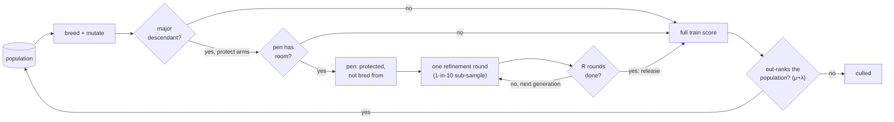

# Short protected refinement for major mutations (Issue #4158)

A mutation that makes a _major_ structural change usually scores badly straight
away, because its new parts have not been tuned yet, so selection culls it
before it can show its worth. This page records one measurement of whether
holding such a child in a small protected pen for a few cheap refinement rounds
buys a better endpoint for the same number of records charged.

Harness:
[`scripts/protected_refinement_study.ts`](../../scripts/protected_refinement_study.ts)
(run with `deno task protected-refinement-study`). Library:
[`scripts/lib/protectedRefinementStudy.ts`](../../scripts/lib/protectedRefinementStudy.ts).
Tests:
[`test/scripts/ProtectedRefinementStudy.ts`](../../test/scripts/ProtectedRefinementStudy.ts).
Artefact: [`protected-refinement-4158.json`](./protected-refinement-4158.json),
written at code commit `00208c7e`. Nothing under `src/` imports the harness, and
no selection behaviour changes.

## Verdict

**Negative result. Protection did not help.** Holding major descendants in a pen
lowered how many of them were retained (0.258 against 0.354 for immediate
competition) and did not improve held-out error. Refinement spent on _ordinary_
descendants beat the same refinement spent on protected majors, which the
pre-declared criteria score as **harm**. Removing the protection while keeping
the refinement (`refine-only`) retained the most major descendants of any arm.

## What was tested

A **major descendant** is a child whose mutation added a neuron, changed the
synapse set (rewiring) or changed a squash (activation), compared with its
pre-mutation self. A change to weights or biases only is **ordinary**.

| Arm                | What it does                                                                                                                                                                                                                                                                                                                                                           |
| ------------------ | ---------------------------------------------------------------------------------------------------------------------------------------------------------------------------------------------------------------------------------------------------------------------------------------------------------------------------------------------------------------------- |
| `immediate`        | Control. Every descendant competes straight away.                                                                                                                                                                                                                                                                                                                      |
| `protect-refine`   | Up to `penCapacity` 4 major descendants are held in a bounded pen, protected from culling and not bred from. Each generation the pen runs one perturbation-refinement round on a 1-in-10 train sub-sample. After R rounds the child is released, scored on the full train set, and must out-rank the population under the existing full-score rule ((μ+λ) truncation). |
| `protect-only`     | The pen, with no refinement. Ablates refinement.                                                                                                                                                                                                                                                                                                                       |
| `refine-only`      | R refinement rounds now, with no pen. Ablates protection.                                                                                                                                                                                                                                                                                                              |
| `matched-ordinary` | The same R rounds spent on an equal count of ordinary descendants. Matched compute.                                                                                                                                                                                                                                                                                    |



## Predeclared design

| Parameter         | Value                                                                          |
| ----------------- | ------------------------------------------------------------------------------ |
| Validation seeds  | 4158–4177 (20 runs per arm)                                                    |
| Calibration seeds | 94158–94161 (4 runs per candidate R, disjoint from validation)                 |
| Corpus seed       | 4158                                                                           |
| Bootstrap         | 10,000 resamples, seed 4158                                                    |
| Budget            | 120,000 charged train records per run                                          |
| Population        | 20                                                                             |
| Corpus            | 300 train records, 300 holdout records (holdout is never charged or consulted) |
| Benefit           | CI95 upper < 0 **and** win fraction ≥ 0.6 **and** species ratio ≥ 0.8          |
| Harm              | CI95 lower > 0                                                                 |
| Otherwise         | no-benefit                                                                     |

The difference is the arm minus the baseline holdout MSE, so negative is better.

## Calibration

R was chosen on **training** MSE only, before validation, on its own seeds.

| R | Median train MSE | Records charged |
| - | ---------------: | --------------: |
| 2 |       2.7987e-02 |         476,700 |
| 3 |       2.8706e-02 |         405,630 |
| 4 |       2.9461e-02 |         479,760 |

**R = 2 was chosen.** Calibration cost 1,362,090 records, reported separately
from the per-run budget. The manifest's `settings.refineRounds` is the
pre-calibration default of 3; validation used `chosenRefineRounds` = 2.

## Contrasts

| Contrast                           | Mean diff | CI95                   | W/L  | Species ratio | Verdict    |
| ---------------------------------- | --------: | ---------------------- | ---- | ------------: | ---------- |
| protect-refine vs immediate        | −2.355e-3 | [−2.119e-2, +1.586e-2] | 9/11 |          0.82 | no-benefit |
| protect-refine vs matched-ordinary | +1.067e-2 | [+2.109e-3, +2.209e-2] | 9/11 |          0.97 | **harm**   |
| protect-refine vs refine-only      | +8.051e-3 | [−1.660e-3, +1.978e-2] | 8/12 |          0.68 | no-benefit |
| protect-refine vs protect-only     | +3.175e-4 | [−9.224e-3, +8.031e-3] | 7/13 |          1.10 | no-benefit |

## Per-arm summary

20 runs per arm.

| Arm              | Median holdout MSE | Mean holdout MSE | Major competed | Major retained | Major retained fraction | Ordinary retained fraction | Refinement records (sum) | Stalled runs | Min records charged |
| ---------------- | -----------------: | ---------------: | -------------: | -------------: | ----------------------: | -------------------------: | -----------------------: | -----------: | ------------------: |
| immediate        |            0.01681 |           0.0318 |            720 |            255 |                   0.354 |                      0.628 |                        0 |            0 |             120,000 |
| protect-refine   |            0.01589 |          0.02944 |            627 |            162 |                   0.258 |                      0.596 |                   54,030 |            1 |              91,710 |
| protect-only     |            0.01584 |          0.02913 |            618 |            140 |                   0.227 |                      0.617 |                        0 |            2 |              84,600 |
| refine-only      |            0.01351 |          0.02139 |            684 |            269 |                   0.393 |                      0.598 |                   62,010 |            1 |             114,090 |
| matched-ordinary |            0.01339 |          0.01877 |            645 |            215 |                   0.333 |                      0.589 |                   56,340 |            2 |              88,500 |

## Findings

- Protection lowered retention of major descendants: 0.258 for `protect-refine`
  against 0.354 for `immediate`. It did not improve held-out error (CI95
  straddles zero).
- Refinement spent on ordinary descendants (`matched-ordinary`) beat refinement
  spent on protected majors: the **harm** verdict.
- Removing protection (`refine-only`) retained the most major descendants
  (0.393).
- Diversity cannot separate the arms. The median final species count is 1–2 and
  the median mean genetic distance is 0.000 in every arm: the toy population
  converges to near-clones.
- **Stalled runs** hit `maxGenerations` (2,000) because crossover declines
  clones, so no offspring are produced. They spent less than the full budget
  (see the minimum records charged above). Counts: `protect-refine` 1,
  `protect-only` 2, `refine-only` 1, `matched-ordinary` 2, `immediate` 0. They
  are kept in the pairs.

## Limitations

- A synthetic two-input regression stand-in, with small creatures. There was no
  production-scale run, so nothing here says how a large creature behaves.
- arXiv 2610.35647 could not be fetched or verified. The method is this
  repository's reading of the issue and does not claim to reproduce the paper.
- Refinement is a Gaussian weight and bias perturbation hill-climb, not
  backpropagation.
- Wall-clock is measured (field `wallMs`) and not capped. Equal charged records
  stand in for equal compute.

## Decision

Nothing under `src/` changed, so there is no production option to remove. The
harness is kept only as the reproduction record.

## Reproduce

```bash
deno task protected-refinement-study \
  --code-version=$(git rev-parse --short=8 HEAD) \
  --json=docs/evidence/protected-refinement-4158.json
```
