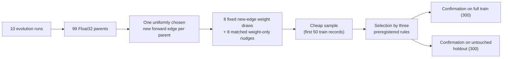

# Topology gains versus new-edge weight-placement luck (Issue #4162)

Whether a single new forward edge helps because of its topology or because its
initial weight happened to land well. Produced by
[`scripts/topology_weight_luck_study.ts`](../../scripts/topology_weight_luck_study.ts);
the machine-readable artefact is
[`topology-weight-luck-4162.json`](topology-weight-luck-4162.json).

## Verdict

**The preregistered primary test is no-benefit.** Selecting mutations by the
median paired gain over eight weight draws (`median-paired`) against selecting
by the best single draw (`best-draw`) gives a holdout precision difference of
+0.175 with a 95% CI of [-0.0088, 0.3810]. The lower bound sits just below 0, so
by the predeclared criterion the result is no-benefit, even though the point
estimate favours `median-paired`. The secondary test against `single-draw` is a
benefit (+0.181, CI [0.079, 0.291]) but costs eight times the cheap evaluations.
`best-draw` picked 19 mutations, and 15 of them (0.79) are confirmed on the
holdout, the same precision as `single-draw` (0.78). Its mean holdout gain is
slightly negative (-0.00016), but one mutation (`r0-p6`, input-3 → output-0,
-0.0377) pulls it below zero: the median of the 19 is +0.00108 and the other 18
average about +0.0019. The mean carries no confidence interval and is not one of
the preregistered criteria, so the study does not show that best-of-eight
selection picks weight-placement luck. No default is changed.

## What was compared

- **Mutation** is one uniformly chosen new forward edge per parent creature.
- **New-edge arm** gives that edge each of eight fixed weight draws.
- **Control arm** is a matched weight-only nudge: one uniformly chosen existing
  synapse is moved by ±|w_k| in Float32, so both arms spend the same Float32 L1
  budget.
- **Paired gain** for draw k is the control's error minus the new-edge arm's
  error on the same records; positive means the added edge won.



### Predeclared design

- Parent seeds 4162–4171 (10 evolution runs, up to 10 parents each), population
  16, 15 generations, mutation rate 0.5.
- Draw seeds 41620–41627, shared by every mutation. Each draw is the production
  `Synapse.randomWeight(1)` rounded with `Math.fround`.
- The matched weight-only control nudges one uniformly chosen existing synapse
  by ±|w_k| in Float32, so both arms spend the same Float32 L1 budget.
- Corpus seed 4162; 300 train and 300 holdout records; the cheap sample is the
  first 50 train records.
- `CONSISTENCY_THRESHOLD` is 6 of 8 draws.
- Bootstrap: 10,000 resamples, seed 4162.
- Criteria, verbatim from the manifest: "Primary test: holdout precision of
  median-paired minus best-draw; benefit iff the paired-bootstrap 95% CI lies
  above 0, harm iff below, else no-benefit. Secondary: median-paired minus
  single-draw, same criteria. Descriptive: the holdout distribution of
  medianPairedGain. A mutation is confirmed on a corpus iff its median paired
  gain there is above 0. Selection uses the cheap sample only."
- Rules, each deciding from the cheap sample only:

| Rule            | Selects a mutation when                                                | Cost (evaluations per mutation) |
| --------------- | ---------------------------------------------------------------------- | ------------------------------- |
| `single-draw`   | the first draw's new edge beat its matched weight-only nudge           | 2                               |
| `best-draw`     | the best new-edge draw gained more than the best weight-only draw      | 16                              |
| `median-paired` | the median paired gain is above 0 and the new edge won at least 6 of 8 | 16                              |

## Results

Per rule, over 99 mutations. Confirmation is on data the rule never saw: a
mutation is confirmed when its median paired gain there is above 0.

| Rule            | Selected of 99 | Confirmed train | Precision train | Confirmed holdout | Precision holdout | Mean holdout gain of selected | Cheap selection cost (records) |
| --------------- | -------------- | --------------- | --------------- | ----------------- | ----------------- | ----------------------------- | ------------------------------ |
| `single-draw`   | 60             | 50              | 0.8333          | 47                | 0.7833            | +0.001634                     | 9,900                          |
| `best-draw`     | 19             | 15              | 0.7895          | 15                | 0.7895            | -0.000164                     | 79,200                         |
| `median-paired` | 28             | 28              | 1.0000          | 27                | 0.9643            | +0.002909                     | 79,200                         |

### Comparisons

| Test                                       | Observed | CI95              | Verdict    |
| ------------------------------------------ | -------- | ----------------- | ---------- |
| Primary: `median-paired` − `best-draw`     | +0.1748  | [-0.0088, 0.3810] | no-benefit |
| Secondary: `median-paired` − `single-draw` | +0.1810  | [0.0788, 0.2908]  | benefit    |

Both are differences in holdout precision, with 10,000 resamples and no
undefined resamples.

### Distribution of the median paired gain

Over all 99 mutations, not only the selected ones.

| Corpus  | Median of median paired gain | CI95                 | Fraction consistent (≥ 6 of 8) | Fraction luck-only |
| ------- | ---------------------------- | -------------------- | ------------------------------ | ------------------ |
| holdout | +0.000517                    | [0.000212, 0.000757] | 0.364                          | 0.081              |
| train   | +0.000548                    | [0.000368, 0.000898] | 0.343                          | 0.051              |
| cheap   | +0.000611                    | [0.000109, 0.000915] | 0.283                          | 0.040              |

Sign-consistency histogram, the number of mutations whose new edge won exactly 0
to 8 of the 8 draws:

| Wins of 8 | 0 | 1 | 2  | 3  | 4  | 5  | 6  | 7  | 8 |
| --------- | - | - | -- | -- | -- | -- | -- | -- | - |
| holdout   | 2 | 4 | 10 | 6  | 25 | 16 | 25 | 11 | 0 |
| train     | 3 | 3 | 8  | 9  | 19 | 23 | 20 | 13 | 1 |
| cheap     | 3 | 5 | 7  | 12 | 15 | 29 | 19 | 6  | 3 |

## Cost

| Phase       | Records |
| ----------- | ------- |
| Preparation | 533,100 |
| Cheap       | 84,150  |
| Train       | 504,900 |
| Holdout     | 504,900 |

Selection alone costs 9,900 cheap records for `single-draw` and 79,200 for each
of `best-draw` and `median-paired`.

## Coverage

The target was 100 parents; 99 were obtained, because one run yielded only 9
distinct parents. All 99 mutations were evaluated, with 0 failures.

## Interpretation

- On this synthetic task the median over mutations of the holdout median paired
  gain is small but positive, with a CI above 0. On average an added edge beats
  a matched weight-only nudge of the same Float32 budget.
- Only about 36% of mutations win at least 6 of 8 draws on holdout. Most
  single-edge gains are not consistent across weight draws.
- `best-draw` selected 19 mutations, 15 of them confirmed on the holdout
  (precision 0.79, against 0.78 for `single-draw`). Their mean holdout median
  paired gain is about -0.00016, but one mutation (`r0-p6`, -0.0377) accounts
  for that: the median of the 19 is +0.00108 (all 99 mutations: +0.00052) and
  the other 18 average about +0.0019. The mean has no interval here and is not a
  preregistered criterion, so it is not evidence that best-of-eight selection
  picks luck.
- The primary test, `median-paired` against `best-draw`, is no-benefit by the
  preregistered criterion: the CI lower bound (about -0.009) is just below 0,
  even though the point estimate is +0.175.
- The secondary test against `single-draw` is a benefit (+0.181, CI [0.079,
  0.291]) but costs eight times the cheap evaluations (79,200 against 9,900
  records).
- Caveat: `median-paired` selects on the same statistic that holdout
  confirmation uses, on different data, whereas `best-draw` is a different
  statistic. That favours `median-paired` in the comparison.
- No default changed and nothing in `src/` calls the harness. No production
  adoption is justified from a synthetic corpus.

## Limits

- A synthetic 4-input regression, taken from `buildStudyCorpus` of the #4160
  study; not a production corpus.
- Parents come from a short 15-generation evolution, not production creatures.
- One structural mutation type: an `AddConnection`-style new forward synapse.
  `AddNeuron` was not tested.
- The paper, arXiv 2611.01213, could not be fetched in this run (the sandbox
  proxy refused the connection), so its method was not pinned. This is the
  repository's reading of the issue.
- "Scorer #588" perturbation machinery is not in this repository, so the
  perturbations are built here.
- No runs were made on private corpora; any such runs stay private.

## Reproduce

```bash
deno task topology-weight-luck-study \
  --json=docs/evidence/topology-weight-luck-4162.json --code-version=4ccb7100
```

The run used neatAiVersion 7.1.20, Deno 2.9.8 and code version 4ccb7100 (the
base commit).

---

**Up to:** [`docs/README.md`](../README.md) (topic index).
