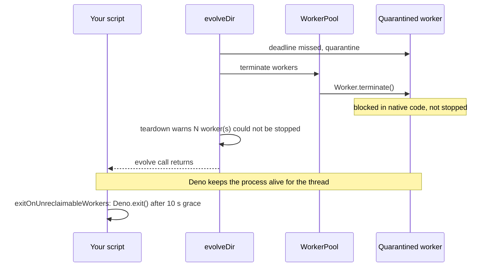

# 🚪 Process Does Not Exit After `evolveDir`

This document covers a run that finishes its work but whose process never exits:
the evolve call has returned, yet the terminal never comes back. See the index
in [`../TROUBLESHOOTING.md`](../TROUBLESHOOTING.md) for other categories.

## Symptom

**Symptom:** The log shows a worker was quarantined earlier in the run, for
example `[worker-N] quarantined`. The evolve call then returns, but the process
stays alive and silent until an external watchdog, a timeout, or Ctrl-C kills
it.

## Cause

A quarantined worker is one that missed its per-task deadline.
`Worker.terminate()` can only stop a worker at a JavaScript boundary. A thread
blocked in synchronous native (FFI) code, such as a native `trainDir` call that
ignores its deadline, cannot be interrupted that way. Deno keeps the event loop,
and therefore the process, alive for that thread, so the script ends but the
process does not.



## Diagnose

The teardown reports the workers it could not stop with a warning line:

```text
teardown: N worker(s) could not be stopped
```

The internal teardown report carries a `workersUnreclaimable` field for the same
workers. It is not part of the public API, so the warning line is the signal to
look for.

## Fix

### Option 1: `exitOnUnreclaimableWorkers`

Set `exitOnUnreclaimableWorkers: true` and, for `evolveDir`, the library exits
the process for you when such workers remain:

```ts
import { createNeatConfig } from "@stsoftware/neat-ai";

const config = createNeatConfig({
  exitOnUnreclaimableWorkers: true, // default: false
});
```

When `true`, and `evolveDir` finishes while a worker it quarantined with an
unanswered task could not be stopped, the library calls `Deno.exit()` 10 seconds
after teardown. It preserves `Deno.exitCode`, so the exit status is the one your
script set. The guard is armed only in that case.

The option takes effect in `evolveDir`, the entry point that schedules
native-trainer tasks. It is accepted but has no effect in `evolveEnv` or
`evolveRL` today: `evolveEnv` has no worker pool, and `evolveRL`'s
EpisodeWorkerPool does not report unstoppable workers. A process that hangs
after `evolveEnv` or `evolveRL` therefore needs Option 2.

The default is `false`, because a library should not exit its host unasked. Only
enable it in a script that has nothing left to do after `evolveDir` returns, or
that finishes within the 10-second grace period.

### Option 2: explicit `Deno.exit()` after cleanup

If your script owns its own exit, finish your own work first and then exit
explicitly:

```ts
const creature = await network.evolveDir(dir, options);
await saveResults(creature); // your own cleanup, awaited
Deno.exit(0);
```

`Deno.exit()` ends the process immediately, so any work not yet flushed is lost.
Await everything you need before you call it.

## See also

- [Workers and parallel evaluation](../config/WORKERS.md) — the
  `exitOnUnreclaimableWorkers` option and the rest of the worker pool options.
- [Timeouts](../TIMEOUTS.md) — how the per-task deadline and quarantine work.

---

**Up to:** [`README.md`](../../README.md) (entry point) ·
[`docs/README.md`](../README.md) (topic index).
