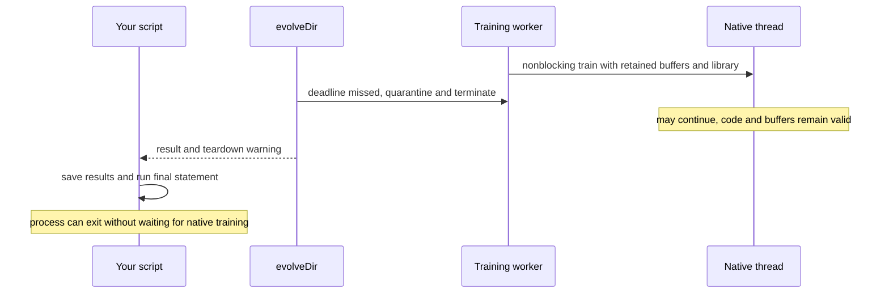

# 🚪 Process Does Not Exit After `evolveDir`

This document covers a run that finishes its work but whose process never exits:
the evolve call has returned, yet the terminal never comes back. See the index
in [`../TROUBLESHOOTING.md`](../TROUBLESHOOTING.md) for other categories.

## Symptom

**Symptom:** The log shows a worker was quarantined earlier in the run, for
example `[worker-N] quarantined`. The evolve call then returns, but the process
stays alive and silent until an external watchdog, a timeout, or Ctrl-C kills
it.

## Cause

A worker can be quarantined after missing its per-task deadline.
`Worker.terminate()` cannot interrupt a synchronous native (FFI) call. Deno can
keep the process alive for that worker after the caller's script ends.

`evolveDir` keeps native-enabled work in real worker isolates, including with
`threads: 1`. It refuses an in-process fallback if worker initialisation fails,
because terminating a mock cannot drop the main isolate's pending FFI operation.

The native training call is now awaited on the worker path (Issue #4126):

- FFI training uses a `nonblocking: true` alias of `neat_backprop_train`.
  Termination releases the worker isolate without waiting for native training.
  The request and output structure live on the C heap. An additional OS loader
  reference keeps the native code mapped after Deno closes the worker's library
  resource. Normal completion frees these resources; an explicit library close
  during pending calls is deferred until those calls settle. Native workers need
  FFI permission for the trainer, the system C allocator and the loader
  (`libc.so.6` / `libdl.so.2` on Linux, `libSystem.B.dylib` on macOS,
  `msvcrt.dll` / `kernel32.dll` on Windows).
- Terminating the isolate cannot run its JavaScript cleanup. Its C buffers,
  loader reference, native result/state and temporary work directory can remain
  until process exit (the directory remains on disk). They do not keep the
  process alive, but native computation itself is **not cancelled**. The engine
  still needs to honour its native deadline. Issue #4146 tracks the remaining
  field overruns; this change does not establish their cause.
- CLI training awaits the subprocess. Deno kills the owned child when the worker
  resources are dropped. Completed and failed calls remove their temporary work
  directory; termination can leave that directory behind.

The synchronous internal `trainDir` entry point still blocks its caller. Worker
setup, capability probes, packaging, and the TypeScript/WASM training loop also
remain synchronous. For backend and deadline diagnostics, look for
`[training-backend]` and `[training-phase]` in the parent log; see
[the native trainer and the per-task deadline](../TIMEOUTS.md#-the-native-trainer-and-the-per-task-deadline-issue-4119).

- **Discovery analysis, until Issue #4126.** `analyze_parallel` was also a
  synchronous native call, so a stuck discovery analysis pinned the process in
  the same way. It is now declared `nonblocking: true`. The worker's thread is
  no longer blocked, so a stuck discovery analysis no longer prevents the
  process from exiting. The native analysis cannot be cancelled from JavaScript;
  it ends at its Rust-side deadline or when `cancel_analysis_memory_pressure()`
  is signalled under memory pressure.



## Diagnose

The teardown reports the workers it could not stop with a warning line:

```text
teardown: N worker(s) could not be stopped
```

The internal teardown report carries a `workersUnreclaimable` field for the same
workers. This count is conservative: an unanswered training task is counted even
when its worker was awaiting native work and can terminate. The warning
therefore says native work **may** still be running, rather than proving the
process cannot exit. The report is internal; use the warning line for diagnosis.

## Fix

### Option 1: `exitOnUnreclaimableWorkers`

Set `exitOnUnreclaimableWorkers: true` and, for `evolveDir`, the library exits
the process for you when such workers remain:

```ts
import { createNeatConfig } from "@stsoftware/neat-ai";

const config = createNeatConfig({
  exitOnUnreclaimableWorkers: true, // default: false
});
```

When `true`, and `evolveDir` returns or throws while a worker could not be
stopped, the library arms a guard that calls `Deno.exit()` 10 seconds after
teardown. A worker counts as not stopped if it was quarantined or terminated
while a task was still unanswered, whether cancelled or not, or if it was
detached because `terminate()` threw or outlived the teardown budget. The exit
preserves `Deno.exitCode`, so the exit status is the one your script set. The
guard is armed only in that case.

The option takes effect in `evolveDir`, the entry point that schedules
native-trainer and discovery tasks. It is accepted but has no effect in
`evolveEnv` or `evolveRL` today: `evolveEnv` has no worker pool, and
`evolveRL`'s EpisodeWorkerPool does not report unstoppable workers. A process
that hangs after `evolveEnv` or `evolveRL` therefore needs Option 2.

The default is `false`, because a library should not exit its host unasked. Only
enable it in a script that has nothing left to do after `evolveDir` returns, or
that finishes within the 10-second grace period.

### Option 2: explicit `Deno.exit()` after cleanup

If your script owns its own exit, finish your own work first and then exit
explicitly:

```ts
const creature = await network.evolveDir(dir, options);
await saveResults(creature); // your own cleanup, awaited
Deno.exit(0);
```

`Deno.exit()` ends the process immediately, so any work not yet flushed is lost.
Await everything you need before you call it.

## See also

- [Workers and parallel evaluation](../config/WORKERS.md) — the
  `exitOnUnreclaimableWorkers` option and the rest of the worker pool options.
- [Timeouts](../TIMEOUTS.md) — how the per-task deadline and quarantine work.

---

**Up to:** [`README.md`](../../README.md) (entry point) ·
[`docs/README.md`](../README.md) (topic index).
